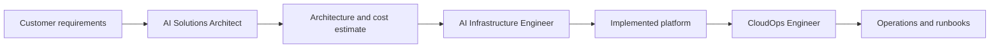
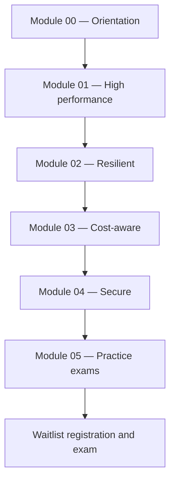

# Module 00 — Orientation & Exam Guide

## ဒီ module က ဘာပြဿနာကို ဖြေရှင်းပေးသလဲ

Nebius Certified AI Solutions Architect စာမေးပွဲဟာ advanced, role-based certification ဖြစ်ပြီး လက်ရှိအချိန်အထိ **waitlist သာ** ဖွင့်ထားသေးပါတယ်။ ဆိုလိုတာက စာမေးပွဲကို တန်းမဖြေနိုင်သေးဘဲ စာရင်းသာ ကြိုပေးထားလို့ ရသေးတဲ့ အခြေအနေပါ။ ဒီလို စာမေးပွဲအသစ်မျိုးအတွက် လေ့လာသူတွေ ကြုံရလေ့ရှိတဲ့ ပြဿနာက —

- ဒီ certification က ကိုယ့်အတွက် မှန်/မမှန် မသိဘူး။
- "AI Solutions Architect" ဆိုတဲ့ role က တကယ် ဘာလုပ်ရမှာလဲ၊ CloudOps နှင့် ဘာကွာသလဲ မရှင်းဘူး။
- စာမေးပွဲမှာ ဘာတွေ မေးမှာလဲ၊ ဘယ်လို ဖြေရမှာလဲ မသိဘူး။
- GPU, storage, orchestrator စတဲ့ ခေါင်းစဉ်တွေ အများကြီးထဲက ဘာကို အရင် လေ့လာရမှာလဲ မဆုံးဖြတ်နိုင်ဘူး။

Module 00 က ဒီပြဿနာတွေကို ဖြေရှင်းပေးဖို့ — certification ရဲ့ ရည်ရွယ်ချက်၊ role အမှန်တကယ် ဘာလုပ်ရမှာလဲ၊ စာမေးပွဲ ပုံစံနှင့် domain map၊ design မေးခွန်းတွေကို ဘယ်လို စဉ်းစားဖြေရမလဲ၊ ဘယ်အစဉ်အတိုင်း လေ့လာရမလဲဆိုတာ ချပြပါမယ်။

## Certification ရဲ့ ရည်ရွယ်ချက်နှင့် role description

Exam Guide အရ Nebius Certified AI Solutions Architect ဆိုတာ —

- ML workload requirements နှင့် underlying infrastructure ကြား တံတားဆောက်ပြီး Nebius AI Cloud ပေါ်မှာ **end-to-end AI infrastructure solutions** တွေ design လုပ်နိုင်သူ။
- workload, team, budget, timeline ကို အကဲဖြတ်ပြီး **architecture နှင့် cost estimate** ထုတ်ပေးသူ။
- **orchestrator, GPU type, storage tier, network design** စတဲ့ ဒီဇိုင်း ဆုံးဖြတ်ချက်တွေကို ရွေးချယ်သူ။
- ကိုယ်ချတဲ့ **architectural decisions တွေအတွက် တာဝန်ယူ**ပြီး stakeholders တွေကို **strategic advisor** အဖြစ် ဆောင်ရွက်သူ။

အဓိက အချက်က — architect က *လုပ်နည်းလမ်းညွှန်* ပေးတာ မဟုတ်ဘူး၊ *ဘယ် architecture ကို ရွေးမလဲ* ဆိုတဲ့ ဆုံးဖြတ်ချက်ကို ချပြီး အဲဒီဆုံးဖြတ်ချက်အတွက် တာဝန်ယူရတာပါ။

## Role သုံးခု — ဘာကွာသလဲ

Nebius certification program မှာ role သုံးမျိုး ရှိပါတယ်။ စာမေးပွဲမေးခွန်းတွေမှာ ဒီတာဝန်ခွဲခြားမှုကို နားလည်ထားဖို့ အရေးကြီးပါတယ်။

| အချက် | AI Solutions Architect | AI CloudOps Engineer (NCO-201) | AI Infrastructure Engineer |
|---|---|---|---|
| အဓိက လုပ်ငန်း | End-to-end AI infrastructure **design** လုပ်ခြင်း | ပြင်ဆင်ပြီးသား platform ကို **operate** လုပ်ခြင်း | Architects ရဲ့ design ကို **implement** လုပ်ခြင်း |
| ဆုံးဖြတ်ချက် | Architecture decisions ချခြင်း — တာဝန်ယူသည် | Runbook အတိုင်း ဆောင်ရွက်ခြင်း — architecture မပြောင်း | Design ပါအတိုင်း တည်ဆောက်ခြင်း |
| ထုတ်ကုန် | Architecture + cost estimate | Operational metrics, incident response | Working infrastructure |
| စာမေးပွဲ အခြေအနေ | **Waitlist** (မကျင်းပသေး) | **Live** (NCO-201 — ဖြေနိုင်ပြီ) | **Waitlist** |
| ပစ်မှတ် ပရိသတ် | Cloud experience ၃+ နှစ် ရှိသူ | Day-to-day operations လုပ်သူ | Implementation engineer များ |

**Figure 1 — Role သုံးခု ဆက်စပ်ပုံ**

**ပုံရှင်းလင်းချက် —** customer ရဲ့ requirements ကနေ စပါတယ်။ Architect က requirements ကို architecture နှင့် cost estimate အဖြစ် ပြောင်းပေးတယ်။ Infrastructure Engineer က အဲဒီ design ကို လက်တွေ့ resource အဖြစ် တည်ဆောက်ပေးတယ်။ CloudOps Engineer က တည်ဆောက်ပြီးသား platform ကို runbook အတိုင်း လည်ပတ်စောင့်ရှောက်တယ်။ မြှားတွေက တာဝန် လွှဲပြောင်းပုံကို ပြတာဖြစ်ပြီး architect က ဆုံးဖြတ်ချက်အစ ဖြစ်တယ်ဆိုတာ မြင်ရပါမယ်။

## ဘယ်သူတွေ ဖြေသင့်သလဲ

- Cloud experience **၃ နှစ်နှင့်အထက်** ရှိသူ (customer side ဖြစ်ဖြစ် integrator/vendor side ဖြစ်ဖြစ်)။
- ML workload တွေအတွက် infrastructure ရွေးချယ်မှု (GPU, storage, network, orchestrator) မှာ ဆုံးဖြတ်ချက်ချဖူးသူ၊ ဒါမှမဟုတ် ချချင်သူ။
- Customer နှင့် ပြောဆိုပြီး requirements ကို technical design အဖြစ် ပြောင်းလဲပေးရတာ ဝါသနာပါသူ။
- ကြိုတင် လိုအပ်ချက် (prerequisites) တော့ မရှိပါဘူး — ဒါပေမယ့် အတွေ့အကြုံ ၃+ နှစ် အကြံပြုချက်ကို လေးလေးနက်နက် ယူသင့်ပါတယ်။

## စာမေးပွဲ ပုံစံနှင့် စာရင်းသွင်းခြင်း

| အချက် | အသေးစိတ် |
|---|---|
| အမည် | Nebius Certified AI Solutions Architect |
| အဆင့် | Advanced role-based |
| မေးခွန်း ပုံစံ | Multiple choice — အဖြေမှန် ၁ ခု + distractors ၃ ခု |
| အချိန် | ၁ နာရီ (60 minutes) |
| ပေးပို့မှု | Remote + AI-assisted proctoring (partner exam platform) |
| ကြိုတင် လိုအပ်ချက် | မရှိပါ (no strict prerequisites) |
| အခြေအနေ | **Waitlist** — စာမေးပွဲ မကျင်းပသေးပါ |

လက်ရှိ လုပ်နိုင်တာက **waitlist စာရင်းသွင်းခြင်း** ပါ။ စာမေးပွဲ ဖွင့်လှစ်ချိန်ကျရင် အသိပေးချက် ရပါမယ် —

- Waitlist စာရင်းသွင်းရန်: https://2erefq.share-eu1.hsforms.com/2-2OIVRNPQHuDxVlhex6cag?program=ai-solutions-architect
- Exam Guide (PDF): https://assets.nebius.com/assets/5328a86a-d40c-4d14-abcc-942a0e3efa36/Exam_Guide_Nebius_AI_Solutions_Architect.pdf

## Exam domain map

စာမေးပွဲမှာ domain ၄ ခု ရှိပြီး တစ်ခုချင်းစီက ခန့်မှန်းခြေ **~25%** စီ ဖြစ်ပါတယ် — ဆိုလိုတာက domain တစ်ခုကို ပေါ့ပေါ့တန်တန် ချန်လို့ မရပါဘူး။

| Domain | အလေးချိန် | ဘာတွေ ပါဝင်သလဲ |
|---|---|---|
| 1. Design high-performing architectures | ~25% | GPU/platform building blocks ရွေးခြင်း၊ storage architecture၊ training-platform support stack၊ deployment shape၊ orchestration overlays၊ distributed-training architecture tradeoffs |
| 2. Design resilient architectures | ~25% | Checkpoint/restart strategies၊ observability (logs/metrics/traces)၊ validation/benchmark/acceptance plan၊ failure handling & support model၊ migration & handover |
| 3. Design efficient & cost-aware architectures | ~25% | Capacity/quotas/onboarding cost၊ reuse & automation၊ FinOps (governance/monitoring/decommissioning)၊ cost tradeoffs၊ right-sizing၊ multi-cloud connectivity & data ingestion |
| 4. Design secure architectures | ~25% | Identity & access model၊ private connectivity၊ secrets/audit/compliance၊ shared responsibility & tenant isolation & least privilege၊ data classification၊ encryption၊ incident response |

Course ရဲ့ module တွေက ဒီ domain တွေနဲ့ တစ်ခုချင်းစီ ကိုက်ပါတယ် — Module 01 က Domain 1၊ Module 02 က Domain 2၊ Module 03 က Domain 3၊ Module 04 က Domain 4၊ Module 05 က practice exams ဖြစ်ပါတယ်။

## Design-case study method — design မေးခွန်းက ops မေးခွန်းနှင့် မတူဘူး

CloudOps စာမေးပွဲက **runbook-driven** ဖြစ်ပါတယ် — "ဒီ incident မှာ ဘယ် step အရင်လုပ်မလဲ"၊ "ဒီ command က ဘာလုပ်သလဲ" ဆိုတဲ့ မေးခွန်းမျိုးပါ။ Architect စာမေးပွဲကတော့ **scenario-based design** ဖြစ်ပါတယ် — workload, team, budget, timeline ပါတဲ့ အခြေအနေပေးပြီး "ဘယ် architecture ကို ရွေးမလဲ၊ ဘာကြောင့်လဲ" မေးပါတယ်။

| အချက် | Ops မေးခွန်း | Design မေးခွန်း |
|---|---|---|
| မေးခွန်း ပုံစံ | တစ်ခုခုကို ဘယ်လို လုပ်/ပြင်မလဲ | ပေးထားတဲ့ requirements အတွက် ဘယ်ဟာ ရွေးမလဲ |
| အဖြေ ရှာပုံ | မှန်ကန်တဲ့ procedure/command ကို သိ/မှတ်မိရုံ | tradeoffs ကို ချိန်ဆပြီး အကောင်းဆုံးကို ရွေးရ |
| ဥပမာ | "Node ပျက်ရင် job ကို ဘယ်လို restart လုပ်မလဲ" | "Checkpoint ကို ဘယ် storage tier မှာ ထားမလဲ" |
| Distractor များ | မှားယွင်းတဲ့ step/flag | အလုပ်ဖြစ်ပေမယ့် requirements နှင့် မကိုက်တဲ့ ရွေးချယ်မှု |

Design မေးခွန်းတစ်ခုကို ဖြေတဲ့အခါ အောက်ပါ အဆင့် ၃ ဆင့် သုံးပါ —

1. **Scenario ဖတ်** — workload အမျိုးအစား (training/fine-tuning/inference)၊ data အရွယ်၊ team အရွယ်၊ budget/timeline ကန့်သတ်ချက် စတာတွေကို ခွဲခြားမှတ်သား။
2. **Requirements ထုတ်** — ဘယ် requirements က *hard constraint* (ဥပမာ — အချိန်ကန့်သတ်ချက်)၊ ဘယ်ဟာက *preference* လဲ ခွဲခြား။
3. **Design choice ချ** — ရွေးချယ်စရာ တစ်ခုချင်းစီကို requirements နှင့် ချိန်ဆကြည့်ပြီး အကောင်းဆုံးကို ရွေး၊ ကျန်တဲ့ ၃ ခု ဘာကြောင့် မကိုက်တာလဲပါ ရှင်းနိုင်ရ။

> သင်ကြားရေး ဥပမာ (စာမေးပွဲ မေးခွန်း မဟုတ်ပါ) — ops မေးခွန်းက "Slurm job queue ကို ဘယ် command နဲ့ ကြည့်မလဲ" ဖြစ်နိုင်ပြီး design မေးခွန်းကတော့ "ရက်သတ္တပတ်ပေါင်းများစွာ ကြာမယ့် distributed training အတွက် ဘယ် orchestrator က အကောင်းဆုံးလဲ" ဖြစ်ပါတယ်။

## Study roadmap

Exam Guide ကို အခြေခံပြီး အောက်ပါ အစဉ်အတိုင်း လေ့လာပါ —

1. **Module 00 (ဒီ module)** — role, domain map, design-case method ကို နားလည်အောင် လုပ်။
2. **Module 01–04** — domain တစ်ခုချင်းစီကို ပြဿနာ → concept → comparison → configuration → သတိပေးချက် အစဉ်အတိုင်း လေ့လာ။ တစ်ခုချင်းစီပြီးရင် self-check မေးခွန်းတွေနဲ့ စစ်ဆေး။
3. **Module 05** — practice exams ၂ စုံကို အချိန်တိုင်းပြီး ဖြေကြည့်ပြီး domain အလိုက် အားနည်းချက် ပြန်စစ်။
4. **Review** — အားနည်းတဲ့ domain ကို ပြန်ဖတ်၊ design scenario တွေကို အဖြေရှင်းနည်း (scenario → requirements → design choice) နဲ့ ထပ်လေ့ကျင့်။
5. **Waitlist စာရင်းသွင်း**ပြီး စာမေးပွဲ ဖွင့်လှစ်ချိန် အသိပေးချက်ကို စောင့်။

**Figure 2 — Study path အစဉ်**

**ပုံရှင်းလင်းချက် —** လေ့လာမှုက Module 00 ကနေ စပြီး domain ၄ ခု (Module 01–04) ကို အစဉ်လိုက် ဖြတ်သန်းပါတယ်။ ဘာကြောင့် ဒီအစဉ်လဲဆိုတော့ Module 01 (performance) က GPU/storage/orchestrator အခြေခံတွေ ချပေးလို့ဖြစ်ပြီး နောက်ပိုင်း resilience, cost, security domain တွေက အဲဒီအခြေခံပေါ်မှာ ဆောက်တာ ဖြစ်ပါတယ်။ နောက်ဆုံးအဆင့်က practice exams နှင့် အားနည်းချက် ပြန်စစ်ခြင်းဖြစ်ပြီး ပြီးမှ စာမေးပွဲအတွက် အဆင်သင့် ဖြစ်ပါမယ်။

## တရားဝင် လေ့လာရေး အရင်းအမြစ်များ

- **Exam Guide (PDF)** — domain တွေ၊ skills/expertise စာရင်း၊ role description ရဲ့ တရားဝင် အရင်းအမြစ်: https://assets.nebius.com/assets/5328a86a-d40c-4d14-abcc-942a0e3efa36/Exam_Guide_Nebius_AI_Solutions_Architect.pdf
- **Nebius Academy — AI Cloud Onboarding Course**: https://academy.nebius.com/home/nebius-ai-cloud-onboarding/ (sign in လိုအပ်ပါသည်)
- **Nebius Documentation**: https://docs.nebius.com/ — product specifics အားလုံး (GPU types, storage, Kubernetes, Slurm/Soperator, Object Storage) ကို ဒီမှာ စစ်ဆေးပါ
- **Certification page**: https://nebius.com/certification — waitlist စာရင်းသွင်းခြင်းနှင့် ဆက်စပ် certification များ

## Self-check — မိမိကိုယ်ကို စစ်ဆေးရန် မေးခွန်းများ

**၁။ AI Solutions Architect နှင့် AI CloudOps Engineer ရဲ့ အဓိက ကွာခြားချက် ဘာလဲ?**
အဖြေ — Architect က architecture decisions ကို ချပြီး အဲဒီအတွက် တာဝန်ယူသည် (strategic advisor)။ CloudOps Engineer က ပြင်ဆင်ပြီးသား platform ကို runbook အတိုင်း operate လုပ်ပြီး architecture ဆုံးဖြတ်ချက် မချပါ။

**၂။ စာမေးပွဲ ပုံစံနှင့် အချိန် ဘယ်လိုလဲ?**
အဖြေ — Multiple choice (အဖြေမှန် ၁ ခု + distractors ၃ ခု)၊ ၁ နာရီ၊ remote + AI-assisted proctoring ဖြင့် ဖြေရပါသည်။

**၃။ Exam domains ဘုံးခုရှိပြီး တစ်ခုချင်းစီ ဘယ်လောက် ပါဝင်သလဲ?**
အဖြေ — ၄ ခု (high-performing, resilient, cost-aware, secure)၊ တစ်ခုချင်းစီ ခန့်မှန်းခြေ ~25% ဖြစ်ပါသည်။

**၄။ Design မေးခွန်းတစ်ခုကို ဖြေတဲ့အခါ အဓိက အဆင့် ၃ ဆင့် ဘာတွေလဲ?**
အဖြေ — (၁) scenario ဖတ်ပြီး constraints ခွဲခြားခြင်း၊ (၂) hard requirements နှင့် preferences ထုတ်ခြင်း၊ (၃) tradeoffs ချိန်ဆပြီး design choice ချခြင်း (မကိုက်တဲ့ ရွေးချယ်စရာများ ဘာကြောင့် မကိုက်လဲပါ ရှင်းနိုင်ရ)။

**၅။ လက်ရှိ ဒီ certification အတွက် ဘာလုပ်လို့ ရသေးသလဲ?**
အဖြေ — စာမေးပွဲက waitlist အဆင့်သာ ရှိသေးသဖြင့် waitlist စာရင်းသွင်းထားပြီး Exam Guide အတိုင်း ကြိုတင် လေ့လာထားနိုင်ပါသည်။

## Technical review notes

- Exam facts (ပုံစံ၊ အချိန်၊ proctoring၊ domain weights ~25%) အားလုံးသည် တရားဝင် Exam Guide PDF အတိုင်း ဖြစ်ပြီး PDF link ကို 2026-10-14 တွင် ဖွင့်ကြည့်ရာ HTTP 200 ရရှိခဲ့သည်။
- Waitlist link, certification page, Nebius Academy link များ အားလုံး 2026-10-14 တွင် ဝင်ကြည့်နိုင်ခဲ့သည် (Academy သည် sign-in page သို့ redirect လုပ်သည်)။
- NCO-201 (CloudOps) နှင့် AI Infrastructure Engineer တို့၏ အခြေအနေ (live/waitlist) နှင့် တာဝန်ခွဲခြားမှုကို Nebius certification program အချက်အလက်အရ ဖော်ပြထားခြင်းဖြစ်ပြီး စာမေးပွဲ ကျင်းပချိန်တွင် ပြောင်းလဲနိုင်သဖြင့် certification page တွင် ပြန်စစ်ပါ။
- "Design မေးခွန်း vs ops မေးခွန်း" ဥပမာများသည် သင်ကြားရေးအတွက် ဖန်တီးထားခြင်းဖြစ်ပြီး စာမေးပွဲ မေးခွန်း အစစ်များ မဟုတ်ပါ။
