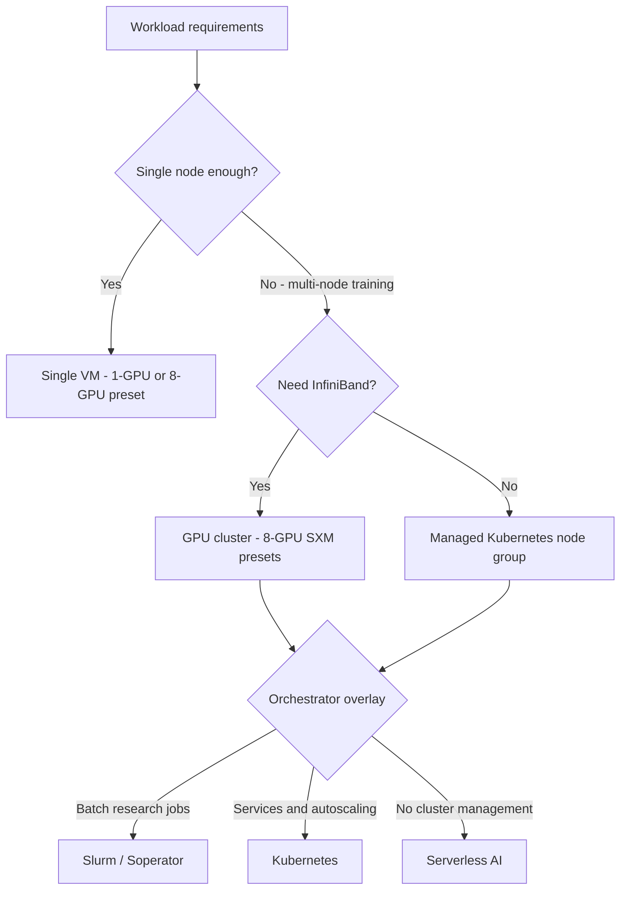
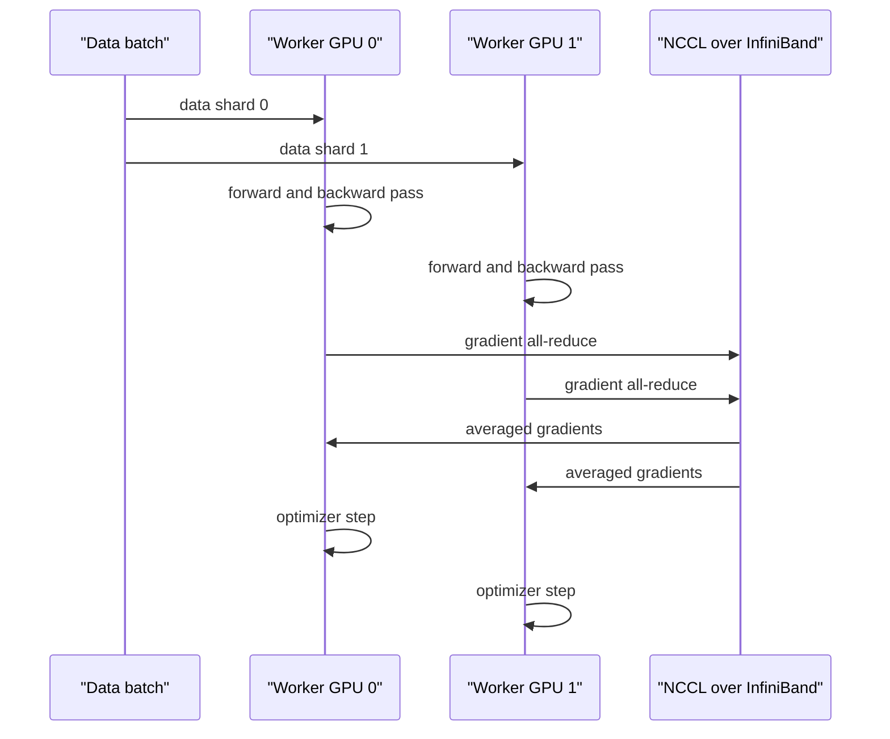

# Module 01 — Design High-Performing Architectures (~25%)

## ဒီ module က ဘာပြဿနာကို ဖြေရှင်းပေးသလဲ

Customer တစ်ဦးက "LLM ကို fine-tune ချင်တယ်၊ တစ်လအတွင်း ပြီးချင်တယ်၊ budget က ကန့်သတ်ထားတယ်" လို့ ပြောလာရင် architect က ဘာတွေ ဆုံးဖြတ်ရမလဲ? ဘယ် GPU သုံးမလဲ၊ data နှင့် checkpoint တွေကို ဘယ် storage မှာ ထားမလဲ၊ တစ်လုံးတည်း node နှင့် ရမလား၊ multi-node cluster လိုမလား၊ Slurm လား Kubernetes လား — ဒီဆုံးဖြတ်ချက်တွေ အားလုံးက ရလဒ်ရဲ့ **performance** ကို တိုက်ရိုက် သက်ရောက်ပါတယ်။

Performance ဆိုတာ GPU အမြန်ဆုံး ဝယ်လိုက်ရုံနှင့် မပြီးပါဘူး — GPU memory က model အရွယ်နှင့် ကိုက်ရမယ်၊ GPU ချင်း ဆက်သွယ်မှု (interconnect) က distributed training နှင့် ကိုက်ရမယ်၊ storage က GPU တွေ မဆာပဲ ဒေတာ စားနိုင်ရမယ်၊ platform stack က job တွေကို ထိရောက်စွာ စီမံနိုင်ရမယ်။ Exam Guide ရဲ့ Domain 1 objectives ကလည်း ဒီအချက်တွေကိုပဲ ဖော်ပြထားပါတယ် —

- **Skills in:** Selecting GPU architecture and platform-level building blocks for a workload; Designing the storage architecture for AI workloads; Designing the training-platform support stack and user environment.
- **Expertise in:** Defining workload outcomes and the right deployment shape; Architecting orchestration and workload-framework overlays; Recommending distributed-training architecture and its tradeoffs.

ဒီ module မှာ အဆိုပါ ၆ ချက်ကို concept → comparison → configuration အစဉ်နှင့် လေ့လာပါမယ်။ Product specifics များကို docs.nebius.com အတိုင်း ဖော်ပြထားပါသည်။

## Concept 1 — Workload outcomes နှင့် deployment shape

ပထမဆုံး ဆုံးဖြတ်ရမှာက "ဘာကို ပေးချင်တာလဲ (outcome)" ပါ။

- **Training** — model အသစ် train ခြင်း၊ ပမာဏကြီးပြီး GPU အများကြီး ကြာကြာ သုံးရတတ်သည်။
- **Fine-tuning** — model ကြိုတင် train ပြီးသားကို data အသစ်နှင့် ပြန်ညှိခြင်း၊ GPU နည်းနည်းနှင့် ရနိုင်တတ်သည်။
- **Inference** — model ကို request များ ဖြေကြားစေခြင်း၊ latency နှင့် availability က အဓိက။
- **Data preparation** — dataset preprocess ခြင်း၊ GPU ထက် CPU/storage က ပိုအရေးကြီးတတ်သည်။

Outcome သတ်မှတ်ပြီးရင် **deployment shape** — ဆိုလိုတာက compute ကို ဘယ်လို စုစည်းမလဲ — ကို ရွေးရပါမယ်။

- **Single node (တစ်လုံးတည်း VM)** — fine-tuning ငယ်များ၊ inference စမ်းသပ်ခြင်း၊ experiment အတွက်။ Nebius မှာ 1-GPU preset (ဥပမာ `1gpu-16vcpu-200gb`) ကနေ စနိုင်သည်။
- **Single node multi-GPU** — 8-GPU preset တစ်ခုတည်း (ဥပမာ `8gpu-128vcpu-1600gb`) — node တစ်လုံးအတွင်း NVLink ဖြင့် ချိတ်ဆက်ထား၍ intra-node communication မြန်သည်။
- **Multi-node GPU cluster** — 8-GPU nodes များကို InfiniBand GPU cluster အဖြစ် ချိတ်ဆက်ခြင်း — ကြီးမားသော distributed training အတွက်။
- **Cluster + orchestrator** — အပေါ်က shapes များပေါ်တွင် Slurm/Soperator သို့မဟုတ် Kubernetes ကို overlay လုပ်ခြင်း — team အများ အသုံးပြုခြင်း၊ job queue စီမံခြင်းအတွက်။

**Figure 1 — Deployment shape ဆုံးဖြတ်ခြင်း flowchart**



**ပုံရှင်းလင်းချက် —** workload requirements ကနေ စပါတယ်။ ပထမမေးခွန်းက "node တစ်လုံးနှင့် လုံလောက်သလား" — လုံလောက်ရင် single VM နှင့် ရပါတယ် (1-GPU သို့မဟုတ် 8-GPU preset)။ မလုံလောက်ရင် multi-node သွားပြီး "InfiniBand လိုသလား" ဆက်မေးပါတယ် — distributed training က interconnect လိုသဖြင့် GPU cluster (8-GPU SXM presets နှင့်သာ ကိုက်သည်) ကို ရွေးပါတယ်။ နောက်ဆုံးမှာ orchestrator overlay ကို ရွေးပါတယ် — batch research jobs အတွက် Slurm/Soperator၊ service နှင့် autoscaling အတွက် Kubernetes၊ cluster မစီမံချင်ရင် Serverless AI ဖြစ်ပါတယ်။

## Concept 2 — GPU architecture နှင့် platform-level building blocks

Nebius AI Cloud မှာ GPU platform များကို `platform ID` နှင့် preset များဖြင့် သတ်မှတ်ပါတယ် (docs: Types of virtual machines and GPUs)။ စဉ်းစားရမယ့် အဓိက အချက်များ —

1. **GPU memory နှင့် model အရွယ်** — model weights, gradients, optimizer state အတွက် GPU memory လိုပါတယ်။ memory မလုံလောက်ရင် GPU အများကြီး ချိတ်ရတတ်သည် (model parallelism) — ဒါကြောင့် GPU တစ်လုံးချင်းစီ memory ကြီးခြင်းက ဒီဇိုင်းကို ရိုးရှင်းစေပါတယ်။
2. **Interconnect** — node တစ်လုံးအတွင်း NVLink (SXM platforms)၊ node ချင်းကြား InfiniBand။ Distributed training မှာ gradient ဖလှယ်မှုက ကွန်ရက်ပေါ် မူတည်သဖြင့် PCIe-only GPU များ (InfiniBand မပါ) က multi-node training အတွက် မကိုက်ပါ။
3. **Form factor နှင့် generation** — SXM (high-bandwidth NVLink + InfiniBand ပါ) vs PCIe။ Generation အသစ်ဆိုတာ memory နှင့် bandwidth ပိုကြီးခြင်း ဖြစ်ပေမယ့် ကိုယ့် workload အတွက် လုံလောက်တဲ့ tier က ပိုကုန်ကျသက်သာပါတယ်။
4. **Region နှင့် capacity** — platform တိုင်း region တိုင်းမှာ မရပါ — capacity advisor ဖြင့် quota နှင့် လက်ရှိ capacity ကို စစ်ဆေးနိုင်ပါတယ်။

docs.nebius.com အတိုင်း GPU types များ —

| GPU | Architecture | Form factor | GPU memory | Memory bandwidth | InfiniBand interconnect | Platform ID |
|---|---|---|---|---|---|---|
| NVIDIA B300 | Blackwell Ultra | SXM | 288 GB HBM3e | 10 TB/s | 800 Gbps (8x ConnectX-8) | `gpu-b300-sxm` |
| NVIDIA B200 | Blackwell | SXM | 180 GB HBM3e | 8 TB/s | 400 Gbps (8x ConnectX-7) | `gpu-b200-sxm`, `gpu-b200-sxm-a` |
| NVIDIA RTX PRO 6000 | Blackwell | PCIe Gen5 | 96 GB GDDR7 | 1.6 TB/s | မပါဝင်ပါ | `gpu-rtx6000`, `gpu-rtx6000-a` |
| NVIDIA H200 | Hopper | SXM | 141 GB HBM3e | 4.8 TB/s | 400 Gbps (8x ConnectX-7) | `gpu-h200-sxm` |
| NVIDIA H100 | Hopper | SXM | 80 GB HBM3 | 3.35 TB/s | 400 Gbps (8x ConnectX-7) | `gpu-h100-sxm` |
| NVIDIA L40S | Ada Lovelace | PCIe | 48 GB GDDR6 | 864 GB/s | မပါဝင်ပါ | `gpu-l40s-a`, `gpu-l40s-d` |

မှတ်ချက် — preset များက GPU အရေအတွက်, vCPU, RAM ကို သတ်မှတ်ပေးပါတယ် (ဥပမာ `8gpu-128vcpu-1600gb` ဆိုလျှင် 8 GPU, 128 vCPU, 1600 GiB RAM)။

### GPU cluster — InfiniBand ဖြင့် multi-node ချိတ်ဆက်ခြင်း

VM များကို **GPU cluster** အဖြစ် စုပြီး InfiniBand ဖြင့် ချိတ်ဆက်နိုင်ပါတယ် (docs: InfiniBand networking for Compute VMs with GPUs) —

- 8-GPU VM တစ်လုံးချင်းစီရဲ့ GPU တစ်ခုချင်းစီ NIC မှ တဆင့် ချိတ်ဆက်ပြီး **GPUDirect RDMA** ကို အသုံးပြုပါတယ် — GPU နှင့် NIC ကြား ဒေတာ တိုက်ရိုက် စီးဆင်းနိုင်၍ CPU ကို ကျော်ဖြတ်ပြီး အမြန်နှုန်း တက်စေပါတယ်။
- GPU cluster ထဲ ထည့်နိုင်တာ **8-GPU SXM presets** များသာ ဖြစ်ပါတယ် — `8gpu-192vcpu-2768gb` (B300), `8gpu-160vcpu-1792gb` (B200), `8gpu-128vcpu-1600gb` (H200/H100)။ အခြား presets များ GPU cluster နှင့် မကိုက်ပါ။
- တစ်ခုချင်းစေ GPU cluster ကို **InfiniBand fabric** တစ်ခုအတွင်း ဖန်တီးရပြီး fabric တစ်ခုချင်းစီတွင် GPU platform အမျိုးအစား ကန့်သတ်ချက် ရှိပါတယ် (ဥပမာ `fabric-7` ဆိုလျှင် H200 သာ)။
- VM ကို GPU cluster ထဲ **VM ဖန်တီးစဉ်ကသာ** ထည့်နိုင်ပြီး cluster နှင့် VM များ project တစ်ခုတည်းတွင် ရှိရပါမယ်။
- InfiniBand traffic ကို **partition keys (P-Keys)** ဖြင့် cluster ချင်း isolate လုပ်ပေးထားပါတယ် — fabric တစ်ခုတည်း မျှဝေသုံးနေလည်း cluster အချင်းချင်း InfiniBand ဖြင့် ဆက်သွယ်၍ မရပါ။

### InfiniBand topology နှင့် topology-aware scheduling

InfiniBand ကွန်ရက်က အဆင့် ၃ ဆင့် ပါတဲ့ hierarchy ဖြစ်ပါတယ် (docs: InfiniBand topology of a GPU cluster) — fabric layer (root switch) → POD (core switches ဖြင့် ချိတ်) → scalable unit / SU (leaf switches ဖြင့် ချိတ်)။ အဆင့် မြင့်လေ ကွန်ရက် ကုန်ကျမှု မြင့်လေ ဖြစ်သဖြင့် တစ်ခုတည်းသော SU/POD အတွင်းက node များကို job တစ်ခုတည်းအတွက် ရွေးပေးခြင်းက performance ကို တိုးစေပါတယ် — ဒါကို **topology-aware job scheduling** လို့ ခေါ်ပြီး Slurm နှင့် Volcano ကဲ့သို့ workload managers တွေက topology file များ အသုံးပြု ဆောင်ရွက်ပါတယ်။ Nebius ရဲ့ စမ်းသပ်ချက်များအရ NCCL AllReduce tests မှာ topology ပေးထားခြင်းက cluster အရွယ်ပေါ် မူတည်ပြီး **၂၀% အထိ** အကျိုးကျေးဇူး ရရှိကြောင်း ဖော်ပြထားပါတယ် (docs တွင် ဖော်ပြထားသော ကိုယ်ပိုင် test ရလဒ် — သင့် workload အတွက် အာမခံချက် မဟုတ်ပါ)။

## Concept 3 — Storage architecture ဒီဇိုင်း

AI workload တစ်ခုမှာ data အမျိုးအစား အမျိုးမျိုး ရှိပြီး တစ်ခုချင်းစီအတွက် storage tier ကွဲပါတယ် (docs: Types of storage volumes in Compute)။

- **Network SSD disks** — managed block storage — boot disk, database, infra အတွက်။ `network_ssd` (erasure coding — hardware failure ၂ ခု အထိ ခံနိုင်), `network_ssd_non_replicated` (NRD — redundancy မပါ, ပိုမြန်, ပိုသက်သာ), `network_ssd_io_m3` (replication ၃ စုံ — ပိုမြန်ပြီး ယုံကြည်ရ)။
- **Local SSD disks** — host-local NVMe — အလွန်မြန်ပြီး latency နည်း၊ ဒါပေမယ့် **ephemeral** — VM ရပ်/ပျက်ရင် data ပျက်သွားပြီး encryption မပါပါ။ scratch/cache အတွက်သာ။
- **Shared filesystems** — file storage — VM အများ တပြိုင်နက် mount လုပ်နိုင် — dataset, code, checkpoints, model weights မျှဝေခြင်းအတွက်။
- **Object Storage** — buckets ထဲ objects ထားခြင်း — dataset ကြီးများ, checkpoint archive, model registry, inference results အတွက်။ S3-compatible (AWS CLI စသည် အသုံးပြုနိုင်)၊ objects အားလုံး AES-256 ဖြင့် encrypt ဖြစ်ပြီး storage classes နှင့် lifecycle rules ဖြင့် ကုန်ကျစရိတ် ထိန်းနိုင်ပါတယ်။

Disk types နှိုင်းယှဉ်ချက် (docs အတိုင်း — bandwidth/IOPS သည် upper bounds ဖြစ်ပြီး workload ပေါ် မူတည်ပါသည်) —

| အချက် | Network SSD | Network SSD NRD | Network SSD IO M3 | Local SSD |
|---|---|---|---|---|
| စွမ်းဆောင်ရည် | 450 MiB/s, 20k IOPS | 2 GiB/s, 75k IOPS | 2 GiB/s, 75k IOPS | Read 6.8 GB/s, Write 2.6 GB/s, 510k read IOPS |
| ယုံကြည်ရမှု | Erasure coding (failure ၂ ခု ခံ) | မရှိပါ | Replication (mirror ၃ စုံ) | မရှိပါ (ephemeral) |
| Encryption | default ဖြင့် ပါဝင် | ရွေးချယ်နိုင် | ရွေးချယ်နိုင် | မပါဝင်ပါ |
| အဓိက အသုံးပြုပုံ | Boot disk, infra | ယာယီ အမြန် storage | Performance-critical storage | Scratch, cache |

### Workload အလိုက် storage ချိတ်ဆက်ပုံ (docs အကြံပြုချက်)

| Workload အဆင့် | အကောင်းဆုံး tier |
|---|---|
| Dataset များ preprocess ခြင်း | Object Storage buckets |
| Training အတွက် dataset stream ခြင်း | Shared filesystem (dataset အလွန်ကြီး 1 PiB+ ဆို Object Storage) |
| Code မျှဝေခြင်း | Shared filesystem |
| Checkpoints | Training အတွင်း shared filesystem → ပြီးလျှင် Object Storage သို့ async ပြောင်း |
| Scratch space | Local SSD (ပြန်ဖန်တီးနိုင်သော data အတွက်သာ) |
| Inference weights မျှဝေခြင်း | Shared filesystem |
| Inference results | Object Storage buckets |

Checkpoint ကို shared filesystem မှာ အရင် အမြန် သိမ်းပြီး နောက်မှ Object Storage ကို ပို့ခြင်းက အဖြစ်များတဲ့ pattern ဖြစ်ပါတယ် — write speed နှင့် durability/cost နှစ်ခုလုံး ရစေလို့ ဖြစ်ပါတယ်။

## Concept 4 — Training-platform support stack နှင့် user environment

GPU နှင့် storage ပြီးရင် "job တွေကို ဘယ်လို စီမံမလဲ" ဆိုတဲ့ support stack လိုပါတယ် —

- **Scheduler** — job queue, resource allocation, priority — Slurm က research/training team တွေ အတွက် standard ဖြစ်ပါတယ်။
- **Container/runtime layer** — Kubernetes က containers ဖြင့် service management, autoscaling, self-healing ပေးပါတယ်။
- **User environment** — login nodes, user accounts, shared root filesystem, tools/versions များ — သုံးသူများ job တင်နိုင်ရုံ မက တူညီတဲ့ environment မှာ လုပ်နိုင်ရပါမယ်။
- **Health checks နှင့် monitoring** — GPU/node ကျန်းမာရေး စစ်ဆေးခြင်း၊ metrics (GPU utilization, job queue) စောင့်ကြည့်ခြင်း။

Nebius မှာ ဒီ stack ကို **Soperator** က ပေါင်းစပ်ပေးပါတယ် (docs: Slurm and Soperator) — Soperator ဆိုတာ Nebius ရဲ့ open-source Kubernetes operator ဖြစ်ပြီး **Slurm nodes တွေကို Kubernetes pods အဖြစ်** run ပါတယ် — Slurm ရဲ့ ML job management နှင့် Kubernetes ရဲ့ cloud-native အားသာချက် (autoscaling, self-healing) ကို ပေါင်းပေးတာ ဖြစ်ပါတယ်။ အဓိက အားသာချက်များ —

- **Easy scaling** — workload ပေါ် မူတည်၍ အလိုအလျောက် scale up/down။
- **High availability** — Kubernetes self-healing + Soperator က configuration drift ကို ပြန်ညှိပေးခြင်း။
- **Unified storage** — login/worker nodes အားလုံး shared root filesystem မျှဝေသဖြင့် on-prem Slurm cluster ကဲ့သို့ `sbatch` ဖြင့် job တင်နိုင်ပြီး node တွေအချင်းချင်း sync လုပ်စရာ မလိုပါ (package ထည့်, dataset ဆွဲချ စသည် တစ်နေရာကနေ လုပ်ရုံ)။
- **Secure environment** — user actions ကို container-like environment အတွင်း isolate လုပ်ပေးခြင်း။
- **Automated health checks** — Slurm HealthCheckProgram, NCCL tests ကို job အဖြစ် run ခြင်း (benchmark မပြည့်မီ node များကို drain လုပ်ခြင်း), Prolog/Epilog GPU checks, maintenance events ဖြင့် faulty node များ အလိုအလျောက် အစားထိုးခြင်း။
- **Monitoring** — Kubernetes metrics, Slurm metrics (job queue, node states), GPU (NVIDIA DCGM) metrics။

Deployment options အနေနှင့် Managed Service for Soperator (Nebius-managed), Pro Solution (Nebius solution architects တည်ဆောက်), self-deploy on Managed Kubernetes, on-prem/other clouds — ရွေးချယ်နိုင်ပါတယ်။

## Concept 5 — Orchestrator နှင့် workload-framework overlays

| Overlay | ဘယ်အခါ သုံးမလဲ | အားသာချက် | ကန့်သတ်ချက် |
|---|---|---|---|
| **Managed Slurm / Soperator** | Large-scale batch training, research team များ, queue ဖြင့် စီမံချင်ရင် | ML jobs အတွက် mature scheduling, shared filesystem, NCCL health checks | Service-oriented workloads အတွက် မဟုတ် |
| **Managed Kubernetes** (GPU node groups) | Inference services, autoscaling, container workflows | Self-healing, ecosystem ကြီး, InfiniBand GPU node groups ရနိုင် | Training-specific features အတွက် ကိုယ်တိုင် ဖြည့်ရ |
| **Serverless AI** (endpoints/jobs) | Cluster မစီမံချင်ရင် — model serving, batch jobs, fine-tuning jobs | VM/cluster မထားရဘဲ container တင်ရုံ၊ per-second billing | ကိုယ်တိုင် control နည်း; long-running training cluster အတွက် မဟုတ် |
| **Raw VMs** | Single-node experiments, custom stacks | ပြည့်စုံသော control | scheduling/scaling ကိုယ်တိုင် လုပ်ရ |

Serverless AI (docs: About Serverless AI) မှာ workload ကို **endpoint** (interactive — request နားထောင်ပြီး ဖြေကြား, public URL ပါ, နာရီမှ ရက်များ ကြာ) သို့မဟုတ် **job** (non-interactive — ပြီးရင် ရပ်, မိနစ်မှ ရက်များ — preprocessing, training/fine-tuning, batch inference) အဖြစ် တင်နိုင်ပြီး resource provisioning ကို service က ကိုင်တွယ်ပေးပါတယ်။

## Concept 6 — Distributed-training architecture နှင့် tradeoffs

GPU အများကြီး သုံးတဲ့အခါ model ကို ဘယ်လို ခွဲဝေမလဲဆိုတာ ဒီဇိုင်း ဆုံးဖြတ်ချက် ဖြစ်ပါတယ် —

- **Data parallel** — GPU တစ်ခုချင်းစီမှာ model အပြည့် ထားပြီး data shard ခွဲကျွေး၊ gradient များကို **all-reduce** ဖြင့် ပြန်ပေါင်း။ ရိုးရှင်းပြီး အဖြစ်များဆုံး — ဒါပေမယ့် GPU တိုးလေ all-reduce traffic တိုးလေ၊ network က လမ်းပိတ်နိုင်လေ။
- **Model parallel (tensor parallel)** — model layer တစ်ခုအတွင်းက weight တွေကို GPU များခွဲထား။ GPU memory မလုံလောက်တဲ့ model ကြီးများအတွက် လိုအပ်ပြီး communication အများဆုံး — latency နည်း interconnect (NVLink) အတွင်းမှာသာ ကောင်းစွာ လုပ်နိုင်။
- **Pipeline parallel** — model ကို stage များခွဲပြီး GPU များကို stage အလိုက် တာဝန်ပေး။ Communication ပိုနည်းပေမယ့် stage ကြား စောင့်ရခြင်း (bubble) ကြောင့် efficiency ကျနိုင်။

လက်တွေ့မှာ သုံးခုကို ပေါင်းသုံးလေ့ ရှိပါတယ် (data + tensor + pipeline parallel)။ ရွေးချယ်မှုက အောက်ပါ tradeoffs ပေါ် မူတည်ပါတယ် —

- **Scaling efficiency** — GPU တိုးလိုက်တိုင်း အမြန်နှုန်း တိုးမလား (linear မဟုတ်ဘူး — communication overhead ကြောင့်)။
- **Communication overhead** — all-reduce (data parallel) က broadcast/reduce pattern၊ tensor parallel က per-layer p2p — network bandwidth နှင့် latency ပေါ် မူတည်။
- **Fault tolerance** — node တစ်ခု ကျရင် data parallel က restart ပိုလွယ်၊ model/pipeline parallel က ပိုရှုပ်ထွေး။
- **Memory fit** — model အရွယ်ကြောင့် tensor/pipeline လို/မလို ပထမ ဆုံးဖြတ်ရ။

**Figure 2 — Data-parallel distributed training တွင် ဆက်သွယ်ပုံ (all-reduce)**



**ပုံရှင်းလင်းချက် —** data batch ကို workers များကြား ခွဲဝေပါတယ်။ worker တစ်ခုချင်းစီက ကိုယ့် shard နှင့် forward/backward pass လုပ်ပြီး gradient တွေ ထွက်လာပါတယ်။ ဒီ gradient တွေကို NCCL (NVIDIA Collective Communications Library) က InfiniBand ပေါ်ကနေ all-reduce လုပ်ပြီး ပျမ်းမျှ gradient ကို worker တိုင်း ပြန်ပေးပါတယ်။ ဒီ all-reduce အဆင့်ကသာ distributed training ရဲ့ ကွန်ရက် ကုန်ကျမှု အဓိက ဖြစ်ပြီး — interconnect မြန်လေ ဒီအဆင့် တိုတောင်းလေ၊ GPU များလေ ဒီအဆင့် ကြီးမားလေ ဖြစ်ပါတယ်။

## Configuration — design ကနေ resource ဆီ

အောက်ပါ commands များသည် docs.nebius.com မှ နမူနာများဖြစ်ပြီး **illustrative** ဖြစ်ပါသည် — names/IDs များကို မိမိ project အတွက် အစားထိုးရပါမယ်။

GPU cluster တစ်ခု ဖန်တီးခြင်း (CLI, docs အတိုင်း) —

```
export INFINIBAND_FABRIC=<fabric>

export GPU_CLUSTER_ID=$(nebius compute gpu-cluster create \
  --name <gpu_cluster_name> \
  --infiniband-fabric $INFINIBAND_FABRIC \
  --format jsonpath='{.metadata.id}')
```

GPU cluster ထဲ VM ထည့်ခြင်း — GPU cluster နှင့် ကိုက်သော 8-GPU preset ကိုသာ သုံးရပါမယ် —

```
nebius compute instance create \
  --resources-platform gpu-h100-sxm \
  --resources-preset 8gpu-128vcpu-1600gb \
  --gpu-cluster-id $GPU_CLUSTER_ID \
  --boot-disk-existing-disk-id $BOOT_DISK_ID \
  ...
```

မှတ်ချက် — VM ကို GPU cluster ထဲ ထည့်ခြင်းက VM ဖန်တီးစဉ်မှာသာ လုပ်နိုင်ပါတယ်။ InfiniBand fabric ရွေးချယ်မှုက GPU platform နှင့် region ပေါ် မူတည်ပါတယ်။

## သတိပေးချက်များ — အမှားလွယ်တဲ့ အချက်များ

- **"GPU အမြန်ဆုံး = အကောင်းဆုံး" ဆိုတာ မှားပါတယ်** — L40S/RTX PRO 6000 ကဲ့သို့ PCIe GPUs များက inference နှင့် fine-tuning ငယ်များအတွက် လုံလောက်နိုင်ပြီး ပိုကုန်ကျသက်သာပါတယ်။ ဒါပေမယ့် multi-node distributed training အတွက် InfiniBand ပါတဲ့ SXM platforms ကိုသာ ရွေးရပါမယ် (PCIe GPU များ InfiniBand မပါ)။
- **Local SSD က ephemeral ဖြစ်ပါတယ်** — VM ရပ်/ပျက်ရင် data ပျက်ပြီး encryption မပါပါ။ ပြန်ဖန်တီး၍ မရတဲ့ data (checkpoints, datasets) ကို local SSD မှာ တစ်ခုတည်း မထားပါနှင့်။
- **GPU cluster က 8-GPU SXM presets သာ လက်ခံပါတယ်** — အခြား preset နှင့် ဖန်တီးထားသော VM ကို GPU cluster ထဲ ထည့်၍ မရပါ။
- **Network SSD တစ်ခုက running VM တစ်လုံးတည်းနှင့်သာ** ချိတ်နိုင်ပါတယ် — shared access လိုရင် shared filesystem ကို သုံးပါ။
- **Topology-aware scheduling ကို မမေ့ပါနှင့်** — cluster ကြီးများမှာ topology file ပေးခြင်းက performance ကို သိသိသာသာ ကူညီနိုင်ပါတယ်။
- **ဈေးနှုန်း အချက်အလက်များ** — docs ပေါ်က disk ဈေးနှုန်းများသည် ဖော်ပြထားသော ရက်စွဲအတိုင်း ဖြစ်ပြီး ပြောင်းလဲနိုင်ပါသည် — cost estimate မထုတ်ခင် docs မှ pricing ကို အမြဲ ပြန်စစ်ပါ။
- **Benchmark ဂဏန်းများကို မတီထွင်ပါနှင့်** — ကိုယ့် workload အတွက် performance ခန့်မှန်းချက် လိုရင် NCCL tests ကဲ့သို့ ကိုယ်တိုင် စမ်းသပ်မှု (benchmark/acceptance plan) ဖြင့် အတည်ပြုပါ။

## Self-check — မိမိကိုယ်ကို စစ်ဆေးရန် မေးခွန်းများ

**၁။ 8-GPU node ၄ လုံးဖြင့် multi-node training လုပ်မည်ဆိုပါက ဘယ် platform အမျိုးအစားနှင့် cluster setting ကို ရွေးရမလဲ?**
အဖြေ — InfiniBand ပါသော SXM platform (ဥပမာ `gpu-h200-sxm`) နှင့် 8-GPU preset (`8gpu-128vcpu-1600gb`) ကို သုံးပြီး GPU cluster တစ်ခုအတွင်း VM များ ဖန်တီးရပါမယ်။ PCIe GPUs (L40S, RTX PRO 6000) က InfiniBand မပါ၍ မကိုက်ပါ။

**၂။ Training data က 1 PiB ကျော်ကြီးပြီး checkpoint ကို အမြန် သိမ်းချင်ပါတယ် — storage ဘယ်လို ခွဲမလဲ?**
အဖြေ — Dataset ကြီးအတွက် Object Storage buckets (streaming)၊ checkpoints အတွက် training အတွင်း shared filesystem မှာ အမြန်သိမ်းပြီး နောက်မှ Object Storage သို့ async ပြောင်းပါ (docs အကြံပြုချက် အတိုင်း)။

**၃။ Local SSD ကို ဘယ်အခါ သုံးသင့်သလဲ၊ ဘယ်အခါ မသုံးသင့်ဘူးလဲ?**
အဖြေ — ပြန်ဖန်တီးနိုင်သော scratch/cache data အတွက် (အမြန်နှုန်း လိုခြင်း) သုံးသင့်ပြီး ephemeral ဖြစ်၍ encryption မပါသဖြင့် checkpoints/datasets ကဲ့သို့ အရေးကြီး data အတွက် မသုံးသင့်ပါ။

**၄။ Data parallel training မှာ GPU အရေအတွက် တိုးလိုက်ရင် ဘယ်အချက်က scaling efficiency ကို ကျစေနိုင်သလဲ?**
အဖြေ — gradient all-reduce ရဲ့ communication overhead — GPU များလေ ကွန်ရက် ဖလှယ်မှု ကြီးမားလေ ဖြစ်ပြီး interconnect နှေးပါက အမြန်နှုန်း တိုးတက်မှု လျော့ကျလာပါမယ်။

**၅။ Research team တစ်ခုက batch training jobs များကို queue ဖြင့် စီမံချင်ပြီး Kubernetes ကို မစီမံချင်ပါဘူး — Nebius မှာ ဘယ် overlay က အကိုက်ဆုံးလဲ?**
အဖြေ — Managed Service for Soperator (Slurm + Kubernetes ပေါင်းထားသော) — Slurm queue ဖြင့် jobs စီမံနိုင်ပြီး Kubernetes စီမံချက်ကို Soperator က ကိုင်တွယ်ပေးခြင်းကြောင့် ဖြစ်ပါတယ်။

## Technical review notes

- GPU types, presets, InfiniBand fabrics, P-Key isolation, topology hierarchy, disk types/bandwidth/IOPS, storage အကြံပြုချက်များ၊ Soperator features၊ Serverless AI endpoints/jobs အချက်အလက် အားလုံးကို docs.nebius.com (compute/virtual-machines/types, compute/clusters/gpu, compute/clusters/gpu/topology, compute/storage/types, kubernetes/gpu/clusters, slurm-soperator, object-storage/overview, serverless/overview) မှ 2026-10-14 တွင် စစ်ဆေးပြီး ဖော်ပြထားခြင်း ဖြစ်ပါသည်။
- "Topology-aware scheduling ဖြင့် NCCL AllReduce တွင် ၂၀% အထိ တိုးတက်မှု" သည် Nebius ၏ ကိုယ်ပိုင် စမ်းသပ်ချက် ရလဒ်ကို docs တွင် ဖော်ပြထားခြင်းဖြစ်ပြီး cluster အရွယ်ပေါ် မူတည်ကြောင်း ဖော်ပြထားသည် — universal ဂဏန်း မဟုတ်ပါ။
- Disk ဈေးနှုန်းများကို docs တွင် March 9, 2026 အဖြစ် ဖော်ပြထားခြင်းဖြစ်၍ ဤ module တွင် ဂဏန်းအဖြစ် မထည့်သွင်းထားပါ — cost estimate အတွက် docs မှ current pricing ကို အသုံးပြုပါ။
- Model size နှင့် GPU memory ချိန်ဆခြင်းကို concept အနေဖြင့်သာ ဖော်ပြထားပြီး benchmark ဂဏန်းများ မထည့်သွင်းပါ — လက်တွေ့ sizing အတွက် ကိုယ်ပိုင် စမ်းသပ်မှု လိုအပ်ပါသည် (needs verification per workload)။
- CLI commands များသည် docs မှ နမူနာများဖြစ်ပြီး illustrative သာ ဖြစ်ပါသည်။
