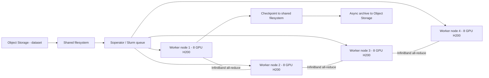

# Module 01 — Solution: Design High-Performing Architectures

ဤအဖြေများသည် model answer များဖြစ်ပြီး scenario ထဲက requirements ကို ခိုင်လုံစွာ အကြောင်းပြနိုင်ပါက အခြားသော ခိုင်လုံသော design များလည်း လက်ခံနိုင်ပါသည်။ Memory sizing ဂဏန်းများသည် **conceptual estimate** များဖြစ်ပြီး benchmark မဟုတ်ပါ (parameter တစ်ခုလျှင် mixed-precision Adam full fine-tune တွင် ~16 bytes ခန့် ကုန်ကျသည်ဟု ခန့်မှန်းထားခြင်း ဖြစ်သည်)။

## Exercise 1 — LLM fine-tuning ငယ် (အဖြေ)

**Constraints —** 7B model, dataset GB ရာဂဏန်း, GPU ၁–၂ လုံး, ရက်ပိုင်း, team ၂ ဦး (cluster မစီမံချင်), checkpoints + model distribution။

1. **Deployment shape / GPU —** single node က လုံလောက်ပါတယ် (multi-node မလို)။ Conceptual estimate အရ 7B full fine-tune က ~112 GB ခန့် ကုန်ကျနိုင်သဖြင့် GPU memory ကြီးသော **H200 (141 GB HBM3e) 1-GPU VM** (`gpu-h200-sxm`, `1gpu-16vcpu-200gb`) က တစ်လုံးတည်းနှင့် ကိုက်ပါတယ်။ Parameter-efficient method (LoRA စသည်) သုံးပါက memory သိသိသာသာ နည်းသဖြင့် **L40S** (`gpu-l40s-d`) ကဲ့သို့ သက်သာသော PCIe GPU နှင့်ပင် ရနိုင်ပါတယ် — ဒါက method ပေါ် မူတည်ပါတယ်။ **InfiniBand မလိုပါ** — multi-node မဟုတ်သဖြင့် GPU cluster ဖန်တီးစရာ မလိုပါ။
2. **Storage —** dataset ကို **Object Storage bucket** ထဲ သိမ်းပြီး training script က data source အဖြစ် အသုံးပြုပါ (docs အကြံပြုချက်)။ Checkpoints ကို အမြန်ရေး/ဖတ်နိုင်သော **shared filesystem** သို့မဟုတ် တိုက်ရိုက် Object Storage သို့ တင်နိုင်ပြီး (model ငယ်သဖြင့် ကွာခြားချက် နည်းပါသည်)၊ ပြီးသွားသော model ကို **model registry bucket** အဖြစ် Object Storage မှာ ထားပြီး အခြား services များဆီ ဖြန့်ချိနိုင်ပါတယ် (docs: Object Storage ကို data storage, checkpoint storage, model registry, results storage အဖြစ် အသုံးပြုပုံ)။
3. **Job execution —** cluster မစီမံချင်သော team အတွက် **Serverless AI job** က အကိုက်ဆုံးဖြစ်ပါတယ် — container တင်ရုံဖြင့် VM/cluster provisioning ကို service က ကိုင်တွယ်ပေးပြီး per-second billing ဖြစ်သဖြင့် ရက်ပိုင်း training အတွက် ကုန်ကျစရိတ် ထိန်းနိုင်ပါတယ်။ တစ်လုံးတည်း VM ပေါ်မှာ ကိုယ်တိုင် run ခြင်းကလည်း မှန်ကန်သော ရွေးချယ်မှု ဖြစ်နိုင်ပါတယ် (control ပိုရချင်ရင်)။

## Exercise 2 — Multi-node pre-training (အဖြေ)

**Constraints —** model ကြီး, GPU ၃၂, ရက်သတ္တပတ်များစွာ, dataset ရာ TB, hourly checkpoints + restart, researchers ၁၀ ဦး queue စီမံချင်။

1. **GPU platform / cluster —** multi-node distributed training အတွက် InfiniBand လိုအပ်သဖြင့် **SXM platform** (ဥပမာ `gpu-h200-sxm` သို့မဟုတ် `gpu-h100-sxm`) ကို **8-GPU preset** (`8gpu-128vcpu-1600gb`) နှင့် သုံးပြီး node ၄ လုံးကို **GPU cluster** တစ်ခုအတွင်း ထည့်ရပါမယ် (8-GPU SXM presets များသာ GPU cluster နှင့် ကိုက်ပါသည်)။ **PCIe GPUs (L40S, RTX PRO 6000) က InfiniBand မပါသဖြင့် multi-node training အတွက် မကိုက်ပါ** — ဒါက ဒီ scenario ရဲ့ hard constraint ကို ဖြည့်ဆည်းနိုင်ခြင်း မရှိပါ။ InfiniBand fabric ကို region နှင့် platform အလိုက် ရွေးပြီး topology-aware scheduling အတွက် topology file ပေးထားပါက ပိုကောင်းပါတယ်။
2. **Storage —** dataset (ရာ TB) ကို **Object Storage** မှာ သိမ်းပြီး streaming လုပ်ပါ (docs: dataset အလွန်ကြီးပါက Object Storage က ပိုကိုက်သည်)၊ worker များကြား code မျှဝေရန် **shared filesystem** သုံးပါ။ Hourly checkpoints ကို **shared filesystem** မှာ အမြန် သိမ်းပြီး (write latency နည်းဖို့) နောက်မှ Object Storage သို့ async ပြောင်းပါ — restart လိုအပ်ချက်ကို ဒီအဆင့်က ဖြည့်ဆည်းပေးပါတယ်။
3. **Parallelism —** GPU ၃၂ အတွက် **data parallel** ကနေ စပါ — GPU တစ်လုံးချင်းစီ memory ထဲ model အပြည့် ထားနိုင်ရင် data parallel တစ်ခုတည်းနှင့် လုံလောက်ပြီး all-reduce ကို InfiniBand က ကိုင်တွယ်ပေးပါတယ်။ Model က GPU memory ထက် ကြီးလာရင်မှ **tensor parallel** (node အတွင်း NVLink ပေါ်) နှင့် **pipeline parallel** (node ကြား) ကို ပေါင်းထည့်ပါ — tensor parallel က communication များသဖြင့် node အတွင်းမှာသာ ချထားခြင်းက အကောင်းဆုံး ဖြစ်ပါတယ်။
4. **Overlay —** researchers များ queue ကို ကိုယ်တိုင် စီမံချင်သဖြင့် **Slurm/Soperator** (Managed Service for Soperator) က အကိုက်ဆုံး ဖြစ်ပါတယ် — `sbatch` queue ဖြင့် jobs စီမံနိုင်ခြင်း၊ shared root filesystem ကြောင့် user environment တူညီခြင်း၊ NCCL-based automated health checks က node ကျန်းမာရေး စစ်ပေးခြင်းတို့က long-running training အတွက် တိုက်ရိုက် အကျိုးပေးပါတယ်။

**Figure 3 — Exercise 2 architecture အကျဉ်း**

**ပုံရှင်းလင်းချက် —** dataset က Object Storage ကနေ shared filesystem ဆီ စီးဝင်ပါတယ် (ယာယီ cache/stream)။ Slurm queue က job ကို worker node ၄ လုံး (8-GPU H200 စီ) ကို ခွဲဝေပါတယ်။ node တွေကြား မြှားနှစ်ဖက်မြှားက InfiniBand ဖြင့် gradient all-reduce ကို ကိုယ်စားပြုပြီး checkpoint များက shared filesystem ဆီ အမြန် ရေးပြီး နောက်မှ Object Storage ဆီ archive လုပ်ပါတယ်။

## Exercise 3 — Inference serving (အဖြေ)

**Constraints —** autoscaling (day/night traffic), weights GB ရာဂဏန်း ဖြန့်ချိမှု, latency sensitive, internal access, K8s ကျွမ်းကျင် team။

1. **Deployment shape / GPU —** inference အတွက် multi-node gradient communication မလိုသဖြင့် **InfiniBand မလိုပါ** — PCIe GPUs (L40S, RTX PRO 6000) ကပင် ကိုက်နိုင်ပြီး ပိုကုန်ကျသက်သာပါတယ်။ weights က GB ရာဂဏန်းသာ ရှိသဖြင့် GPU တစ်လုံးချင်းစီ (node တစ်လုံးချင်းစီ) က လုံလောက်ပါတယ် — GPU cluster စုစည်းစရာ မလိုပါ။ GPU memory နှင့် latency requirement ပေါ် မူတည်၍ H200/H100 1-GPU VM များလည်း ရွေးနိုင်ပါတယ်။
2. **Weights ဖြန့်ချိမှု —** autoscaling ဖြင့် VM အများဆီ weights မျှဝေရန် docs အကြံပြုချက်အတိုင်း **shared filesystem** ကို သုံးပါ — node အသစ်တက်လာတိုင်း weights ကို အမြန် ဖတ်နိုင်ပြီး consistency ရှိပါတယ်။ Retrain ပြီးတိုင်း weights အသစ်ကို ဒီ shared filesystem ပေါ် တင်ပေးရုံဖြင့် node အားလုံး မြင်ရပါမယ်။ Inference results/logs ကို **Object Storage** သို့ ပို့ပါ (docs အကြံပြုချက်)။
3. **Orchestrator —** K8s ကျွမ်းကျင် team ဖြစ်ပြီး autoscaling လိုအပ်သဖြင့် **Managed Service for Kubernetes** ကို GPU node groups နှင့် အသုံးပြုခြင်း က အကောင်းဆုံး ဖြစ်ပါတယ် — cluster autoscaling, self-healing, node group ဖြင့် GPU ရင်းနှီးမြှုပ်နှံမှု ထိန်းချုပ်နိုင်ပါတယ်။ Team က K8s မစီမံချင်ပါက **Serverless AI endpoint** က ရွေးချယ်စရာ ဖြစ်ပါတယ် — endpoint က request များ နားထောင်ပြီး ဖြေကြားပေးခြင်း၊ per-second billing ဖြင့် traffic နည်းချိန် ကုန်ကျစရိတ် လျော့ခြင်း။

## Exercise 4 — Petabyte-scale pipeline (အဖြေ)

**Constraints —** PB အဆင့် raw data (object storage တွင် ရှိပြီး), CPU preprocess + GPU training, GPU မဆာစေရန် အမြန် read, intermediate ပြန်ဖန်တီးနိုင်, cost control။

1. **Storage tiers —**
   - *Raw data* — ရှိပြီးသား **Object Storage** မှာပဲ ထားပါ (PB အဆင့်အတွက် တည်ငြိမ်ပြီး သက်သာ)။
   - *Intermediate (preprocess output)* — ပြန်ဖန်တီးနိုင်သဖြင့် **local SSD (scratch)** သို့မဟုတ် **Network SSD NRD** ကို သုံးပါ — အမြန်ဆုံး/သက်သာဆုံး ဖြစ်ပြီး redundancy မလိုပါ။
   - *Training input* — GPU မဆာစေရန် **shared filesystem** ဖြင့် stream ခြင်း (docs: shared filesystem က training အတွင်း dataset access bottleneck လျော့စေသည်) — dataset အလွန်ကြီးပါက Object Storage မှ တိုက်ရိုက် stream ခြင်းလည်း ကိုက်ပါသည်။
   - *Artifacts (model, reports)* — **Object Storage** သို့ ရောက်ရှိပြီး lifecycle rule ဖြင့် storage class ညှိပါ။
2. **GPU မဆာစေရန် —** storage bandwidth ကို tier ရွေးချယ်မှုဖြင့် ဖြည့်ဆည်းပါ — preprocess output ကို local SSD သို့မဟုတ် shared filesystem လို မြန်သော tier မှာ ထားပြီး batch read pattern (ဖတ်ရာတွင် chunk ကြီးကြီး) ဖြင့် ဖတ်ပါ — docs အကြံပြုချက်အရ maximum bandwidth အတွက် read/write ကို 4 MiB chunks ခန့်ဖြင့် လုပ်ပါ။
3. **Intermediate data အတွက် ရွေးချယ်မှု —** ပြန်ဖန်တီးနိုင်ခြင်းကြောင့် **local SSD** က အကောင်းဆုံးဖြစ်ပါတယ် (ephemeral ဖြစ်ခြင်းက ဒီအတွက် ပြဿနာ မဟုတ်ပါ) — ဈေးနှုန်းချိုသာပြီး IOPS/bandwidth အမြင့်ဆုံး ဖြစ်သဖြင့် cost control requirement နှင့် ကိုက်ပါတယ်။ VM lifecycle နှင့် ချိတ်ဆက်ထားခြင်း (VM-managed) ဖြင့် cleanup ပါ အလိုအလျောက် ဖြစ်စေနိုင်ပါတယ်။

## Exercise 5 — Tradeoff analysis (အဖြေ)

Conceptual estimate — 30B parameters full fine-tune (mixed-precision Adam, ~16 bytes/param) ကုန်ကျမှု ခန့်မှန်းချက် —

| အစိတ်အပိုင်း | ခန့်မှန်း ကုန်ကျမှု |
|---|---|
| FP16 weights | ~60 GB |
| FP16 gradients | ~60 GB |
| FP32 master weights | ~120 GB |
| Adam optimizer states (m, v) | ~240 GB |
| **စုစုပေါင်း** | **~480 GB** |

1. **Hard constraint က memory fit ဖြစ်ပါတယ်** — ပထမဆုံး စစ်ရမှာ "model + training state က GPU memory ထဲ ဝင်သလား" ဆိုတာပါ။ ကုန်ကျစရိတ်/အချိန်က ဒုတိယ အဆင့် ဖြစ်ပါတယ်။
2. **ရွေးချယ်စရာ ခွဲခြားခြင်း —**
   - (A) L40S 1-GPU (48 GB) — ~480 GB လိုအပ်ချက်နှင့် အလွန်ဝေးသဖြင့် full fine-tune အတွက် **မကိုက်ပါ** (LoRA ကဲ့သို့ PEFT သုံးပါကမူ ကိုက်နိုင်ပါတယ် — ဒါပေမယ့် scenario က full fine-tuning ဟု သတ်မှတ်ထားပါသည်)။
   - (B) H200 1-GPU (141 GB) — 30B full fine-tune အတွက် မလုံလောက်ပါ (7B အဆင့် fine-tune အတွက်တော့ ကိုက်နိုင်ပါတယ်)။
   - (C) H200 8-GPU (HBM စုစုပေါင်း ~1128 GB) — memory လုံလောက်ပြီး NVLink ဖြင့် model/tensor sharding လုပ်နိုင်သဖြင့် **ဒီ scenario အတွက် ကိုက်ပါတယ်**။
3. **Distractor ဖယ်ရှားခြင်း —** (A) က ဈေးအသက်သာဆုံးဖြစ်ပေမယ့် memory constraint ကို မဖြည့်ဆည်းနိုင်သဖြင့် ဖယ်ရပါမယ် — "ဈေးသက်သာမှု" က preference ဖြစ်ပြီး "memory fit" က hard constraint ဖြစ်လို့ ဖြစ်ပါတယ်။ (B) က GPU မျိုးဆက် မှန်ပေမယ့် အရေအတွက် မလုံလောက်ပါ။ (C) က single-node ဖြစ်သဖြင့် InfiniBand ပင် မလိုသေးဘဲ တစ်ပတ်အတွင်း timeline ကိုလည်း ဖြည့်ဆည်းနိုင်ပါတယ်။ မှတ်ချက် — single-node 8-GPU ဖြစ်သဖြင့် GPU cluster/InfiniBand မလိုခြင်းကို ရှင်းပြနိုင်ပါက ဒီဇိုင်း နားလည်မှု ပြည့်စုံပါတယ်။

## Technical review notes

- GPU specs (memory, bandwidth, InfiniBand ပါ/မပါ), platform IDs, presets, storage behaviors များကို docs.nebius.com အတိုင်း 2026-10-14 တွင် စစ်ဆေးပြီး ဖော်ပြထားပါသည်။
- Memory sizing ဂဏန်းများ (~16 bytes/param, 30B → ~480 GB, 7B → ~112 GB) သည် conceptual estimates များဖြစ်ပြီး **benchmark မဟုတ်ပါ** — လက်တွေ့ sizing အတွက် framework overhead, batch size, sequence length ပေါ် မူတည်၍ ကွာခြားနိုင်သဖြင့် ကိုယ်ပိုင် စမ်းသပ်မှု လိုအပ်ပါသည် (needs verification per workload)။
- Exercise 1 တွင် LoRA/PEFT အသုံးပြုပါက GPU ရွေးချယ်မှု ပြောင်းလဲနိုင်ကြောင်း ဖော်ပြထားပြီး fine-tuning method ပေါ် မူတည်ကြောင်း မှတ်သားထားပါသည်။
- CLI commands များ explanation.md တွင် ဖော်ပြထားသည်နှင့်အညီ illustrative သာဖြစ်ပါသည်။
