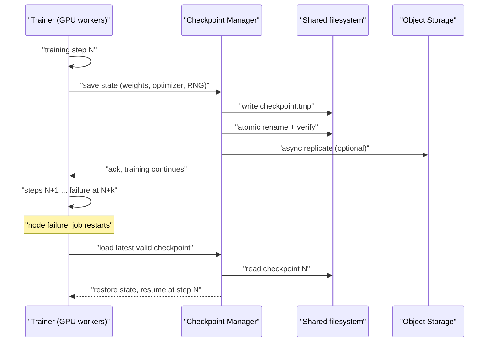
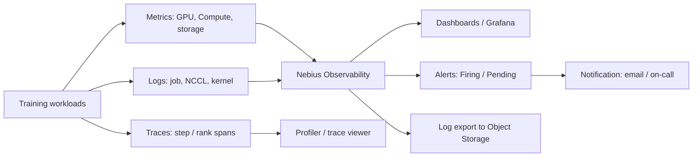
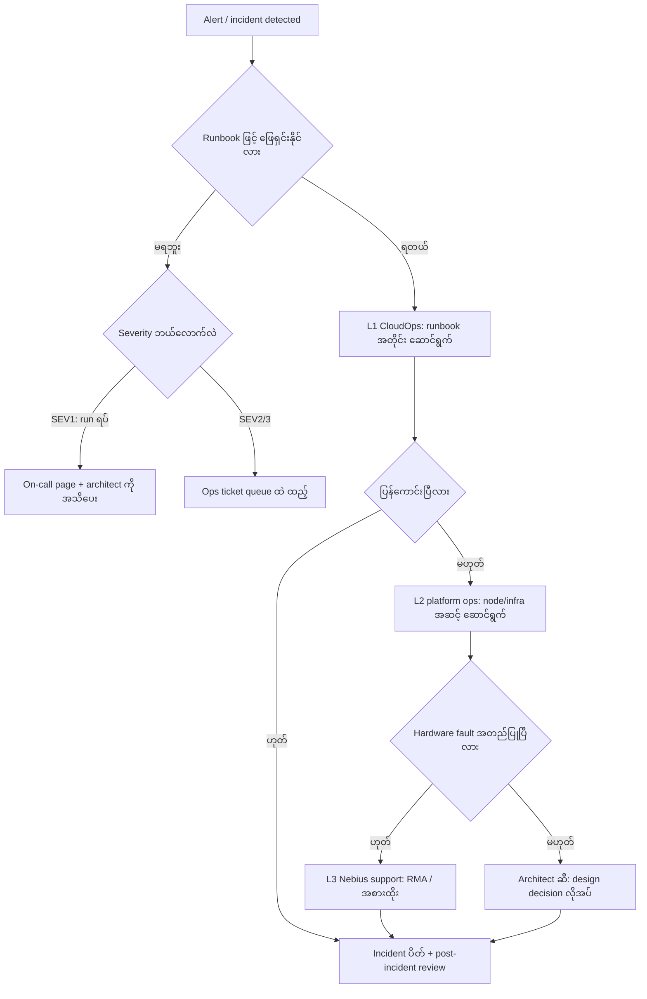

# Module 02 — Design Resilient Architectures

> Exam Domain 2 — "Design resilient architectures" (ခန့်မှန်းခြေ 25%)။
> ဤ module သည် checkpoint/restart strategy, observability scope,
> validation/benchmark/acceptance plan, failure handling နှင့် operational
> support model, migration နှင့် handover path တို့ကို architect ရှုထောင့်မှ
> ဒီဇိုင်းဆွေးနွေးပါမည်။

## ဤ module က ဖြေရှင်းပေးသည့် ပြဿနာ

GPU cluster ကြီးတစ်ခုပေါ်မှာ training run တစ်ခုက ရက်ပေါင်းများစွာ
ကြာနိုင်ပါတယ်။ node တစ်ခု၊ GPU တစ်လုံး၊ InfiniBand link တစ်ကြောင်း
ပျက်သွားတာက cluster အရွယ်အစား ကြီးလေလေ ဖြစ်နိုင်ခြေ များလေလေပါပဲ။
ဒါကြောင့် resilient architecture ဆိုတာ "failure မဖြစ်အောင် ကာကွယ်တာ"
မဟုတ်ဘူး — "failure ဖြစ်လာရင် ဆုံးရှုံးမှု အနည်းဆုံးနဲ့ ပြန်လည် ရပ်တည်နိုင်အောင်
ကြိုတင် ဒီဇိုင်းဆွဲထားတာ" ဖြစ်ပါတယ်။

Architect သည် ဒီဇိုင်းဆုံးဖြတ်ချက်များအတွက် တာဝန်ရှိသူဖြစ်ပြီး
CloudOps operator များက runbook များအတိုင်း လိုက်နာဆောင်ရွက်သူများ
ဖြစ်ပါတယ် — ဆိုလိုသည်မှာ incident တစ်ခု ဖြစ်လာရင် "ဘာလုပ်ရမလဲ" ဆိုတာကို
runbook က ဖြေပေးရမှာ ဖြစ်ပြီး "ဘယ်လို ဒီဇိုင်းပေါင်းစပ်ရမလဲ" ဆိုတာကို
architect က ကြိုတင် ဆုံးဖြတ်ထားရမှာ ဖြစ်ပါတယ်။

Resilience ဒီဇိုင်းကို ငါးရပ်ခွဲ စဉ်းစားပါမယ် —

1. Checkpoint နှင့် restart strategy — failure ဖြစ်ရင် အလုပ် ဘယ်လောက် ဆုံးရှုံးမလဲ
2. Observability scope — logs, metrics, traces ဘာတွေ ကြည့်မလဲ
3. Validation, benchmark, acceptance plan — platform အသင့်ဖြစ်ပြီဆိုတာ ဘယ်လို သက်သေပြမလဲ
4. Failure handling နှင့် operational support model — incident မှာ ဘယ်သူ ဘာလုပ်မလဲ
5. Migration နှင့် handover path — project team ကနေ ops team ကို ဘယ်လို လွှဲပြောင်းမလဲ

---

## 1. Checkpoint နှင့် Restart Strategy

### ပြဿနာ

7 ရက် ကြာမယ့် training run တစ်ခုမှာ ရက် 4 မှာ node တစ်ခု ပျက်သွားရင်
checkpoint မရှိရင် အလုပ် ရက်ဝက်စာ လုံးဝ ဆုံးရှုံးပါတယ်။ checkpoint ကို
စက္ကန့်တိုင်း သိမ်းရင်လည်း training က နှေးသွားပြီး storage ကို ဖိအားပေးပါတယ်။
ဒီကြားထဲက သင့်တော်တဲ့ အချိန်ကို ရွေးတာက checkpoint/restart strategy ရဲ့
အဓိက ဒီဇိုင်းအလုပ် ဖြစ်ပါတယ်။

### အခြေခံ အယူအဆ

Checkpoint ဆိုတာ training state ကို storage ပေါ် သိမ်းထားခြင်း ဖြစ်ပါတယ်။
ပုံမှန် ပါဝင်တဲ့ အစိတ်အပိုင်းတွေက —

- model weights နှင့် optimizer state
- RNG state (random number generator) နှင့် dataloader position — reproduce လုပ်နိုင်ဖို့
- training step counter နှင့် config/version metadata

Restart မှာ job တစ်ခုလုံး ပြန်စရာ မလိုဘဲ နောက်ဆုံး valid checkpoint ကနေ
ပြန်စနိုင်ပါတယ်။ ပြန်စတဲ့ granularity ကို ဒီဇိုင်းမှာ ရွေးချယ်ရပါတယ် —

| Granularity | ဘယ်လို အလုပ်လုပ်လဲ | သင့်တော်သည့် နေရာ | ကန့်သတ်ချက် |
|---|---|---|---|
| Job-level restart | run တစ်ခုလုံးကို checkpoint ကနေ ပြန်စ | training job အများစု | checkpoint ကြီးရင် load ချိန် ကြာနိုင် |
| Step-level restart | နောက်ဆုံး step ကနေသာ ပြန်စ | framework support ရှိရင် (framework-dependent — needs verification) | framework ပေါ် မူတည် |
| Node-level / elastic restart | ပျက်သွားတဲ့ node ကို ဖယ်ပြီး ကျန် node တွေနဲ့ ဆက် | node အရေအတွက် ပြောင်းလို့ ရတဲ့ workload | global batch size ပြောင်းမှုကို ကိုင်တွယ်ရ |

### Checkpoint ကြာချိန် (frequency) နှင့် ဆုံးရှုံးမှု

ဒီဇိုင်း စဉ်းစားပုံက ရိုးရှင်းပါတယ် —

- checkpoint တစ်ခု သိမ်းချိန် (overhead) က training step တွေကို နှေးစေတယ်
- checkpoint ကြားမှာ failure ဖြစ်ရင် နောက်ဆုံး checkpoint ကနေ ပြန်စရတယ်
  → ပျမ်းမျှ ဆုံးရှုံးမှု ≈ checkpoint ကြာချိန်၏ တစ်ဝက် (failure က ကြိုမသိနိုင်လို့)

ဆိုလိုတာက checkpoint ကြာချိန်ကို တိုလေ ဆုံးရှုံးမှု နည်းလေ၊ ဒါပေမယ့်
overhead များလေ ဖြစ်ပါတယ်။ လက်တွေ့ ဒီဇိုင်းမှာ အောက်ပါ အချက်တွေကို
ထည့်စဉ်းစားပါ —

- **Overhead budget** — checkpoint အတွက် training time ရဲ့ ရာခိုင်နှုန်း ဘယ်လောက်
  ပေးမလဲ (ဥပမာ အနေနဲ့ 1–5% လို့ မကြာခဏ ဆိုကြပေမယ့် ဂဏန်းက workload ပေါ်
  မူတည်လို့ ကိုယ့် workload မှာ တိုင်းပါ — ယေဘုယျ သဘောတရားသာ)
- **MTBF (mean time between failures)** — cluster ကြီးလေ failure ကြားချိန် တိုလေ။
  node အရေအတွက်နဲ့ node တစ်ခုချင်းစီရဲ့ failure rate ကနေ ခန့်မှန်းနိုင်ပါတယ်
- **Restart cost** — checkpoint load ချိန်၊ environment ပြန်တည်ဆောက်ချိန်
- **Storage bandwidth** — checkpoint ရေးခြင်းက data loading pipeline နဲ့
  bandwidth ယှဉ်ပြိုင်ရင် training ကို ထိခိုက်နိုင်

### Synchronous vs Asynchronous checkpointing

| | Synchronous | Asynchronous |
|---|---|---|
| အလုပ်လုပ်ပုံ | state သိမ်းပြီးမှ နောက် step ဆက် | compute နဲ့ overlap လုပ်ပြီး နောက်ခံက သိမ်း |
| Training ထိခိုက်မှု | checkpoint ကြာချိန်အတိုင်း ရပ် | သိသိသာသာ နည်း |
| ရှုပ်ထွေးမှု | ရိုးရှင်း၊ consistent state အာမခံ | in-flight state ကို copy လုပ်ရ၊ memory ပိုစား |
| သင့်တော်မှု | checkpoint သေး၊ overhead ခံနိုင်ရင် | run ရှည်၊ checkpoint ကြီးရင် |

Async checkpointing မှာ သတိထားရမှာက — checkpoint ရေးနေစဉ် training က
ရှေ့ဆက်နေတဲ့အတွက် သိမ်းထားတဲ့ state က ဘယ် step အတွက်လဲ ဆိုတာ ရှင်းရှင်းလင်းလင်း
သတ်မှတ်ထားရမှာ ဖြစ်ပြီး write မပြီးခင် failure ဖြစ်ရင် ပြီးခါနီး checkpoint
တစ်ခုလုံး ဆုံးရှုံးနိုင်ပါတယ်။

### Checkpoint ကို ဘယ်မှာ သိမ်းမလဲ — storage ရွေးချယ်မှု

| ပန်းတိုင် | အားသာချက် | အားနည်းချက် | သင့်တော်သည့် အသုံး |
|---|---|---|---|
| Local disk (node ပေါ်) | အမြန်ဆုံး | node ပျက်ရင် checkpoint ပါ ပျက် | အလယ်အလတ်/staging checkpoint သာ |
| Shared filesystem | node အားလုံး မြင်ရ၊ restart မြန် | capacity နှင့် bandwidth စီမံရ | active run ရဲ့ နောက်ဆုံး N checkpoint |
| Object Storage | durable၊ node lifecycle နဲ့ လွတ်၊ versioning | latency များ၊ write path ပိုရှည် | long-term retention နှင့် disaster copy |

Nebius AI Cloud မှာ Compute shared filesystem ကို VM တွေနဲ့ attach/mount
လုပ် အသုံးပြုနိုင်ပြီး (docs အရ — VM နှင့် volume က project တူရမယ်၊ attach mode
READ_WRITE နဲ့ mount tag သတ်မှတ်နိုင်) Object Storage ကတော့ log export လို
durable object သိမ်းတဲ့ နေရာတွေမှာ အသုံးပြုပြီးသား ဖြစ်ပါတယ်။
Checkpoint အတွက် shared filesystem ပေါ် ရေးပြီး Object Storage ကို
လိုအပ်ရင် replicate လုပ်တဲ့ pattern က လူကြိုက်များပါတယ်။

### Figure 1 — Checkpoint နှင့် restart flow (sequence)



ပုံရှင်းလင်းချက် — ဘယ်ကနေ ဘယ်ကို စီးဆင်းသလဲ ဆိုတာ ကြည့်ပါ။ trainer က
state ပေးပြီး checkpoint manager က အရင် shared filesystem ပေါ်မှာ
`.tmp` အဖြစ် ရေး၊ ပြီးမှ atomic rename နဲ့ အမည်ပြောင်း — ဒါက failure ဖြစ်ရင်
တစ်ဝက်ရေးထားတဲ့ checkpoint မကျန်အောင် ကာကွယ်တာ ဖြစ်ပါတယ်။ Object Storage
ကိုတော့ optional async replicate အနေနဲ့ သိမ်းပါတယ်။ failure ဖြစ်ပြီး restart
မှာ နောက်ဆုံး valid checkpoint ကနေသာ ပြန်စတာကို sequence ရဲ့ အောက်ပိုင်းက
ပြထားပါတယ်။

### လက်တွေ့ ဒီဇိုင်း အလေ့အကျင့်များ

- **Atomic write** — `checkpoint.tmp` ကို ရေးပြီး rename လုပ်ခြင်းက တစ်ဝက်ရေးထားသော
  checkpoint မကျန်စေပါ
- **Versioning နှင့် metadata** — checkpoint တစ်ခုချင်းစီမှာ step, config hash,
  framework version ထည့်ပါ — မကိုက်ညီရင် load မလုပ်ခင် ဖမ်းမိစေပါတယ်
- **Retention policy** — နောက်ဆုံး N ခုသာ ထားခြင်းက storage မပြည့်စေပါ
- **Restore drill** — checkpoint ကနေ ပြန်စတဲ့ test ကို production run မစခင်
  တစ်ခါ အနည်းဆုံး လုပ်ကြည့်ပါ — "restore လုပ်လို့ ရမရ" ကို run ကြီး မစခင် သိထားရပါမယ်
- **Integrity check** — checksum နဲ့ load ချိန် verify လုပ်ပါ

### သတိပြုရန်

- checkpoint တစ်ခုတည်းကိုသာ အားကိုးရင် single point of failure ဖြစ်ပါတယ် —
  အနည်းဆုံး နောက်ဆုံး ၂ ခု ထားပါ
- checkpoint များတာက storage bandwidth ကို စားပါတယ် — data loading pipeline
  နဲ့ မျှဝေသုံးရင် step time တက်လာတာ တွေ့နိုင်ပါတယ်
- model weights ဆိုတာ intellectual property ဖြစ်ပါတယ် — checkpoint storage ကို
  access control နှင့် encryption ဒီဇိုင်း (Module 04) နဲ့ ချိတ်ဆက် စဉ်းစားပါ
- "checkpoint ရှိတယ်" နဲ့ "restore လုပ်လို့ ရတယ်" မတူပါ — restore drill မှာ
  ကွဲပြားမှု သိရပါမယ်

---

## 2. Observability Scope — Logs, Metrics, Traces

### ပြဿနာ

Training loss မကျဘူး၊ GPU utilization မြင့်နေပေမယ့် throughput နည်းနေတယ် —
ဒီလို အခြေအနေမှာ metrics တစ်မျိုးတည်းနဲ့ အဖြေ မရနိုင်ပါဘူး။ logs က
"ဘာဖြစ်ခဲ့လဲ" ပြောပြပြီး traces က "ဘယ်နေရာမှာ ကြာနေလဲ" ပြပါတယ်။
Observability scope ဒီဇိုင်းဆိုတာ "ဘာ signal တွေ ကောက်မလဲ၊ ဘယ်လောက်
ကြာအောင် သိမ်းမလဲ၊ ဘယ်သူ ကြည့်ခွင့်ရှိမလဲ" ကို ကြိုတင် ဆုံးဖြတ်ထားခြင်း
ဖြစ်ပါတယ်။

### Signal သုံးမျိုး ဘာအတွက် သုံးလဲ

| Signal | ပြောပြတဲ့ မေးခွန်း | GPU training platform မှာ ဥပမာ |
|---|---|---|
| Metrics | ဘယ်လောက် မြန်/နှေး/ပြည့်နေလဲ | step time, samples/sec, GPU utilization, HBM usage, network throughput |
| Logs | ဘာဖြစ်ခဲ့လဲ | job events, NCCL warnings, Xid errors, checkpoint save/load events |
| Traces | ဘယ်နေရာမှာ ကြာနေလဲ | step တစ်ခုအတွင်း data loading / forward / backward / allreduce span များ |

Golden signals (latency, traffic, errors, saturation) ကို training platform အတွက်
အောက်ပါအတိုင်း ပြန်ဖွဲ့စဉ်းစားနိုင်ပါတယ် —

- **Latency** — step time, checkpoint save time, job queue wait time
- **Traffic** — samples/sec သို့ tokens/sec, data loader throughput
- **Errors** — job failure count, restart count, NCCL timeout, Xid/ECC error count
- **Saturation** — GPU utilization, HBM ပြည့်မှု, storage I/O, InfiniBand utilization

### Nebius AI Cloud မှာ ရနိုင်တဲ့ observability အခြေခံ

Nebius AI Cloud Observability က alerts, metrics, logs ကို နေရာတစ်ခုတည်းမှာ
စုပေးထားပါတယ် (docs အရ — လက်ရှိ preview ဖြစ်ပြီး region အားလုံးတွင် ရနိုင်)။
Observability Overview page မှာ အဓိက အပိုင်းသုံးခု ရှိပါတယ် — firing alerts,
metrics (CPU, memory, disk, network, GPU utilization), နှင့် logs ။

**Metrics** — preconfigured dashboards တွေ ရှိပြီး Prometheus နှင့် Grafana ကို
integration လုပ် နက်ရှိုင်းစွာ ခွဲခြမ်းနိုင်ပါတယ်။ Prometheus ကနေ metrics ဖတ်ချင်ရင်
service account တစ်ခုကို `viewer` အနည်းဆုံး ပါဝင်တဲ့ group ထဲ ထည့်ပြီး OBSERVABILITY
service အတွက် static key ထုတ်ပါ —

```
nebius iam static-key issue \
  --name <name_for_the_key> \
  --account-service-account-id <service_account_ID> \
  --service=OBSERVABILITY
```

(ဤ command သည် docs.nebius.com/observability/metrics/prometheus မှ ဖြစ်ပါသည်။)

Prometheus scrape config မှာ target က `read.monitoring.<region>.nebius.cloud` ဖြစ်ပြီး
`metrics_path` က project ID ကို ညွှန်းပါတယ် — ဝန်ဆောင်မှု အလိုက် bucket ခွဲထားပါတယ် —
`compute` (VM), `gpu` (GPU metrics), `nbs` (Compute volumes), `sp_storage`
(Object Storage), `msp` (PostgreSQL, MLflow)။ အကြံပြု scrape interval က 15 စက္ကန့်
အနည်းဆုံး ဖြစ်ပါတယ်။ time series များရင် `match[]` selector တွေနဲ့ job ကို
shard ခွဲနိုင်ပါတယ် — အောက်ပါ ဥပမာက GPU metrics ကို `uuid` label အလိုက်
ခွဲထားတာ ဖြစ်ပါတယ် (docs မှ ဥပမာ၊ illustrative) —

```yaml
scrape_configs:
  - job_name: 'Nebius Observability: GPU metrics, shard 1'
    honor_labels: true
    scrape_interval: 15s
    scheme: https
    metrics_path: '/projects/<project_ID>/buckets/gpu/prometheus/federate'
    params:
      match[]:
        - '{uuid=~"GPU-[0-7].*"}'
    bearer_token: '<static_key_for_service_account>'
    static_configs:
      - targets:
          - 'read.monitoring.<region>.nebius.cloud'
```

**Logs** — web console ရဲ့ Observability → Logs မှာ ကြည့်နိုင်ပြီး User logs
(Managed Service for Kubernetes က ingest လုပ်တာ) နှင့် service logs ကို
bucket ခွဲပြောင်း ကြည့်နိုင်ပါတယ်။ Compute (VM serial logs), Managed Service
for Kubernetes, PostgreSQL, MLflow စတဲ့ ဝန်ဆောင်မှုတွေအတွက် logs ရှိပြီး
ကိုယ်ပိုင် application logs ကိုလည်း ingest လုပ် စုဆောင်းနိုင်ပါတယ်။
LogQL နဲ့ filter လုပ်နိုင်ပြီး export ကို Object Storage bucket ထဲ
`.json.gzip` သို့ `.parquet` format နဲ့ သိမ်းနိုင်ပါတယ်။ Grafana မှာ Loki data
source ချိတ်ပြီးလည်း ကြည့်နိုင်ပါတယ်။

**Traces** — distributed training မှာ trace ဆိုတာ job → run → step → rank
အဆင့်တွေကို span အဖြစ် ခြေရာခံတာ ဖြစ်ပါတယ်။ framework profiler များ
(ဥပမာ PyTorch profiler, Nsight — framework/tool ပေါ် မူတည်) က ထုတ်ပေးတဲ့
trace data ကို စုဆောင်းပုံက workload ပေါ် မူတည်ပါတယ်။ Nebius Observability
ရဲ့ built-in trace ingestion အကြောင်း တရားဝင် အတည်ပြုချက် မတွေ့သေးသဖြင့်
trace pipeline ဒီဇိုင်းကို framework/tool အဆင့်တွင် စီစဉ်ပါ (needs verification)။

### Figure 2 — Observability data flow



ပုံရှင်းလင်းချက် — training workloads က ထွက်လာတဲ့ signal သုံးမျိုးကို
ကြည့်ပါ။ metrics နှင့် logs က Nebius Observability ထဲ ဝင်ပြီး အဲဒီကနေ
dashboards, alerts, log export ဆီ စီးဆင်းပါတယ်။ alerts က notification
(on-call / email) ဆီ ရောက်ပါတယ်။ traces ကတော့ profiler/trace viewer ဆီ
သီးသန့် စီးဆင်းပါတယ် — ဒီဇိုင်းမှာ ဒီလမ်းကြောင်းကို သီးသန့် စီမံရပါမယ်။

### Alert design

Alert ဒီဇိုင်းရဲ့ အခြေခံ သဘောတရားတွေ —

- **Symptom ကို alert လုပ်ပါ, cause ကို မလုပ်ပါနဲ့** — "GPU utilization ကျ" ထက်
  "training throughput ကျ" က user impact ကို တိုက်ရိုက် ဖော်ပြပါတယ်
- **Severity ခွဲပါ** — run ရပ်သွားတာ (page လုပ်ရမယ်) နဲ့ performance ကျတာ
  (မနက်ဖြန် ကြည့်ရုံ) မတူပါ
- **Alert တစ်ခုချင်းစီအတွက် runbook link ထားပါ** — alert ဖြစ်ရင် ဘာလုပ်ရမလဲ
  ကြိုတင် ရေးထားပါ
- **Alert fatigue ကို ရှောင်ပါ** — မကြာခဏ ဖြစ်ပြီး ဘယ်သူမှ မလုပ်တဲ့ alert က
  အန္တရာယ် ဖြစ်လာပါတယ်

Nebius AI Cloud မှာ console ရဲ့ Observability → Alerts ကနေ Compute VM တွေနှင့်
Object Storage buckets တွေအတွက် custom alert တွေ ဖန်တီးနိုင်ပါတယ်။ alert
condition မှာ metric, exceeds/drops below condition, threshold, နှင့် duration
ပါဝင်ပြီး email notification ပေးနိုင်ပါတယ်။ alert အခြေအနေတွေက `Firing`,
`Pending` (condition ပြည့်ပြီး duration မပြီးသေး), `Normal` တို့ ဖြစ်ပါတယ်။
Email ထက် ပိုပြီး paging/on-call လိုချင်ရင် external notification pipeline
(ဥပမာ chat/webhook/paging tool) ကို ကိုယ်တိုင် ချိတ်ဆက်ရပါမယ် (design concept)။

### Retention ဒီဇိုင်း

Retention ကို ကိုယ့် လိုအပ်ချက်အလိုက် သတ်မှတ်ရပါမယ် —

- **Hot** — active debugging အတွက် metrics/logs ကို လတ်ဆတ်စွာ ထားခြင်း
- **Cold** — log export ကို Object Storage ထဲ `.parquet`/`.json.gzip` အဖြစ်
  ရေရှည် သိမ်းခြင်း (docs အရ ရနိုင်သော နည်းလမ်း)
- retention ကာလ ဂဏန်း သတ်မှတ်ချက်များကို တရားဝင် docs တွင် မတွေ့သဖြင့်
  ဤနေရာတွင် ဂဏန်း မဖော်ပြပါ — ကိုယ့် compliance လိုအပ်ချက်အလိုက် သတ်မှတ်ပါ
  (needs verification for platform limits)

### သတိပြုရန်

- metrics များလွန်းရင် cost နှင့် noise တက်ပါတယ် — signal တစ်ခုချင်းစီကို
  "ဒါကို ကြည့်ပြီး ဘယ် ဆုံးဖြတ်ချက် ချမလဲ" နဲ့ စစ်ပါ
- GPU metrics ကို `gpu` bucket ကနေ သီးသန့် scrape လုပ်တာက ပိုပြီး စီမံရ
  လွယ်ပါတယ် (shard ဥပမာ ကြည့်ပါ)
- log ထဲမှာ secret/credential ပါမလာအောင် log design ကို Module 04 နဲ့
  ချိတ်ဆက် စဉ်းစားပါ

---

## 3. Validation, Benchmark နှင့် Acceptance Plan

### ပြဿနာ

GPU cluster အသစ် ရောက်လာပြီး training စတဲ့အခါ "အလုပ်လုပ်တယ်" ဆိုတာနဲ့
"ဒီဇိုင်းအတိုင်း စွမ်းဆောင်ရည် ရတယ်" ဆိုတာ မတူပါဘူး။ InfiniBand link
တစ်ကြောင်း ကျနေရင် training က လည်ပတ်နေပေမယ့် နှေးနေမှာ ဖြစ်ပါတယ်။
ဒါကြောင့် acceptance criteria ကို test မစခင် ကြိုတင် သတ်မှတ်ပြီး
တစ်ဆင့်ချင်း စစ်ဆေးတဲ့ plan ရှိရပါမယ်။

### စစ်ဆေးမှု အဆင့်များ

**အဆင့် 1 — Physical/link validation** — InfiniBand port အခြေအနေကို
စစ်ဆေးပါ။ VM ထဲ SSH ဝင်ပြီး `ibstatus` ကို run ပါ —

```
Infiniband device 'mlx5_0' port 1 status:
   ...
   state:       4: ACTIVE
   phys state:  5: LinkUp
   rate:     400 Gb/sec (4X NDR)
   link_layer:  InfiniBand
```

(ဤ output သည် docs.nebius.com/compute/clusters/gpu/test မှ ဖြစ်ပါသည်။)
device တိုင်းရဲ့ `phys state` က `LinkUp` ဖြစ်ရမှာ ဖြစ်ပါတယ်။

**အဆင့် 2 — Bandwidth validation** — `perftest` package ကို
(`sudo apt install perftest`) test VM တွေမှာ တပ်ဆင်ပြီး VM တစ်ခုပေါ်မှာ
`ib_send_bw --report_gbits` ကို run၊ နောက် VM တစ်ခုကနေ
`ib_send_bw <first_VM_IP_address> --report_gbits` နဲ့ ချိတ်ပါ။ bytes sent,
average bandwidth, message rate က non-zero ဖြစ်ရပြီး peak speed က
theoretical maximum 400 Gbps ကို မရောက်နိုင်ကြောင်း docs မှာ ဖော်ပြထားပါတယ်
(ဥပမာ output တွင် peak 360.39 Gb/sec ဖြစ်)။

**အဆင့် 3 — Collective communication validation** — NVIDIA NCCL tests
(ဥပမာ `all_reduce_perf`) ကို run ပြီး collective performance ကို တိုင်းပါ။
Compute GPU cluster ပေါ်မှာ MPIrun နဲ့ run တဲ့ ဥပမာ (docs မှ) —

```
mpirun --host <IP_address_1>:8,<IP_address_2>:8,<IP_address_3>:8,<IP_address_4>:8 \
  --allow-run-as-root -np 32 \
  -mca pml ucx \
  ~/nccl-tests/build/all_reduce_perf -b 512M -e 8G -f 2 -g 1
```

`-mca pml ucx` က MPI communication ကို UCX မှတစ်ဆင့် InfiniBand ကို
ဦးစားပေးစေပါတယ်။ ရလဒ်မှာ average bus bandwidth က 300 GB/s အထက်
ရှိရင် connection က တည်ငြိမ်တယ်လို့ docs မှာ ဆိုထားပါတယ်။ ဒီ ဂဏန်းက
InfiniBand bandwidth နဲ့ မတူကြောင်း — NCCL အချို့ operation တွေက NVLink
ကို သုံးလို့ ဖြစ်ကြောင်းလည်း ဖော်ပြထားပါတယ်။

Managed Service for Kubernetes ပေါ်မှာဆိုရင် GPU cluster (InfiniBand fabric
သတ်မှတ်ပြီး `nebius compute gpu-cluster create --name ... --infiniband-fabric ...`)
ဖန်တီး၊ NVIDIA operators နှင့် drivers တပ်ဆင်ပြီး NCCL tests run တဲ့
tutorial တစ်ခု တရားဝင် ရှိပါတယ် (docs.nebius.com/kubernetes/gpu/nccl-test)။

**အဆင့် 4 — Application-level acceptance** — ကိုယ့် workload ရဲ့ ကိုယ်ပိုင်
benchmark ကို run ပါ — ဥပမာ တကယ့် model ရဲ့ အတိုင်းအတာ သေးငယ်တဲ့
version နဲ့ samples/sec, step time ကို baseline နဲ့ နှိုင်းယှဉ်ပါ။
HPL (High Performance Linpack) ကို cluster-level acceptance benchmark
အနေနဲ့ အသုံးပြုလေ့ ရှိကြောင်း ယေဘုယျ လေ့လာမှုများတွင် တွေ့ရသော်လည်း
Nebius တရားဝင် docs တွင် HPL runbook မတွေ့ရသဖြင့် HPL ဆိုင်ရာ
အသေးစိတ်ကို needs verification အဖြစ်သာ ဖော်ပြပါမည်။

### Acceptance plan ဒီဇိုင်း ပုံစံ

| အဆင့် | ဘာစစ်မလဲ | အောင်မြင်မှု သတ်မှတ်ချက် | ဘယ်သူ sign-off လုပ်မလဲ |
|---|---|---|---|
| Physical | `ibstatus` — port အားလုံး `LinkUp` | port အားလုံး အခြေအနေ မှန် | CloudOps + architect review |
| Bandwidth | `ib_send_bw` pairwise | design မှ သတ်မှတ်ထားသော bandwidth threshold ထက် မနိမ့် | architect |
| Collective | NCCL tests bus bandwidth | design မှ သတ်မှတ်ထားသော bus bandwidth threshold ထက် မနိမ့် | architect |
| App-level | workload benchmark | baseline နှင့် ကွာခြားမှု သတ်မှတ်ကန့်သတ်ချက် အတွင်း | ML team + architect |
| Resilience | checkpoint restore drill, node failover test | run ပြန်စနိုင်ခြင်း | architect |
| Observability | dashboard/alert test | alert များ test trigger တုံ့ပြန်ခြင်း | ops team |

Threshold ဂဏန်းတွေကို test မစခင် design မှာ ရေးထားရပါမယ် — test ပြီးမှ
threshold ကို ရလဒ်နဲ့ ညှိတာက acceptance မဟုတ်ပါဘူး။ ရလဒ်တွေကို baseline
အနေနဲ့ သိမ်းထားရင် နောက်ပိုင်း performance regression တွေကို ဖမ်းမိနိုင်ပါတယ်။

### သတိပြုရန်

- benchmark တစ်ခုတည်းနဲ့ acceptance မလုပ်ပါနဲ့ — link, bandwidth,
  collective, application အဆင့်တွေ အားလုံး ဖြတ်သန်းရပါမယ်
- test ရလဒ်တွေကို သိမ်းမထားရင် နောက်ပိုင်း "နှေးလာတယ်" ဆိုတာ
  နှိုင်းယှဉ်စရာ မရှိ ဖြစ်ပါလိမ့်မယ်
- acceptance checklist ကို handover (အပိုင်း 5) ရဲ့ အစိတ်အပိုင်း အဖြစ်
  ထည့်သွင်းပါ

---

## 4. Failure Handling နှင့် Operational Support Model

### ပြဿနာ

ည ၂ နာရီမှာ alert မြည်ရင် ဘယ်သူက ဘာလုပ်မလဲ? ဒီ မေးခွန်းကို
incident ဖြစ်မှ မဖြေချင်ပါဘူး — ကြိုတင် ဒီဇိုင်းဆွဲထားရမှာ ဖြစ်ပါတယ်။
Architect က support model (tier, escalation, on-call) ကို ဒီဇိုင်းဆွဲပြီး
CloudOps operator တွေက runbook အတိုင်း ဆောင်ရွက်ပါတယ်။

### Failure taxonomy — ဘယ်လို အမျိုးအစားတွေ ရှိလဲ

| အမျိုးအစား | ဥပမာ | ပုံမှန် ပထမဆုံး တုံ့ပြန်မှု |
|---|---|---|
| Hardware | GPU Xid/ECC error, InfiniBand link down, disk I/O error | node isolate ပြီး replacement/RMA |
| Platform software | driver ပျက်, NCCL hang, node NotReady | node recycle/reimage, version rollback |
| Workload | OOM, data pipeline ပျက်, loss spike | job restart from checkpoint, config fix |
| Capacity/quota | GPU မလောက်, storage ပြည့် | quota တိုး, queue ပြောင်း, workload ရွှေ့ |

### Automated recovery — platform ဘက်က ဘာ လုပ်ပေးထားလဲ

Managed Service for Kubernetes က node တွေကို Node Problem Detector (NPD)
နဲ့ စောင့်ကြည့်ပြီး ပြဿနာ တွေ့ရင် Kubernetes conditions/events အဖြစ်
တင်ပေးပါတယ် (docs အရ)။ automatic recovery ကို အောက်ပါ အခြေအနေတွေမှာ
လုပ်ပေးပါတယ် —

- Network SSD NRD boot disk I/O problem — error တွေ ၃၀ စက္ကန့်ကျော် ဆက်ရှိရင်
  `NebiusBootDiskIOError = True` သတ်မှတ်ပြီး node ကို ဖျက်၊ boot disk
  ကျန်းမာတဲ့ node အသစ်နဲ့ အစားထိုးပါတယ်
- Node `Ready=False` က ၅ မိနစ်ကျော်၊ သို့ `Unknown` က ၁၅ မိနစ်ကျော်ရင်
  node ကို ဖျက်ပြီး ကျန်းမာတဲ့ node အသစ်နဲ့ အစားထိုးပါတယ်
- GPU problem — `nvidia-smi`, `dcgmi`, `dmesg` စတဲ့ tool တွေနဲ့ GPU, InfiniBand,
  NVLink ကို စစ်ဆေးပြီး Xid error နှင့် ECC memory problem တွေကို ရှာပါတယ်။
  GPU health check က ငါးမိနစ်တစ်ခါ run ပါတယ်။ `NebiusGPUError = True`
  ဖြစ်ရင် node ကို cordon (Pod အသစ် မလာအောင်) လုပ်၊ GPU workload တွေ
  ပြီးအောင်/ရပ်အောင် စောင့်၊ drain (အများဆုံး တစ်နာရီ ကြာနိုင်) လုပ်၊
  VM ကို stop/start လုပ်ပြီး ပြုပြင်ပါတယ်

ဒီ automatic recovery တွေက node အဆင့် ပြုပြင်မှုတွေ ဖြစ်ပြီး job အဆင့်
restart (checkpoint ကနေ ပြန်စခြင်း) ကတော့ workload design ဘက်က
ကိုင်တွယ်ရမှာ ဖြစ်ပါတယ် — ဒီဇိုင်းမှာ ဒီ နှစ်ခု ချိတ်ဆက်မှုကို ရှင်းထားရပါမယ်။

### Support model — tiers နှင့် escalation

| Tier | ဘယ်သူ | ဘာလုပ်မလဲ | ဥပမာ |
|---|---|---|---|
| L1 | CloudOps on-call | runbook အတိုင်း ပထမဆုံး တုံ့ပြန် | alert verify, job restart, runbook ညွှန်း |
| L2 | Platform ops / senior | runbook မဖြေရှင်းနိုင်သော ပြဿနာ | node replacement ပြုလုပ်, driver upgrade, infra change |
| L3 | Nebius support | hardware/vendor အဆင့် | RMA — hardware fault အတည်ပြုပြီး အစားထိုးတောင်းဆို |
| Escalation to architect | Architect | design change လိုသော ဆုံးဖြတ်ချက် | capacity redesign, workload ကို reduced node count နဲ့ ဆက်/မဆက် |

Escalation ဒီဇိုင်းမှာ အဓိက ကိစ္စတွေ —

- **Severity definition** — SEV1 (training run ရပ်) က on-call ကို ချက်ချင်း
  page လုပ်ရပြီး SEV3 (performance ကျ) က ticket queue ထဲ ဝင်ရုံ ဖြစ်ပါတယ်
- **On-call design** — rotation ကို လူနည်းရင် အပင်ပန်းဆုံး ဖြစ်စေမှာမို့
  rotation အလှည့်ကျ၊ handoff မှတ်တမ်း၊ escalation timeout (ဥပမာ တစ်ဝက်နာရီ
  အတွင်း မတုံ့ပြန်ရင် အထက်ဆီ) — timeout ဂဏန်းများကို ကိုယ့်အဖွဲ့ SLA နဲ့
  သတ်မှတ်ပါ (needs verification for platform SLAs)
- **RMA flow concept** — hardware fault ကို L2 က အတည်ပြုပြီးရင် Nebius
  support ကို ticket ဖွင့်၊ အစားထိုး node ရ/မရ ပေါ် မူတည်ပြီး architect က
  "အစားထိုးတဲ့အထိ run ကို reduced capacity နဲ့ ဆက်မလား၊ ရပ်ထားမလား"
  ဆိုတဲ့ design-level ဆုံးဖြတ်ချက်ကို ချပေးပါတယ် — RMA ကာလ ဂဏန်းများကို
  တရားဝင် အတည်မပြုနိုင်သဖြင့် ဂဏန်း မဖော်ပြပါ (needs verification)
- **Post-incident review** — incident တိုင်းအတွက် blameless review လုပ်ပြီး
  runbook ကို ပြန် update လုပ်ပါ — runbook ဟောင်းက incident အသစ် ဖြစ်စေပါတယ်

### Figure 3 — Failure handling escalation flow



ပုံရှင်းလင်းချက် — ဘယ်ကနေ ဘယ်ကို စီးဆင်းသလဲ ဆိုတာ ကြည့်ပါ။ alert
ဝင်လာရင် အရင် runbook နဲ့ ဖြေရှင်းနိုင်/မနိုင် စစ်ပါတယ်။ ရရင် L1 က
runbook အတိုင်း လုပ်ပြီး ပြန်ကောင်း/မကောင်း ဆုံးဖြတ်ပါတယ်။ မရရင်
severity ပေါ် မူတည်ပြီး SEV1 က on-call page + architect ကို အသိပေး၊
SEV2/3 က ticket queue ထဲ ဝင်ပါတယ်။ ဖြေရှင်းမှု မအောင်မြင်ရင် L2 →
hardware fault ဆိုရင် L3 (RMA)၊ design change လိုရင် architect ဆီ
တက်ပါတယ်။ အားလုံးက နောက်ဆုံး post-incident review နဲ့ ပြီးဆုံးပါတယ်။

### သတိပြုရန်

- runbook မှာ "ဘယ်သူ ခွင့်ပြုချက်နဲ့ ဘာလုပ်ရမလဲ" ကို ရှင်းရှင်း ရေးထားပါ —
  L1 က node ဖျက်ခွင့် ရှိ/မရှိ ဆိုတာ ကြိုတင် သတ်မှတ်ပါ
- incident တစ်ခုတည်းကို ကျွမ်းကျင်သူ တစ်ယောက်တည်းကသာ ကိုင်တွယ်နိုင်ရင်
  single point of failure ဖြစ်ပါတယ် — knowledge sharing ကို ဒီဇိုင်းမှာ
  ထည့်ပါ
- alert ကို တုံ့ပြန်သူ မရှိတာ alert design ရဲ့ ပြဿနာ ဖြစ်ပါတယ် —
  routing ကို ပြန်စစ်ပါ

---

## 5. Migration နှင့် Handover Path

### ပြဿနာ

Project team က platform ကို တည်ဆောက်ပြီး လုပ်ငန်းခွင် ဝင်ခါနီးမှာ
"ဒီအလုပ်ကို ဘယ်သူ ဆက်လုပ်မှာလဲ" ဆိုတာ မရှင်းရင် documentation နဲ့
အတွေ့အကြုံက project team နဲ့အတူ ထွက်သွားပါတယ်။ handover ဆိုတာ
နောက်ဆုံးရက် လွှဲပေးတာ မဟုတ်ဘူး — project စကတည်းက ဆောက်ရတဲ့
လမ်းကြောင်း ဖြစ်ပါတယ်။

### Handover deliverables

| Deliverable | ဘာပါရမလဲ | ဘာကြောင့် လိုလဲ |
|---|---|---|
| Architecture documentation | component များ၊ data flow၊ design decision နှင့် အကြောင်းပြချက် | ဆုံးဖြတ်ချက် ဘာကြောင့် ချခဲ့လဲ ပြန်ရှင်းနိုင်ဖို့ |
| Runbooks | incident အမျိုးအစား အလိုက် အဆင့်ဆင့် လုပ်ဆောင်ပုံ | L1/L2 က runbook အတိုင်း လုပ်နိုင်ဖို့ |
| Infrastructure as Code | Terraform state နှင့် module များ | platform ကို reproduce လုပ်နိုင်ဖို့ |
| Observability assets | dashboards, alerts, alert routing | စောင့်ကြည့်မှု မပြတ်စေဖို့ |
| Access model | IAM — group, service account, role များ လွှဲပြောင်းမှု | ခွင့်ပြုချက် ပြဿနာ မဖြစ်စေဖို့ |
| Training နှင့် drills | ops team အတွက် walkthrough + tabletop incident drill | လက်တွေ့ လုပ်နိုင်ဖို့ |
| Acceptance နှင့် sign-off | checklist အတိုင်း ပြီးစီးကြောင်း လက်မှတ် | တာဝန် လွှဲပြောင်းမှု ရှင်းလင်းစေဖို့ |

### လမ်းကြောင်း အဆင့်များ

1. **Documentation ပြီးစီး** — design docs, runbooks, diagrams ကို project
   အတွင်း အဆက်မပြတ် update လုပ် (handover ရက်မှ စရေးတာ မဟုတ်)
2. **Shadowing** — ops team က incident drill တွေမှာ project team နဲ့အတူ
   ပါဝင် လေ့ကျင့်
3. **Hypercare period** — လွှဲပြောင်းပြီး ကာလတစ်ခုအထိ project team က
   backup support ပေး (ကာလ သတ်မှတ်ချက်က သဘောတူညီချက်အလိုက်)
4. **Sign-off** — acceptance checklist ပြီး၊ documentation review ပြီးမှ
   တာဝန် လွှဲပြောင်းမှု ပြီးဆုံး
5. **RACI ရှင်းလင်း** — ဘယ်အလုပ်က ဘယ်သူ (Responsible/Accountable/
   Consulted/Informed) ဆိုတာ စာရွက်ပေါ် ရှိရပါမယ် — architect က
   design decision အတွက် accountable ဖြစ်ပြီး operator က procedure
   execution အတွက် responsible ဖြစ်ပါတယ်

### သတိပြုရန်

- documentation မရှိတဲ့ runbook ဆိုတာ runbook မဟုတ်ပါဘူး — incident
  drill မှာ စမ်းသပ်မှသာ အလုပ်လုပ်/မလုပ် သိရပါမယ်
- access လွှဲပြောင်းမှုကို နောက်ဆုံးမှ လုပ်ရင် credential တွေ ပြန်စီမံရတာ
  အချိန်ကြာပါတယ် — ကြိုတင် စီစဉ်ပါ
- hypercare မပါရင် လွှဲပြောင်းပြီး ပထမဆုံး incident မှာ ပြန်လှည့် ကူညီရတာ
  မကြာခဏ ဖြစ်ပါတယ်

---

## စစ်ဆေးရန် မေးခွန်းများ (Self-check)

**Q1 — Checkpoint ကြာချိန် တိုတောင်းလေ ဘာအကျိုး/ဘာအားနည်းချက် ရှိလဲ?**

A — အကျိုးက failure ဖြစ်ရင် ဆုံးရှုံးတဲ့ အလုပ် နည်းလေ (ပျမ်းမျှ ဆုံးရှုံးမှုက
checkpoint ကြာချိန်ရဲ့ တစ်ဝက်ခန့်)။ အားနည်းချက်က checkpoint overhead
များလာပြီး storage bandwidth ကို ပိုစားခြင်း ဖြစ်ပါတယ်။

**Q2 — Synchronous checkpointing နဲ့ asynchronous checkpointing ဘယ်အခါ
ဘယ်ဟာ သုံးမလဲ?**

A — synchronous က ရိုးရှင်းပြီး consistent state အာမခံနိုင်လို့ checkpoint
သေး၊ overhead ခံနိုင်ရင် သင့်ပါတယ်။ asynchronous က training ကို နည်းနည်းပဲ
ထိခိုက်စေလို့ run ရှည်/checkpoint ကြီးတဲ့ အခါ သင့်ပေမယ့် in-flight state
copy နှင့် memory သုံးစွဲမှု ကိုင်တွယ်ရမှု ပိုရှုပ်ထွေးပါတယ်။

**Q3 — Golden signals လေးခုက training platform မှာ ဘယ်လို ပြန်ဖွဲ့မလဲ?**

A — latency = step time/checkpoint time; traffic = samples/sec; errors =
job failure/restart count, NCCL timeout; saturation = GPU utilization, HBM,
storage I/O, network utilization ဖြစ်ပါတယ်။

**Q4 — GPU cluster အသစ် ရောက်လာရင် acceptance test ကို ဘယ်အဆင့်တွေနဲ့
လုပ်မလဲ?**

A — (1) `ibstatus` နဲ့ link state စစ်၊ (2) `ib_send_bw` နဲ့ bandwidth တိုင်း၊
(3) NCCL tests နဲ့ collective performance တိုင်း၊ (4) workload benchmark နဲ့
application-level စစ် — threshold တွေကို test မစခင် ကြိုတင် သတ်မှတ်ပြီး
ရလဒ်တွေကို baseline အဖြစ် သိမ်းထားရပါမယ်။

**Q5 — Incident တစ်ခုမှာ L1/L2/L3 နဲ့ architect ရဲ့ အခန်းကဏ္ဍ ကွာခြားမှုက
ဘာလဲ?**

A — L1 (CloudOps) က runbook အတိုင်း ပထမဆုံး တုံ့ပြန်၊ L2 (platform ops) က
node/infra အဆင့် လုပ်ဆောင်၊ L3 (Nebius support) က hardware/RMA ကိုင်တွယ်၊
architect ကတော့ design change လိုသော ဆုံးဖြတ်ချက် (ဥပမာ reduced capacity
နဲ့ ဆက်/မဆက်) ကို တာဝန်ယူပါတယ်။

---

## Technical review notes

- Nebius ထုတ်ကုန် အသေးစိတ် အားလုံး (Observability overview/metrics/
  Prometheus/logs/alerts, Managed Kubernetes NPD health checks, GPU cluster
  `ibstatus`/`ib_send_bw` test, NCCL tests, Compute storage manage) ကို
  docs.nebius.com တွင် web extract ဖြင့် အတည်ပြုပြီး ဖြစ်ပါသည်။
- NPD GPU recovery အဆင့် 6 (VM start ပြီးနောက် node ကို cluster ထဲ ပြန်ထည့်ပုံ)
  သည် docs တွင် truncate ဖြစ်သွားသဖြင့် အဆင့် 1–5 ကိုသာ ဖော်ပြထားပါသည်
  (needs verification)။
- HPL acceptance benchmark ဆိုင်ရာ Nebius တရားဝင် runbook မတွေ့ရသဖြင့်
  ယေဘုယျ concept အဖြစ်သာ ဖော်ပြပြီး အသေးစိတ် ဂဏန်းများ မဖော်ပြပါ
  (needs verification)။
- Trace ingestion (built-in) ဆိုင်ရာ Nebius feature အတည်ပြုချက် မတွေ့ရသဖြင့်
  trace pipeline ကို framework/tool-level concept အဖြစ်သာ ရေးသားထားပါသည်
  (needs verification)။
- Retention ကာလများ၊ support SLA အချိန်များ၊ RMA ကာလများအတွက် တရားဝင်
  ဂဏန်း အတည်ပြုချက် မရှိသဖြင့် ဂဏန်း မဖော်ပြဘဲ design placeholder အဖြစ်
  သတ်မှတ်ရန် ဖော်ပြထားပါသည် (needs verification)။
- Framework checkpoint လုပ်ဆောင်ပုံ အသေးစိတ် (PyTorch DCP စသည်) များကို
  framework တရားဝင် docs ဖြင့် အတည်ပြုရန် လိုအပ်ပါသည် (needs verification)။
