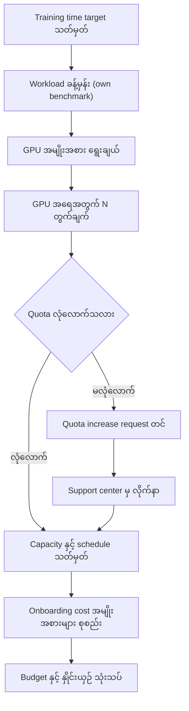
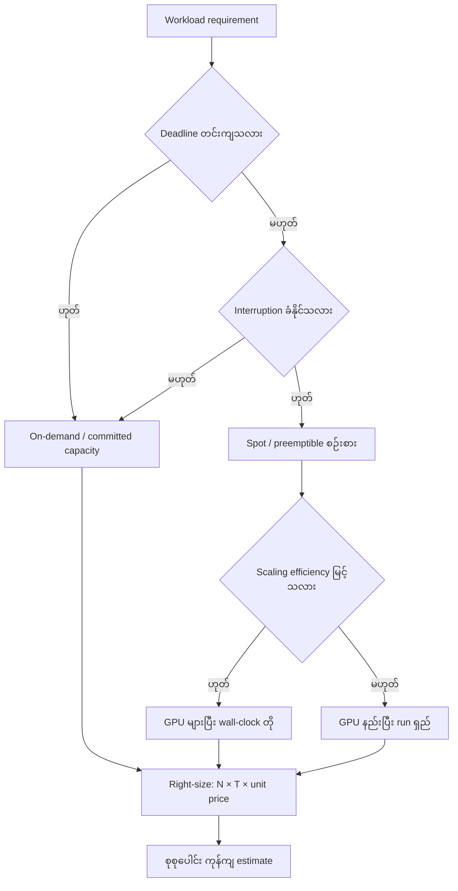
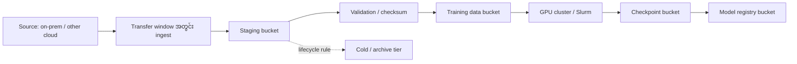

# Module 03 — Design Efficient & Cost-Aware Architectures

> Exam Domain 3 — "Design efficient & cost-aware architectures" (ခန့်မှန်းချေ ~25%)။
> ဤ module ပြီးလျှင် workload, team, budget, timeline ကို သုံးသပ်ပြီး architecture တစ်ခုနှင့် ၎င်း၏ cost estimate ကို
> တစ်ပြိုင်နက် တည်ဆောက်တတ်ရမည်။

## ဤ chapter က ဖြေရှင်းပေးမည့် ပြဿနာ

AI solution တစ်ခုရဲ့ architecture ဟာ နည်းပညာအရ မှန်ကန်ရုံနဲ့ မလုံလောက်ပါဘူး။ GPU instance တွေ၊
storage တွေ၊ network traffic တွေဟာ လျင်မြန်စွာ ကုန်ကျစရိတ် စုပုံလာနိုင်ပါတယ်။ လုပ်ငန်းခွင်မှာ
အဖြစ်များတဲ့ ပြဿနာတွေက —

- GPU capacity ကြိုတင် မခန့်မှန်းဘဲ စတင်လိုက်လို့ deadline လွဲခြင်း၊ သို့မဟုတ် quota မလုံလောက်ဘဲ
  run ကြီးစတင်ဖို့ ရက်သတ္တပတ်များစွာ စောင့်ရခြင်း
- budget ကျော်မှန်း မသိဘဲ လစဉ် ငွေကုန်ကြေးကြီးလာခြင်း၊ project ပြီးမှ idle resource တွေ ဆက်လက်
  ကုန်ကျနေခြင်း
- ဈေးအကြီးဆုံး GPU ကို အများဆုံး သုံးလိုက်ပေမယ့် run အချိန် မတိုတောင်းဘဲ စုစုပေါင်း ကုန်ကျစရိတ်
  ပိုများသွားခြင်း
- dataset ကို cloud တစ်ခုမှ တစ်ခုသို့ ပြောင်းရာတွင် transfer bandwidth နှင့် egress cost ကို
  မစဉ်းစားမိဘဲ ingestion pipeline ပျက်သွားခြင်း

Solution architect တစ်ယောက်ဟာ ဤအချက်တွေကို design အဆင့်မှာတည်းက ဖြေရှင်းရပါမယ်။
ဤ module မှာ capacity planning, quota, reuse & automation, FinOps practice,
cost-vs-performance tradeoff, right-sizing နှင့် data-ingestion design တို့ကို လေ့လာပါမည်။

---

## 3.1 Capacity, Quotas နှင့် Onboarding Cost Planning

### ပြဿနာ

"2 ပတ်အတွင်း model ကို train ပြီးရမယ်" ဆိုတဲ့ requirement တစ်ခု ရလာပြီဆိုပါစို့။ ဘယ်နှစ်ကျော့ GPU
လိုမလဲ? quota က လုံလောက်ရဲ့လား? မလုံလောက်ရင် ကြိုတင် request တင်ထားဖို့ အချိန် ဘယ်လောက်ယူမလဲ?
ဤမေးခွန်းတွေကို မဖြေရှင်းဘဲ စတင်ခြင်းသည် capacity ပြတ်တောက်ခြင်း (capacity shortfall) နှင့်
onboarding cost မှန်းဆမှားခြင်းဆီ ဦးတည်စေပါတယ်။

### Capacity planning ဘယ်လို လုပ်ရမလဲ

GPU demand ကို training time target ကနေ ပြန်လည် ခန့်မှန်းနိုင်ပါတယ်။ အခြေခံ ဆက်စပ်မှုက —

```
GPU-hours (စုစုပေါင်း) = လိုအပ်သော စုစုပေါင်း compute ပမာဏ ÷ (GPU တစ်လုံးချင်းစီ၏ throughput × utilization)

GPU အရေအတွက် (N) = GPU-hours ÷ (ရရှိနိုင်သော wall-clock ရက်အရေအတွက် × ၂၄)
```

အမှန်တကယ် design လုပ်ရာတွင် အောက်ပါ အဆင့်တွေ ပါဝင်ပါတယ် —

1. **Target သတ်မှတ်ခြင်း** — training run ပြီးရမည့် deadline (wall-clock time) ကို ရှင်းလင်းစွာ သတ်မှတ်ပါ။
2. **Workload ခန့်မှန်းခြင်း** — model size, dataset size, epoch အရေအတွက် စသည်တို့ကနေ
   per-GPU throughput ကို ကိုယ်ပိုင် benchmark သို့မဟုတ် ယခင် run မှတ်တမ်းများမှ ရယူပါ။
   (ကိန်းဂဏန်း အတိအကျ မသိပါက ခန့်မှန်းချက်ဟု ရှင်းလင်းစွာ မှတ်သားပြီး run အစောပိုင်း ဒေတာဖြင့်
   ပြန်ညှိပါ။ မဖန်တီးထားသော benchmark ကိန်းဂဏန်းများကို မသုံးပါနှင့်။)
3. **GPU အမျိုးအစား ရွေးချယ်ခြင်း** — GPU memory (model နှင့် batch size ဆံ့/မဆံ့)၊
   interconnect (multi-GPU scaling အတွက်)၊ per-hour ကုန်ကျစရိတ် တို့ကို ချိန်ဆပါ။
4. **GPU အရေအတွက် တွက်ချက်ခြင်း** — အပေါ်ပါ ပုံသေနည်းဖြင့် N ကို ရှာပါ။ ထို့နောက် scaling efficiency
   (N တိုးလျှင် throughput ဘယ်လောက် လိုက်လာသလဲ) ကို ထည့်သွင်း ပြန်ညှိပါ။
5. **Quota စစ်ဆေးခြင်း** — လိုအပ်မည့် resource ပမာဏသည် လက်ရှိ quota အောက် ရှိ/မရှိ စစ်ပါ။
6. **Onboarding cost အမျိုးအစားများ စုစည်းခြင်း** — compute အပြင် အောက်ပါ အမျိုးအစားများလည်း
   ပါဝင်ပါတယ် (စျေးနှုန်း အတိအကျ မဟုတ်ဘဲ ကုန်ကျစရိတ် အမျိုးအစားအဖြစ်သာ စဉ်းစားပါ) —
   - **Compute** — GPU instance, node group အချိန်ဖြင့် ကုန်ကျခြင်း
   - **Storage** — training dataset, checkpoint, artifact များအတွက် Object Storage နှင့် disk
   - **Network** — data ingress/egress ပမာဏ (ingress များသော်လည်း egress ကို အထူး သတိပြုပါ)
   - **Managed services** — Managed Service for PostgreSQL®, MLflow စသည် (လိုအပ်မှသာ)
   - **Operational effort** — team ရဲ့ setup, monitoring, teardown အချိန် (ဤအချက်ကို အောက်ပါ
     3.2 တွင် automation ဖြင့် လျှော့ချပုံ လေ့လာပါမည်)

### Quotas ကို design အဆင့်မှာ ဘာကြောင့် ထည့်စဉ်းစားရမလဲ

Nebius AI Cloud မှာ _quota_ များက သင် မည်မျှ resource သုံးနိုင်သလဲ သတ်မှတ်ပေးပါတယ်။
[docs.nebius.com/overview/quotas](https://docs.nebius.com/overview/quotas) အရ အောက်ပါအတိုင်း ဖြစ်ပါတယ် —

- sign up လုပ်ချိန်တွင် quota များကို default တန်ဖိုးများဖြင့် သတ်မှတ်ပေးပါတယ်။
- quota များသည် **region တစ်ခုချင်းစီအလိုက်** သီးခြားဖြစ်ပြီး **project တစ်ခုချင်းစီအတွက်လည်း
  ကွဲပြားစွာ သတ်မှတ်နိုင်**ပါတယ်။
- quota ကြည့်ရန် — web console တွင် **Administration → Limits → Quotas** သို့ သွားပါ။
- quota ပြောင်းလဲရန် `admin` role ပါသော group ထဲ ပါဝင်ရန် လိုအပ်ပြီး **Change quota** ဖြင့်
  request တင်နိုင်ပါတယ်။ request များကို support center မှ လိုက်နာကြည့်ရှုနိုင်ပါတယ်။
- quota ကို **တိုးရန်** သာမက **လျှော့ချရန်** လည်း request တင်နိုင်ပါတယ် — အသုံးပြုမှုနှင့်
  ကုန်ကျစရိတ်ကို ကန့်သတ်ချင်ပါက quota လျှော့ချခြင်းက governance tool တစ်ခု ဖြစ်ပါတယ်။
- သတိပြုရန် — usage သည် သတ်မှတ်ထားသော limit အောက်တွင် ကြာရှည်စွာ နည်းပါးနေပါက
  Nebius AI Cloud က quota ကို **အလိုအလျောက် လျှော့ချ**နိုင်ပါတယ်။ email ကြိုတင်အသိပေးချက်
  ပို့ပြီး ပုံမှန်အားဖြင့် ၂ ရက်ခန့် grace period ပေးပါတယ်။ ထိုကာလအတွင်း usage တက်လာပါက
  လျှော့ချမှု ပယ်ဖျက်ပါတယ်။ running workloads ကို ထိခိုက်ခြင်း မရှိဘဲ default တန်ဖိုးအောက်
  လျှော့ချခြင်းလည်း မရှိပါ။

design ရှုထောင့်မှ ဆိုရလျှင် quota request သည် အဆင့်တစ်ခု ဖြစ်ပါတယ် — run စတင်မည့် ရက်မတိုင်မီ
လိုအပ်သော GPU အရေအတွက်အတွက် quota ကြိုတင် request တင်ခြင်းက timeline ကို ကာကွယ်ပေးပါတယ်။
quota မလုံလောက်ပါက design ကို ပြန်ညှိရပါမည် — ရက်စွဲ ရွှေ့ခြင်း၊ run ကို အဆင့်ခွဲခြင်း၊
သို့မဟုတ် GPU အမျိုးအစား ပြောင်းခြင်း စသည်။



**Figure 1 — Capacity နှင့် quota planning အဆင့်များ**

ပုံရှင်းလင်းချက် — ဘယ်ဘက်အစမှ training time target ကို စတင်ပြီး workload ခန့်မှန်းချက်၊ GPU အမျိုးအစား
ရွေးချယ်မှု၊ GPU အရေအတွက် တွက်ချက်မှုဆီ ဆင်းသွားပါတယ်။ အလယ်ရှိ ဆုံးဖြတ်ချက်အဆင့် (diamond) က
quota လုံ/မလုံကို စစ်ဆေးပါတယ် — မလုံလောက်ပါက quota increase request တင်ပြီး support center မှ
ခြေရာခံကာ ပြန်လည် ဆက်လက်ပါတယ်။ နောက်ဆုံးတွင် onboarding cost အမျိုးအစားများ စုစည်းပြီး budget နှင့်
နှိုင်းယှဉ် သုံးသပ်ခြင်းဖြင့် အဆုံးသတ်ပါတယ်။

---

## 3.2 Reuse နှင့် Automation — Operational Effort လျှော့ချခြင်း

### ပြဿနာ

project တိုင်းကို console ကနေ လက်ဖြင့် တည်ဆောက်ပါက အမှားဖြစ်နိုင်ခြေ များပြီး ပြန်လည် တည်ဆောက်ရန်
အချိန်ကုန်ပါတယ်။ environment အသစ် တစ်ခုအတွက် ရက်များစွာ ကုန်ခြင်း၊ လူတစ်ဦးတည်းသာ
configuration ကို နားလည်ခြင်းတို့က operational effort ကို မြင့်တက်စေပါတယ်။

### Terraform နှင့် IaC (Infrastructure as Code)

Nebius AI Cloud အတွက် **Terraform provider** ရှိပါတယ် — declarative နည်းလမ်းဖြင့်
infrastructure ကို code အဖြစ် စီမံခန့်ခွဲနိုင်ပါတယ်
([docs.nebius.com/terraform-provider](https://docs.nebius.com/terraform-provider))။

- **Installation & authentication** — provider ကို install/init လုပ်ပြီး **service account** သို့မဟုတ်
  **user account** ဖြင့် authenticate လုပ်နိုင်ပါတယ်။ automation pipeline အတွက် service account က
  လူတစ်ဦးချင်းစီအပေါ် မှီခိုမှုကို လျှော့ချပေးပါတယ်။
- **Reference** — provider ရဲ့ resource နှင့် data source များကို reference တွင် ကြည့်ရှုနိုင်ပါတယ်။
- **Sensitive values** — secret များကို state file တွင် မသိမ်းဆည်းဘဲ စီမံရန် provider က
  **write-only arguments**, **ephemeral variables and resources** များကို ပံ့ပိုးပါတယ်။

### Reuse ပုံစံများ

| နည်းလမ်း | ဘယ်လို အလုပ်လုပ်သလဲ | အသုံးပြုသင့်သော အခြေအနေ | ကန့်သတ်ချက် |
|---|---|---|---|
| Terraform modules | VPC, node group, bucket စသည်ကို module အဖြစ် ထုတ်ပြီး project တိုင်းတွင် ပြန်သုံး | environment အမျိုးမျိုး တည်ဆောက်ရသောအခါ | module version စီမံခန့်ခွဲမှု လိုအပ် |
| Templates / stacks | စံချိန်ကျ environment ပုံစံ (training env, inference env) ကြိုမျိုးသတ်မှတ် | team အသစ်/project အသစ် onboarding မကြာခဏ ဖြစ်သောအခါ | template နှင့် မကိုက်သော အထူးလိုအပ်ချက်အတွက် ပြန်ညှိရ |
| Self-service environments | developer များကိုယ်တိုင် standard environment ထုတ်ယူနိုင်အောင် ပြင်ဆင် | team ကြီး၊ request queue ကြောင့် နှောင့်နှေးမှု ရှိသောအခါ | guardrail (quota, budget, policy) မပါက ကုန်ကျစရိတ် ထိန်းချုပ်ရ ခက် |
| CI/CD pipeline | plan/apply ကို review ဖြင့် ဖြတ်သန်းစေခြင်း | ပြောင်းလဲမှု မကြာခဏ ရှိသောအခါ | pipeline တည်ဆောက်/ထိန်းသိမ်းမှု ကုန်ကျ |

**လက်တွေ့ ဥပမာ (illustrative)** — Terraform configuration တစ်ခုတွင် resource တစ်ခု ကြေညာပုံ —

```hcl
# ဤသည် နမူနာ ပုံစံသက်သက် ဖြစ်ပြီး resource အမျိုးအစား အမည်များကို
# provider reference (docs.nebius.com/terraform-provider/reference) တွင်
# အမြဲတမ်း အတည်ပြုပါ။
resource "nebius_compute_instance" "trainer" {
  name = "trainer-node-01"
  # လိုအပ်သော argument များကို provider reference အတိုင်း ဖြည့်ပါ
}
```

### Reuse/automation ရဲ့ ကန့်သတ်ချက်များ

- module/template များကို မွမ်းမံရန် owner တစ်ဦး လိုအပ်ပါတယ် — မပြုလုပ်ပါက "အဟောင်းကို ပြန်သုံးမိ"
  ခြင်းသည်လည်း risk တစ်ခု ဖြစ်လာပါတယ်။
- state file ကို လုံခြုံစွာ သိမ်းဆည်းခြင်းနှင့် secret များကို write-only/ephemeral နည်းလမ်းများဖြင့်
  ကိုင်တွယ်ခြင်းကို team စံနှုန်းအဖြစ် သတ်မှတ်ပါ။
- automation သည် ကုန်ကျစရိတ်ကို အလိုအလျောက် မလျှော့ချပါ — ထိန်းချုပ်မှု (budget, quota,
  decommission policy) နှင့် တွဲမှသာ ထိရောက်ပါတယ်။

---

## 3.3 FinOps Practice — Governance, Cost Monitoring, Decommissioning

FinOps ဆိုသည်မှာ engineering, finance, business ကို ချိတ်ဆက်ပြီး cloud ကုန်ကျစရိတ်ကို
တာဝန်သိစွာ စီမံခန့်ခွဲခြင်း ဖြစ်ပါတယ်။ အဓိက အဆင့်သုံးခု — governance, cost monitoring,
decommissioning — ကို Nebius AI Cloud ရဲ့ tool များဖြင့် ချိတ်ဆက်ကြည့်ပါမည်။

### 3.3.1 Governance — budget, quota, policy

**Budget** ဆိုသည်မှာ pay-as-you-go သုံးစွဲမှုကို သတ်မှတ်ထားသော threshold တစ်ခုနှင့်
ပုံမှန်ကာလ (recurring period) တစ်ခုအတွင်း ခြေရာခံပြီး ကျော်လွန်လျှင် email alert ပို့ပေးသော
စီမံခန့်ခွဲမှု tool ဖြစ်ပါတယ်
([docs.nebius.com/signup-billing/budgets](https://docs.nebius.com/signup-billing/budgets))။
အရေးကြီးသော အပြုအမူများ —

- budget သည် usage ကို **ရပ်တန့်ခြင်း/ကန့်သတ်ခြင်း မလုပ်ပါ** — alert သက်သက် ဖြစ်ပါတယ်။
  usage ကို ကန့်သတ်ချင်ပါက **quota decrease request** ကို သုံးပါ။
- budget usage data ကို နာရီအနည်းငယ်တစ်ကြိမ် အသစ်ပြင်ဆင်သောကြောင့် alert သည်
  threshold ကျော်ပြီးမှ ရောက်လာနိုင်ပါတယ် — တုံ့ပြန်ရန် အချိန်ရစေရန် threshold ကို
  နိမ့်နိမ့်ထားပါ (ဥပမာ — 50% တစ်ခုနှင့် 100% တစ်ခု နှစ်ခု ထားခြင်း)။
- period များ — **Daily, Monthly, Quarterly, Yearly**။ ကာလတစ်ခုချင်းစီသည် 00:00 UTC တွင်
  စတင်ပြီး calendar နှင့် ချိန်ကိုက်ပါတယ် (monthly က လစဦးပိုင်းတွင် reset ဖြစ်ပါတယ်)။
- scope — **All usage** (account တစ်ခုလုံး) သို့မဟုတ် **Conditions** (Region, Project, Service,
  Product) ဖြင့် ကန့်သတ်နိုင်ပါတယ်။ condition များစွာ ပေါင်းပါက အားလုံးနှင့် ကိုက်ညီသော
  usage သာ ရေတွက်ပါတယ်။
- alert threshold များကို percentage သို့မဟုတ် absolute value ဖြင့် သတ်မှတ်နိုင်ပြီး
  **forecasted spending အပေါ် မဟုတ်ဘဲ actual recorded spending** ကိုသာ အခြေခံပါတယ်။
- recipient များအတွက် **tenant contact** (shared mailbox — billing notification အတွက်
  အကြံပြု) နှင့် **personal contact** ကို ရွေးချယ်နိုင်ပါတယ်။ recipient မထားပါက budget က
  usage ဆက်ခြေရာခံပေမယ့် alert မပို့ပါ။
- budget ပမာဏနှင့် ခြေရာခံသော သုံးစွဲမှုတွင် **VAT မပါဝင်**ပါ။

အကြံပြုလေ့ရှိသော scope ပေါင်းစပ်မှုများ —

- account တစ်ခုလုံးအတွက် monthly budget တစ်ခု (All usage) — ဘက်စုံ overspending ဖမ်းရန်
- team/project တစ်ခုချင်းစီအတွက် Project condition ပါသော budget — ဘယ် team က ကျော်သလဲ သိရန်
- Product condition (ဥပမာ — GPU ကဲ့သို့ ဈေးကြီး product) — အကုန်အကျဆုံး အစိတ်အပိုင်းကို
  သီးခြား စောင့်ကြည့်ရန် (Project + Product ပေါင်းပါက team တစ်ခုရဲ့ GPU သုံးစွဲမှုကို ခြေရာခံနိုင်)

quota ကိုလည်း governance တစ်ခုအဖြစ် သုံးနိုင်ပါတယ် — project တစ်ခုချင်းစီအတွက် quota သီးခြား
သတ်မှတ်ခြင်းဖြင့် team တစ်ခု အကုန်အကျ လွန်ကဲစွာ မသုံးနိုင်အောင် ကန့်သတ်နိုင်ပါတယ်။

### 3.3.2 Cost Monitoring — usage ကြည့်ခြင်းနှင့် alert

- **Billing → Usage** — လက်ရှိ သုံးစွဲမှု အသေးစိတ်ကို web console တွင် ကြည့်ရှုနိုင်ပါတယ်။
  budget alert ရလျှင် budget scope အတိုင်း filter လုပ်ပြီး ဘယ် project/service/resource က
  ကုန်ကျစရိတ် ဖြစ်စေသလဲ ရှာဖွေပါ။
- **Usage CSV export** — billing period တစ်ခုအတွက် **နာရီအလိုက် usage data** ကို
  CSV အဖြစ် export လုပ်၍ ကိုယ်ပိုင် dashboard/report အတွက် ခွဲခြမ်းနိုင်ပါတယ်။
- **Usage and cost breakdown (PDF)** — billing period တစ်ခုအတွက် product များ၊ ပမာဏများ၊
  ကုန်ကျစရိတ်များ၊ VAT နှင့် စုစုပေါင်းကို အနှစ်ချုပ် ဖော်ပြသော PDF ဖြစ်ပါတယ်။
  invoice နှင့်အတူ ပို့ပေးပြီး **Billing → Payments → Transactions** မှ
  "Download cost breakdown" ဖြင့် ပြန်ယူနိုင်ပါတယ်
  ([docs.nebius.com/signup-billing/payments/cost-breakdown](https://docs.nebius.com/signup-billing/payments/cost-breakdown))။
  breakdown သည် ဖန်တီးချိန် ဒေတာကို ရောင်ပြန်ပြသခြင်း ဖြစ်သောကြောင့် နောက်ပိုင်း adjustment
  များကို console တွင်သာ တွေ့ရပါမည်။
- **Budget alert များ** — အပေါ်တွင် ဖော်ပြပြီးပါပြီ။ ဒေတာ update ဖြစ်မှု နှေးကွေးနိုင်သောကြောင့်
  threshold ကို ကြိုတင် သတ်မှတ်ထားပါ။

> မှတ်ချက် — Monitoring နှင့် Logging service များကို လက်ရှိတွင် preview အဆင့်ဖြင့်
> အခမဲ့ ပေးထားကြောင်း PAYG စာမျက်နှာတွင် ဖော်ပြထားပါတယ် — service အဆင့်နှင့်
> ကုန်ကျမှု အခြေအနေသည် အချိန်နှင့်အမျှ ပြောင်းလဲနိုင်သောကြောင့် စီမံကိန်း မချမီ
> တရားဝင် documentation တွင် ထပ်မံ အတည်ပြုပါ။

### 3.3.3 Decommissioning — idle resource နှင့် project ပြီးဆုံးမှု

PAYG model အောက်တွင် resource အသုံးပြုသလောက်သာ ကုန်ကျသော်လည်း
"မသုံးတော့သော resource ကို မဖျက်မိ" ခြင်းက အဖြစ်များဆုံး ငွေကုန်ခြင်း ဖြစ်ပါတယ်
([PAYG](https://docs.nebius.com/signup-billing/billing-models/payg) စာမျက်နှာ အရ) —

- **VM ရပ်ထားပါက** computing resources အတွက် မကုန်ကျတော့သော်လည်း **storage volume များအတွက်
  ဆက်လက် ကုန်ကျနေပါသေးတယ်** — မလိုတော့ပါက volume များကို ဖျက်ပါ။
- resource တစ်ခုချင်းစီအတွက် "ကုန်ကျမှု ရပ်စေသော" လုပ်ဆောင်ချက် ကွဲပြားပါတယ် —
  Object Storage အတွက် bucket ဖျက်ခြင်း၊ PostgreSQL အတွက် cluster ဖျက်ခြင်း၊
  Serverless AI အတွက် endpoint/job ဖျက်ခြင်း၊ MLflow အတွက် cluster ဖျက်ခြင်း ဖြစ်ပါတယ်။

design တွင် decommissioning ကို policy အဖြစ် ကြိုတင် ရေးဆွဲထားပါ —

- **Idle resource policy** — ဥပမာ — "GPU utilization သတ်မှတ်ချက်အောက် ရက်ပေါင်းများစွာ
  ကျဆင်းနေပါက node များကို ပြန်လည် သုံးသပ်/ဖျက်သိမ်း"၊ "snapshot ဟောင်းများကို
  သတ်မှတ်ကာလအလိုက် သန့်ရှင်းရေး"။
- **End-of-project teardown** — project တစ်ခု ပြီးဆုံးပါက Terraform ဖြင့် တည်ဆောက်ထားပါက
  environment တစ်ခုလုံးကို code ကနေ ဖျက်သိမ်းနိုင်ပါတယ် — artifact များ (model, checkpoint
  နှင့် လိုအပ်သော dataset) ကိုသာ ခွဲခြား သိမ်းဆည်းပြီး ကျန် resource များကို ဖျက်ပါ။
- **Ownership** — ဘယ် resource ကို ဘယ်သူ ဖျက်မလဲ ဆိုတာကို project handover plan တွင်
  သတ်မှတ်ထားပါ။

---

## 3.4 Cost vs Performance — Tradeoff များ

### ပြဿနာ

"performance အကောင်းဆုံး" ဆိုသည်မှာ "ကုန်ကျစရိတ် အသင့်တင့်ဆုံး" မဟုတ်ပါ။ architect သည်
cost က performance ကို ကျော်လွန်နိုင်သော အခြေအနေများကို ရှင်းလင်းစွာ ချပြတတ်ရပါမယ်။

### Spot / preemptible နှင့် on-demand

ဤသည်ကို **ယေဘုယျ cloud concept** အဖြစ် စဉ်းစားနိုင်ပြီး Nebius တွင်လည်း preemptible VM
capacity အတွက် **spot price** များ ရှိပြီး ၎င်းတို့သည် အချိန်နှင့်အမျှ ပြောင်းလဲနိုင်ကြောင်း၊
spot prices ကို web console တွင် ကြည့်ရှုနိုင်ပြီး **pricing policies** များ ဖန်တီးနိုင်ကြောင်း
PAYG စာမျက်နှာတွင် ဖော်ပြထားပါတယ်
([Spot pricing and pricing policies](https://docs.nebius.com/signup-billing/pricing-policy))။
(အသေးစိတ် spot စျေးနှုန်းနှင့် interruption အပြုအမူကို ဤ module တွင် အတည်မပြုရသေးပါ —
မှတ်သားချက်တွင် ကြည့်ပါ။)

| အချက် | On-demand / standard capacity | Spot / preemptible capacity |
|---|---|---|
| ရရှိနိုင်မှု | ပုံမှန် အာမခံချက် ပိုမြင့် | capacity ပြတ်လျှင် ရပ်တန့်/ပြန်သိမ်းခံရနိုင် |
| ကုန်ကျစရိတ် | ပုံမှန် နှုန်းထား | ယေဘုယျအားဖြင့် ပိုနည်း (စျေးပြောင်းလဲနိုင်) |
| သင့်လျော်သော workload | deadline တင်းကျ; 24/7 service; ပထမဆုံး run | checkpoint ရှိ; ရပ်တန့်ခံနိုင်; experimental jobs |
| design လိုအပ်ချက် | ရိုးရှင်း | checkpoint/resume, job queue ပြန်လည် စတင်နိုင်မှု |

**စဉ်းစားပုံ** — deadline တင်းကျသော production training ကို spot တွင်သာ မှီခိုပါက interruption
ကြောင့် deadline လွဲပြီး စုစုပေါင်း ကုန်ကျစရိတ် (လူအချိန် + ပြန်လည် run) ပိုများသွားနိုင်ပါတယ်။
ထို့ကြောင့် mixed ပုံစံ — critical path အတွက် on-demand၊ ကျန်အလုပ်များအတွက် spot — ကို
မကြာခဏ ရွေးချယ်ကြပါတယ်။

### Precision vs throughput

mixed precision (fp16/bf16 စသည်) သုံးခြင်းက memory နှင့် throughput ကို ကူညီနိုင်သော်လည်း
numerical stability သို့မဟုတ် quality ကို သက်ရောက်နိုင်ပါတယ်။ မည်သည့် precision က
လုပ်ငန်းအတွက် လက်ခံနိုင်သလဲဆိုတာကို benchmark နှင့် အတည်ပြုပြီးမှ ရွေးချယ်ပါ —
"ဈေးအသက်သာဆုံး" ကို မရွေးဘဲ "လိုအပ်ချက် ဖြည့်ဆည်းနိုင်သော အနိမ့်ဆုံး ကုန်ကျ" ကို ရွေးပါ။

### Right-sizing GPU count vs training time — GPU ပိုသုံးခြင်းက ကုန်ကျ လျော့ကျစေနိုင်ခြင်း

ကောင်းကျိုးလွဲမှားမှု — "GPU နည်းနည်း သုံးရင် ဈေးသက်သာမယ်" ဆိုတာ အမြဲ မမှန်ပါ။
စုစုပေါင်း ကုန်ကျစရိတ်သည် —

```
စုစုပေါင်း ကုန်ကျ = GPU အရေအတွက် (N) × run အချိန် (T) × unit price
GPU-hours = N × T = လိုအပ်သော အလုပ်ပမာဏ ÷ scaling efficiency (η)
```

- N တိုးလျှင် T လျော့ကျပါတယ် — ဒါပေမယ့် scaling efficiency (η) က ပုံမှန်အားဖြင့်
  N တိုးလျှင် အနည်းငယ် ကျတတ်ပါတယ် (communication overhead)။
- သို့သော် အချို့အခြေအနေများတွင် GPU များများ သုံးခြင်းက **GPU-hours ကို လျော့ကျ**စေနိုင်ပါတယ် —
  ဥပမာ — GPU အရေအတွက် တိုးလိုက်မှ သင့်တော်သော parallelism strategy (tensor/pipeline parallel)
  ထိရောက်စွာ အလုပ်လုပ်ခြင်း၊ batch ကြီးပြီး per-GPU throughput မြင့်တက်ခြင်း၊ သို့မဟုတ်
  wall-clock တိုတောင်းသွားပြီး ထပ်ခါတလဲ iteration ပြန်စရန် အချိန်/လူအင်အား ကုန်ကျမှု လျော့ကျခြင်း။
- ထို့အပြင် deadline တစ်ခု လွဲခြင်း၏ ကုန်ကျ (project နှောင့်နှေးမှု) ကို ထည့်သွင်းပါက
  အချိန် ပိုတိုသော run က စုစုပေါင်းအရ ပိုသက်သာနိုင်ပါတယ်။

**ဆိုလိုသည်မှာ** — GPU အရေအတွက်ကို run အချိန် target နှင့် scaling efficiency အပေါ် အခြေခံပြီး
ရွေးချယ်ပါ။ "GPU နည်းရင် ဈေးသက်သာ" မဟုတ်ဘဲ "GPU-hours နည်းရင် ဈေးသက်သာ" ဖြစ်ပါတယ်။
(ကိန်းဂဏန်း အတိအကျ များကို ကိုယ်ပိုင် workload ၏ benchmark ဖြင့်သာ အတည်ပြုပါ။)



**Figure 2 — Cost-aware capacity ဆုံးဖြတ်ချက် စီးဆင်းပုံ (cost-decision flowchart)**

ပုံရှင်းလင်းချက် — workload requirement မှ စတင်ပြီး ပထမ ဆုံးဖြတ်ချက်က deadline တင်းကျမှု ဖြစ်ပါတယ်။
တင်းကျပါက on-demand/committed capacity ဘက် ဦးတည်ပြီး မတင်းကျပါက interruption ခံနိုင်မှု ကို
မေးပါတယ်။ ခံနိုင်ပါက spot/preemptible ကို စဉ်းစားပြီး scaling efficiency ပေါ် မူတည်၍ GPU များပြီး
အချိန်တိုစေမလား၊ GPU နည်းပြီး အချိန်ရှည်ခံမလား ရွေးပါတယ်။ နောက်ဆုံးတွင် လမ်းကြောင်း
အားလုံးက N × T × unit price ဖြင့် စုစုပေါင်း ကုန်ကျ estimate ဆီ ရောက်ပါတယ်။

---

## 3.5 Right-sizing တွင် Cost Dimensions များ

compute အပြင် ကုန်ကျစရိတ်ကို သက်ရောက်စေသော dimension များကို design တွင် ထည့်သွင်းပါ။

### Storage class နှင့် access pattern

Object Storage တွင် **storage classes** များက data ၏ access pattern ပေါ် မူတည်၍
ကုန်ကျစရိတ်နှင့် အမြန်နှုန်းကို ထိန်းချုပ်ပေးပါတယ်
([docs.nebius.com/object-storage/storage-classes](https://docs.nebius.com/object-storage/storage-classes))။

| Storage class | ဘယ်လို အလုပ်လုပ်သလဲ | သင့်လျော်သော အသုံးပြုမှု |
|---|---|---|
| **Enhanced Throughput** (`ENHANCED_THROUGHPUT`) | upload/download အမြန်နှုန်း ကန့်သတ်ချက် မရှိ (throttle မပါ) — ဈေးပိုမြင့်သော်လည်း operations နှင့် data egress အခမဲ့ | bandwidth မြင့်၊ latency နိမ့် လိုအပ်သော training data စားသုံးမှု |
| **Intelligent** (`INTELLIGENT`) | ရှားပါးစွာ ဝင်ရောက်ကြည့်ရှုသော data ကို အလိုအလျောက် ကုန်ကျ သက်သာစေ — Warm/Cold tier နှစ်ခုပါ; ရက် ၃၀ အထိ မဝင်ကြည့်ပါက Cold သို့ အလိုအလျောက် ပြောင်း (စျေးနှုန်းသာ ကွဲ; performance မပြောင်း) | ကြိုတင် မခန့်မှန်းနိုင်သော access pattern ရှိ dataset ကြီးများ |
| **Standard** (`STANDARD`) | ယေဘုယျ သိုလှောင်မှု လိုအပ်ချက် (region အချို့တွင် default) | အထွေထွေ အသုံးပြုမှု |

- Intelligent နှင့် Standard အတွက် upload/download သည် region တစ်ခုလုံးအတွက် tenant လျှင်
  **20 GBps** အထိ ကန့်သတ်ထားပြီး lifecycle rule ဖြင့် class ပြောင်းချိန်တွင်လည်း
  ၎င်းကန့်သတ်ချက် သက်ရောက်ပါတယ်။
- **lifecycle rules** ဖြင့် object များကို class ကြား အလိုအလျောက် ပြောင်းပေးနိုင်ပါတယ် —
  ဥပမာ — checkpoint ဟောင်းများကို သတ်မှတ်ကာလအလိုက် Cold သို့ ပြောင်းခြင်း။
- region အချို့တွင် Intelligent/Standard မရရှိနိုင်ပါ (documentation အရ `uk-south1`, `uk-south2`,
  `eu-south1`, `eu-west2`, `us-north1`) — region ရွေးချယ်မှုနှင့် တွဲစဉ်းစားပါ။

**ဒီဇိုင်း ဥပမာ** — actively သုံးနေသော training dataset ကို Enhanced Throughput တွင် ထားခြင်းက
ingestion နှင့် training စားသုံးမှု အမြန်နှုန်းကို ကူညီပေးပြီး၊ ပြီးဆုံးသွားသော experiment artifacts
များကို Intelligent class တွင် ထားခြင်းက ကြာချိန် ကုန်ကျစရိတ်ကို လျှော့ချပေးပါတယ်။
တစ်ချိန်တည်းမှာပင် အသုံးပြုမှု ပုံစံနှင့် ကိုက်ညီမှု ရှိ/မရှိကို ပုံမှန် ပြန်လည် သုံးသပ်ပါ။

### Network egress နှင့် data movement

- data ကို region/organization အပြင်ဘက် ထုတ်ယူပါက (egress) ကုန်ကျစရိတ် သက်ရောက်နိုင်ပါတယ် —
  မည်မျှ ကြာခြားသလဲဆိုတာက traffic ပမာဏနှင့် ဦးတည်ရာပေါ် မူတည်ပါတယ် (အသေးစိတ်
  နှုန်းထားများကို ဤ module တွင် မဖော်ပြပါ — pricing စာမျက်နှာတွင် အတည်ပြုပါ)။
- Enhanced Throughput class တွင် data egress အခမဲ့ ဖြစ်ကြောင်း storage-classes စာမျက်နှာတွင်
  ဖော်ပြထားသောကြောင့် heavy data-movement workload အတွက် class ရွေးချယ်မှုက egress
  ကုန်ကျကို ပြောင်းလဲစေနိုင်ပါတယ်။
- **Virtual Networks** service ကိုယ်တိုင်က PAYG စာမျက်နှာ အရ အခမဲ့ ဖြစ်ပါတယ် — ဒါပေမယ့်
  ၎င်းကို ဖြတ်သန်းသော traffic ၏ ကုန်ကျကို သီးခြား စဉ်းစားရပါမယ်။

### GPU right-sizing

- **GPU memory** — model, optimizer state, batch size ဆံ့/မဆံ့က GPU အမျိုးအစား အနိမ့်ဆုံး
  သတ်မှတ်ချက် ဖြစ်ပါတယ်။ memory မလုံလောက်ပါက ဈေးပိုကြီးသော GPU သို့ တက်ရခြင်းက
  right-sizing ရဲ့ ပထမ အဆင့် ဖြစ်ပါတယ်။
- **Utilization** — GPU ဈေးကြီးပေမယ့် data loading ကြောင့် စောင့်ဆိုင်းနေရပါက တကယ်
  ကုန်ကျနေတာ ဖြစ်ပါတယ် — pipeline, prefetch, storage class ရွေးချယ်မှုတွေက
  utilization ကို တိုးစေပြီး GPU-hours ကို လျှော့ချပေးပါတယ်။

---

## 3.6 Multi-Cloud Connectivity နှင့် Data-Ingestion Pipelines

### ပြဿနာ

dataset က ကိုယ်ပိုင် data center သို့မဟုတ် အခြား cloud တစ်ခုတွင် ရှိနေပါက ဒေတာကို
Nebius AI Cloud သို့ မည်သို့ ပို့မလဲ — transfer bandwidth ဘယ်လောက် လိုမလဲ၊ ကုန်ကျစရိတ်
ဘယ်လောက် ဖြစ်မလဲ၊ training မစမီ ဒေတာ ရောက်/မရောက် ဘယ်လို အာမခံမလဲ။
ဤမေးခွန်းများကို design အဆင့်မှာ ဖြေရှင်းရပါမယ်။

### Network design အခြေခံ (Nebius Virtual Networks)

Nebius AI Cloud ရဲ့ **Virtual Networks** service က resource များအတွက် networking infrastructure
ပေးပါတယ် ([docs.nebius.com/vpc/overview](https://docs.nebius.com/vpc/overview))။

- **network** — resource များကြား IP connectivity ပေးပြီး အပြင်ဘက်မှ ခွဲခြား (isolate) ပေးပါတယ်။
- **subnet** — network အတွင်း IP address range ပါသော segment။ VM, Kubernetes cluster စသည်က
  subnet လိုအပ်ပါတယ်။ CIDR block ကို ရှင်းလင်းစွာ သတ်မှတ်နိုင်ပါတယ်။
- **pool** — CIDR block များ ကြိုတင် သိမ်းဆည်းပေးခြင်း (network သို့ subnet အတွက်)။
- **allocation** — reserved IP address (public/private) — resource တစ်ခုကို တည်ငြိမ်သော
  address ပေးချင်ပါက သုံးပါ။
- **routing table** နှင့် **DNS zone** — custom route နှင့် အမည်ဖြေရှင်းမှု (name resolution)။
- project တစ်ခု ဖန်တီးပါက default resources (`default-network`, `default-subnet` စသည်)
  အလိုအလျောက် ပါဝင်ပါတယ်။ အထူး လိုအပ်ချက် ရှိပါက customized infrastructure ဖန်တီးနိုင်ပြီး
  documentation တွင် ဥပမာအဖြစ် **multi-region deployment** နှင့် **external infrastructure နှင့်
  connectivity တည်ဆောက်ခြင်း** ကို ဖော်ပြထားပါတယ်။ (လက်ရှိတွင် IPv4 သာ ပံ့ပိုးပါတယ်။)

### Data-ingestion pipeline design အဆင့်များ

1. **Source နှင့် ပမာဏ သတ်မှတ်ခြင်း** — dataset အရွယ်အစား၊ တည်နေရာ (on-prem/အခြား cloud)၊
   update ကြာချိန် (one-time / incremental)။
2. **Ingest bandwidth တွက်ချက်ခြင်း** — ရရှိနိုင်သော transfer bandwidth ပေါ် မူတည်၍
   ပြောင်းရွှေ့ချိန် = dataset size ÷ effective throughput ဖြင့် ခန့်မှန်းပါ။
   deadline နှင့် ကိုက်/မကိုက် စစ်ပါ။
3. **Staging storage** — ဒေတာကို တိုက်ရိုက် training bucket သို့ မပို့ဘဲ **staging bucket**
   တစ်ခုတွင် အရင် လက်ခံပါ။ validation/checksum ပြီးမှ ထုတ်လွှင့် (promote) ပါ —
   တစ်စိတ်တစ်ပိုင်း ပျက်နေသော data ဖြင့် training မစရန် ကာကွယ်ပေးပါတယ်။
4. **Transfer window** — bandwidth ကို အခြား workload များနှင့် ဝေမျှရပါက transfer ကို
   သတ်မှတ် အချိန်ပိုင်း (ဥပမာ — ညဘက်) တွင် ပြုလုပ်ခြင်းက training ကို မထိခိုက်စေပါ။
5. **Training နှင့် artifact စီမံခန့်ခွဲမှု** — training data bucket → GPU cluster/Slurm →
   checkpoint bucket → model registry — တစ်ဆင့်ချင်းစီ သီးခြား bucket များဖြင့် ခွဲထားခြင်းက
   lifecycle rule နှင့် access control ကို လွယ်ကူစေပါတယ်။
6. **ရေရှည် ကုန်ကျစရိတ် စီမံခန့်ခွဲမှု** — ပြီးဆုံးသွားသော raw/staging data ကို lifecycle rule
   ဖြင့် ဈေးသက်သာသော class/tier သို့ ပြောင်းခြင်း၊ မလိုတော့သော data ကို ဖျက်ခြင်း။



**Figure 3 — Multi-cloud data-ingestion pipeline architecture**

ပုံရှင်းလင်းချက် — ဘယ်ဘက်တွင် ပြင်ပ source (on-prem သို့မဟုတ် အခြား cloud) ရှိပြီး
သတ်မှတ်ထားသော transfer window အတွင်း staging bucket သို့ ရောက်ရှိပါတယ်။ validation/checksum
ဖြင့် စစ်ဆေးပြီးမှ training data bucket သို့ ရွှေ့ပါတယ်။ ထို့နောက် GPU cluster (သို့မဟုတ် Slurm
cluster) က စားသုံးပြီး checkpoint များကို သီးခြား bucket တွင် သိမ်း၊ model registry bucket သို့
ဖြန့်ဝေပါတယ်။ အောက်ဘက် ပြတ်ကျသော မျဉ်းက staging data ကို lifecycle rule ဖြင့်
Cold/archive tier သို့ အလိုအလျောက် ပြောင်းပေးပုံကို ဖော်ပြပါတယ်။

---

## အနှစ်ချုပ်

- capacity planning သည် deadline ကနေ GPU demand ကို ပြန်လည် တွက်ချက်ခြင်း ဖြစ်ပြီး
  quota request ကို design အဆင့်မှာတည်းက ထည့်သွင်းပါ။
- Terraform module/template/self-service environment များက operational effort ကို လျှော့ချပြီး
  guardrail (budget, quota, policy) နှင့် တွဲသုံးပါ။
- FinOps သည် governance (budget/quota), cost monitoring (Usage, CSV export, cost breakdown,
  alert) နှင့် decommissioning (idle policy, teardown) တို့ ပါဝင်ပါတယ်။
- "GPU နည်းရင် ဈေးသက်သာ" မဟုတ်ပါ — GPU-hours နည်းမှ ဈေးသက်သာပါတယ်။
- storage class, egress, utilization စသော cost dimension များကို right-sizing တွင် ထည့်သွင်းပါ။
- data-ingestion pipeline တွင် bandwidth, staging, transfer window ကို ကြိုတင် ဒီဇိုင်းဆွဲပါ။

---

## ကိုယ်တိုင် စစ်ဆေးရန် မေးခွန်းများ (Self-check)

**Q1. Nebius AI Cloud တွင် quota တစ်ခုကို မည်သည့်နေရာမှ ကြည့်ရှု ပြောင်းလဲနိုင်သလဲ —
နှင့် quota ကို လျှော့ချခြင်းက ဘာအတွက် အသုံးဝင်သလဲ?**

A1. web console တွင် **Administration → Limits → Quotas** မှ ကြည့်ရှုနိုင်ပြီး `admin` role ပါသော
group မှ **Change quota** ဖြင့် request တင်နိုင်ပါတယ် (request များကို support center တွင် လိုက်နာနိုင်)။
quota လျှော့ချခြင်းက usage နှင့် ကုန်ကျစရိတ်ကို hard limit ဖြင့် ကန့်သတ်လိုသောအခါ (budget က
ရပ်တန့်ပေးခြင်း မဟုတ်သောကြောင့်) အသုံးဝင်ပါတယ်။

**Q2. budget တစ်ခုက spending ကို ကန့်သတ်ပေးသလား? မပေးပါက မည်သည့် tool က
ကန့်သတ်ပေးသလဲ?**

A2. မပေးပါ — budget သည် threshold ကျော်ပါက email alert ပို့ရုံသာ ဖြစ်ပြီး usage ကို
မရပ်တန့်စေပါ (data ကလည်း နာရီအနည်းငယ်တစ်ကြိမ်မှ update ဖြစ်ပါတယ်)။ usage ကို
ကန့်သတ်လိုပါက **quota decrease request** ကို သုံးပါ။

**Q3. training run တစ်ခုအတွက် GPU အရေအတွက် ရွေးချယ်ရာတွင် မည်သည့် ပမာဏက
စုစုပေါင်း ကုန်ကျစရိတ်ကို အမှန်တကယ် သတ်မှတ်သလဲ? GPU အနည်းဆုံး သုံးခြင်းက အမြဲ ဈေးသက်သာသလား?**

A3. စုစုပေါင်း ကုန်ကျကို GPU-hours (N × T) က သတ်မှတ်ပါတယ်။ GPU အနည်းဆုံး သုံးခြင်းက
အမြဲ ဈေးသက်သာခြင်း မဟုတ်ပါ — scaling efficiency မြင့်ပြီး GPU ပိုသုံးလျှင် run အချိန် တိုပြီး
GPU-hours ကျနိုင်သလို deadline လွဲခြင်း ကုန်ကျကိုလည်း ရှောင်ရှားနိုင်ပါတယ်။

**Q4. VM တစ်လုံးကို stop လုပ်ထားပါက ကုန်ကျစရိတ် လုံးဝ သုည ဖြစ်သွားသလား?**

A4. မဖြစ်ပါ — computing resources အတွက် မကုန်ကျတော့သော်လည်း **storage volumes များအတွက်
ဆက်လက် ကုန်ကျ**နေပါသေးတယ်။ မလိုတော့ပါက volume များကို ဖျက်မှ ကုန်ကျမှု ရပ်ပါမည်။

**Q5. data-ingestion pipeline တစ်ခုတွင် staging bucket တစ်ခု ထားရှိခြင်းရဲ့ အကျိုးကျေးဇူးက
ဘာလဲ?**

A5. ပြင်ပမှ ပို့လိုက်သော data ကို တိုက်ရိုက် training bucket သို့ မဝင်စေဘဲ validation/checksum
အဆင့် ဖြတ်သန်းစေပါတယ် — ပျက်နေ/မပြည့်စုံသော data ဖြင့် training စခြင်းကို ကာကွယ်ပေးပြီး
raw data ကိုလည်း lifecycle rule ဖြင့် သီးခြား ကုန်ကျစရိတ် စီမံခန့်ခွဲနိုင်ပါတယ်။

---

## Technical review notes

- **အတည်ပြုပြီး** (docs.nebius.com) — quota လုပ်ဆောင်ပုံ (default, per-region, per-project,
  admin role, automatic quota reduction နှင့် grace period)၊ budget လုပ်ဆောင်ပုံ (period များ,
  scope conditions, thresholds, alerts on actual spending, VAT မပါဝင်မှု)၊ cost breakdown PDF နှင့်
  usage CSV export၊ Terraform provider (install, auth, sensitive values)၊ Object Storage
  storage classes (Enhanced Throughput/Intelligent/Standard, Warm-Cold tier, 20 GBps throttle,
  lifecycle rules)၊ VPC resource များနှင့် default resources၊ PAYG billing နှင့်
  "stop being charged" လုပ်ဆောင်ချက်များ (VM stop ပြီးလည်း volume ကုန်ကျနေခြင်း)။
- **Needs verification** — spot/preemptible VM ၏ interruption အသေးစိတ် အပြုအမူ၊ spot pricing
  နှုန်းထားများနှင့် pricing policy အသေးစိတ် (PAYG စာမျက်နှာတွင် တည်ရှိကြောင်းသာ အတည်ပြုပြီး
  မဖတ်ရသေး)၊ commitment discount model ၏ အသေးစိတ် စည်းကမ်းချက်များ၊ Monitoring/Logging
  အခမဲ့ preview အခြေအနေ (ပြောင်းလဲနိုင်)၊ egress နှုန်းထား အတိအကျများ၊ GPU instance
  per-hour နှုန်းထားများ — ဤ module တွင် စျေးနှုန်း ကိန်းဂဏန်း မဖော်ပြပါ။
- Terraform resource ဥပမာသည် **illustrative** ဖြစ်ပြီး resource အမျိုးအစား အမည်နှင့် argument
  များကို provider reference တွင် အမြဲ အတည်ပြုရန် လိုအပ်ပါတယ်။
