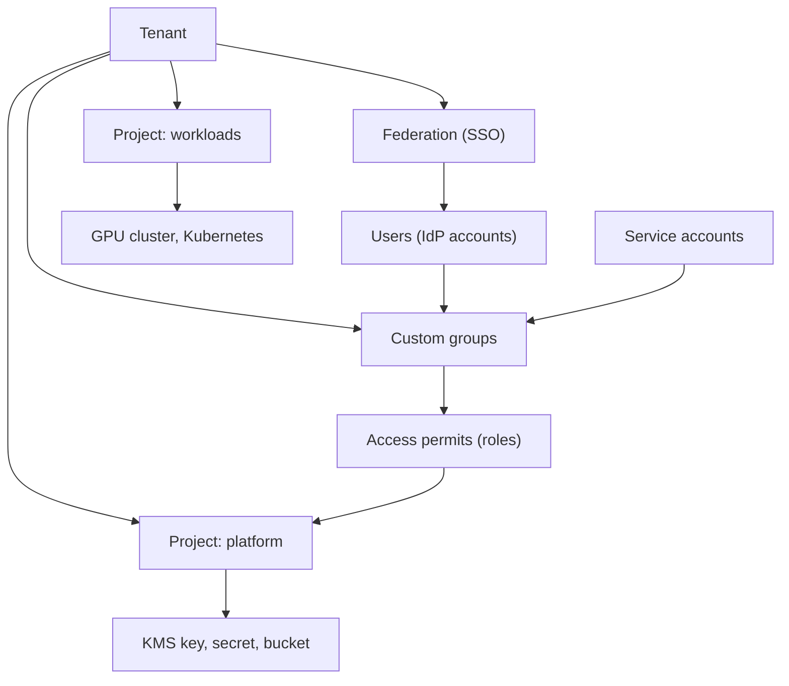
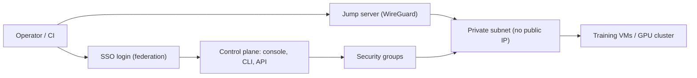
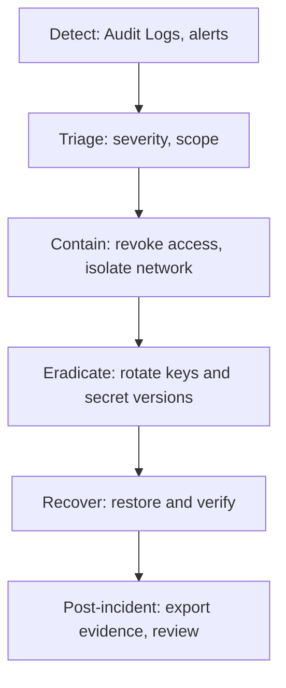

# Module 04 — Design Secure Architectures

> Exam Domain 4 "Design secure architectures" ≈ 25% ။ ဤ module သည် identity နှင့် access model design,
> private connectivity, secrets/audit/compliance posture, shared responsibility နှင့် tenant isolation,
> data classification, encryption နှင့် incident-response posture တို့ကို design ရှုထောင့်မှ ရှင်းပြသည်။
> Solutions architect ၏ အလုပ်မှာ ကိုယ်တိုင် configure လုပ်ရန်မဟုတ်ဘဲ design decision ချပြီး
> stakeholder များကို အကြံပေးရန် ဖြစ်သည် — ထို့ကြောင့် ဤနေရာတွင် "ဘာကြောင့် ထို design ကို
> ရွေးသလဲ" ဆိုသော reasoning ကို အဓိကထားသည်။

## 4.0 ဤ module က ဖြေရှင်းပေးသော ပြဿနာ

AI platform တစ်ခုတွင် GPU cluster များ၊ training data များ၊ model weights များ၊
API key နှင့် password များ စုစုပေါင်း တစ်နေရာတည်းတွင် ရှိနေတတ်သည်။
access design မှားလျှင် ရလဒ်မှာ data ပေါက်ကြားခြင်း၊ compute အလွဲသုံးစားဖြစ်ခြင်း (crypto mining
လို အသုံးပြုခံရခြင်း)၊ compliance ပျက်ခြင်းတို့ ဖြစ်သည်။ ထိုအရာများကို system ပြီးမှ patch
လုပ်၍ မရပါ — architecture ရေးဆွဲစဉ်ကတည်းက security boundary များကို ဆုံးဖြတ်ထားရမည်။

ဤ module သည် အောက်ပါ မေးခွန်း ၅ ခုကို design နည်းလမ်းဖြင့် ဖြေပေးသည်။

1. ဘယ်သူက ဘာကို လုပ်ခွင့်ရမလဲ (identity and access model)
2. operator နှင့် control plane ကို ဘယ်လို private ချိတ်ဆက်မလဲ
3. secret များကို ဘယ်မှာ သိမ်းမလဲ၊ ဘယ်လောက်ကြာအောင် audit trail ထားမလဲ
4. Nebius က ဘာကို တာဝန်ယူသလဲ၊ architect က ဘာကို တာဝန်ယူရမလဲ (shared responsibility)
5. data ကို ဘယ်လို အဆင့်ခွဲမလဲ၊ ဘယ်လို encrypt လုပ်မလဲ၊ incident ဖြစ်ရင် ဘယ်လို တုံ့ပြန်မလဲ

---

## 4.1 Identity and access model design

### ပြဿနာ

"လူတိုင်း admin" ဆိုသော ချဉ်းကပ်မှုသည် အဖွဲ့ငယ်တွင် အလုပ်ဖြစ်သလို ထင်ရသော်လည်း
ပထမဆုံး incident ဖြစ်သည်နှင့် ဘယ် credential က ပေါက်ကြားသွားသလဲ ရှာမရတော့ပါ။
လူ ၁၀ ယောက် တစ်ခုတည်းသော shared admin account ကို သုံးနေလျှင် accountability မရှိတော့ပါ။
ထို့ကြောင့် access model ကို resource များ မတည်ဆောက်မီ ရေးဆွဲရပါမည်။

### အခြေခံ concept — resource hierarchy နှင့် identity

Nebius AI Cloud တွင် resource hierarchy သည် အောက်ပါအတိုင်း ဖြစ်သည်
(https://docs.nebius.com/iam/overview အရ)။

- **Tenant** အောက်တွင် user များ၊ group များ၊ federation များ၊ audit event များ၊ quota များ
  နှင့် project များ ရှိသည်။
- **Project** အောက်တွင် virtual machine၊ GPU cluster၊ Object Storage bucket၊
  Managed Kubernetes cluster (node group များ အပါအဝင်)၊ Managed PostgreSQL cluster၊
  KMS key များ၊ SecretStash secret များ၊ service account များ၊ routing table များ၊
  security group များ ရှိသည်။
- Security group ၏ parent သည် project ဖြစ်ပြီး network တစ်ခုနှင့် ချိတ်ဆက်သည်။
  Security rule များက security group ၏ child resource များ ဖြစ်သည်။

Access control မှာ component သုံးခုပေါ်တွင် အလုပ်လုပ်သည်။

| Component | အဓိပ္ပာယ် | design ရှုထောင့် |
|---|---|---|
| **Identity** | user (federation မှ SSO ဖြင့် ဝင်ခြင်း) သို့မဟုတ် service account (automation) | လူအတွက် လူ့ account၊ script/CI အတွက် service account — တစ်ခါမှ မရောပါနှင့် |
| **Group** | identity များကို စုစည်းပေးသော unit | role ကို group အပေါ်တွင်သာ ချပေးသည် — group သည် authorization ၏ ဗဟိုချက် |
| **Role + access permit** | role က permission အစုကို သတ်မှတ်ပေးပြီး access permit က role ကို resource level အထိ ချပေးသည် | default role ကျယ်လွန်းလျှင် custom group ဖြင့် ကျဉ်းအောင် လုပ်ရမည် |

Nebius တွင် default group လေးခု ကြိုတင် ဖန်တီးပြီးသား ဖြစ်သည်
(https://docs.nebius.com/iam/authorization/groups/index အရ)။

- `auditors` — resource အချို့ကို data မပါဘဲ view လုပ်နိုင်သည်
- `viewers` — resource အများစုကို view လုပ်နိုင်ပြီး data ပါ ရယူနိုင်သည် (bucket မှ object download လုပ်ခြင်း စသည်)
- `editors` — resource အများစုကို view နှင့် manage လုပ်နိုင်သည်
- `admins` — resource အားလုံးကို view/manage နှင့် data access လုပ်နိုင်သည်

တစ်ခုချင်းစီသည် tenant-wide general role တစ်ခုနှင့် ချိတ်ဆက်ထားသည်။
Nebius ကိုယ်တိုင် သတိပေးထားသည်မှာ — default group များနှင့် general role များသည်
service အားလုံးတွင် ခွင့်ပြုချက် ကျယ်ပြန့်လွန်းသဖြင့် least privilege principle အတွက်
custom group များ ဖန်တီးပြီး permission အနည်းဆုံး role များကိုသာ ချပေးရန် ဖြစ်သည်။
Custom group ကို tenant level သို့မဟုတ် project level တွင် ဖန်တီးနိုင်ပြီး
access permit များက role ကို resource level အထိ သတ်မှတ်ပေးသည်။

Service role အချို့ (စစ်ဆေးပြီး အတည်ပြုထားသော ID များ) မှာ —

- `auditlogs.audit-event-viewer` / `auditlogs.audit-event-exporter` — Audit Logs ကြည့်ခြင်း / export ထုတ်ခြင်း
- `mysterybox.payload-viewer` — SecretStash secret payload ကြည့်ခွင့်
  (admin general role ၏ sub-role ဖြစ်သော်လည်း editor တွင် မပါဝင်ပါ)
- `applicationtunnel.agent` — Nebius Tunnels agent အတွက်
- `security-auditor` — security ရှုထောင့်မှ resource များကို view လုပ်ခွင့်
- `storage.uploader` — audit event export အတွက် destination bucket သို့ ရေးသားခွင့်

### Service account — automation အတွက် identity

လူကို user account ဖြင့် ကိုယ်စားပြုပြီး script၊ CI/CD pipeline၊ Terraform run များကို
service account ဖြင့် ကိုယ်စားပြုသည်။ Service account အသစ်များသည် group တွင် မပါမီ
resource တစ်ခုကိုမှ ဝင်ခွင့် မရှိပါ (default deny — ဤအချက်က ဒီဇိုင်းအတွက် အလွန်ကောင်းသည်)။
Authentication နည်းလမ်း သုံးမျိုး ရှိသည် (https://docs.nebius.com/iam/service-accounts/authentication အရ)။

| Method | ဘယ်မှာ သုံးမလဲ | သတိထားရန် |
|---|---|---|
| **Authorized key pair** | CLI နှင့် Terraform provider | private key ကို disk ပေါ်တွင် မထားပါနှင့် — SecretStash တွင် သိမ်းပါ |
| **Access key** | AWS-compatible API များ (Object Storage စသည်) | static credential ဖြစ်သောကြောင့် rotate လုပ်မှု policy ရှိရမည် |
| **Metadata authentication** | Compute VM ဖန်တီးရာတွင် service account သတ်မှတ်ထားပါက | key file မလို — VM ပေါ်တွင် အကောင်းဆုံး |

### Federation — enterprise SSO

Enterprise customer အတွက် user အသစ်တိုင်းကို cloud ဘက်တွင် ထပ်ဖန်တီးစရာ မလိုပါ။
Nebius federation သည် SAML SSO ဖြင့် identity provider နှင့် ချိတ်ဆက်ပြီး user များကို
tenant တစ်ခုတည်းအတွင်း အလုပ်လုပ်စေသည်။ ပံ့ပိုးသော IdP များမှာ Microsoft Entra ID၊
JumpCloud၊ Okta နှင့် Keycloak တို့ ဖြစ်သည် (https://docs.nebius.com/iam/federations/saml-sso)။
Design ရှုထောင့်မှ — IdP ဘက်တွင် role ကို group mapping ဖြင့် စီမံခြင်းသည်
joiner/mover/leaver ပြဿနာကို ဖြေရှင်းပေးသည် (IdP မှ user ထွက်သွားလျှင် cloud access ပါ
ပြတ်သွားသည်)။

### Figure 1 — Identity and access model ဖွဲ့စည်းပုံ



ပုံရှင်းလင်းချက် — Tenant က ဗဟိုချက်ဖြစ်ပြီး ၎င်းအောက်တွင် federation (SSO မှ ဝင်လာသော user
များ)၊ custom groups နှင့် project များ ရှိသည်။ User များနှင့် service account များ နှစ်မျိုးစလုံး
group အတွင်းသို့ ဝင်ရောက်သည် — group ကိုသာ access unit အဖြစ် သုံးထားခြင်း ဖြစ်သည်။
Access permit က role ကို ချပေးပြီး project/resource level အထိ ရောက်အောင် လုပ်သည်ကို
မြင်ရသည်။ လူတစ်ဦးချင်းကို resource တွင် တိုက်ရိုက်ချပေးခြင်း မပြထားပါ —
ထိုအချက်က group-based design ရဲ့ အဓိက point ဖြစ်သည်။

### လက်တွေ့ဒီဇိုင်း ဥပမာ — function အလိုက် group ခွဲခြင်း

| Group | ပေးသင့်သော role | ဘာကြောင့် |
|---|---|---|
| `platform-admins` | `admin` (tenant-level) | infra အပြောင်းအလဲ အားလုံး — လူနည်းနည်းသာ |
| `ml-engineers` | custom: compute နှင့် storage access သာ | GPU သုံးခွင့် လိုသည်၊ user management မလို |
| `data-scientists` | custom: bucket read + notebook VM သာ | data ဖတ်ခွင့်၊ infra ပြောင်းခွင့် မလို |
| `ci-deploy` (service account) | custom: သတ်မှတ်ထားသော project resource များသာ | pipeline တစ်ခုချင်းစီအတွက် identity သီးခြား |
| `security-team` | `security-auditor` + `auditlogs.audit-event-viewer` | view သာ — change ခွင့် မပေးပါနှင့် |

### သတိပေးချက်များ

- Default group (အထူးသဖြင့် `editors`) ကို အလွယ်တစ်ကူ အားလုံးကို မပေးပါနှင့် —
  editor သည် secret ဖန်တီးနိုင်သော်လည်း secret payload ကြည့်ခွင့် မရပါ
  (payload ကြည့်ရန် `mysterybox.payload-viewer` လိုသည်) — ဤ role split ကို design တွင် ထည့်တွက်ပါ။
- Service account တစ်ခုကို pipeline အားလုံးအတွက် မသုံးပါနှင့် — တစ်ခုပေါက်လျှင် အားလုံး ပါသွားမည်။
- Quota ပြောင်းခွင့်မှာ `admin` role group များတွင်သာ ရှိသည် (https://docs.nebius.com/overview/quotas) —
  capacity planning နှင့် access design ကို အတူတွဲ စဉ်းစားပါ။

---

## 4.2 Private connectivity for control-plane and operator access

### ပြဿနာ

Training VM တိုင်းကို public IP ပေးပြီး SSH port ဖွင့်ထားခြင်းသည် အမြန်ဆုံးနည်း ဖြစ်သော်လည်း
internet ပေါ်တွင် scanner များက ရှာတွေ့သည်နှင့် brute-force ခံရမည်။ Operator များ
control plane (console/CLI/API) ကို ဘယ်ကနေ ဝင်မလဲ၊ workload များကို ဘယ်လို
public exposure မပါဘဲ စီမံမလဲ ဆိုတာကို design က အဖြေပေးရမည်။

### အခြေခံ concept — control plane နှင့် data plane ခွဲခြင်း

- **Control plane** — Nebius console၊ CLI၊ API မှတစ်ဆင့် resource များကို ဖန်တီး/ပြောင်းလဲခြင်း။
  ဤနေရာတွင် authentication က federation/SSO ဖြင့် ဖြေရှင်းပြီး access က role/group ဖြင့် ထိန်းသည်။
- **Data plane** — workload ကိုယ်တိုင် ၎င်း၏ data ကို ဖတ်/ရေးခြင်း (model training၊
  inference request များ စသည်)။ ဤနေရာတွင် network design က ထိန်းသည်။

နှစ်ခုကို သီးခြား စဉ်းစားခြင်းက operator ခွင့်ပြုချက်နှင့် workload ခွင့်ပြုချက် ရောမသွားစေပါ။

Nebius AI Cloud တွင် "private endpoint" ဟု ခေါ်သော သီးခြား product စာမျက်နှာ မရှိပါ
(docs.nebius.com တွင် ရှာဖွေပြီး မတွေ့ပါ — 404)။ ရှိပြီးသား တည်ဆောက်ပိုင်း block များမှာ —

1. **Private subnet (public IP မပါသော subnet)** — `--ipv4-public-pools-use-network-pools=False`
   flag ဖြင့် public address လုံးဝ မခွဲပေးနိုင်သော subnet ဖန်တီးနိုင်သည်
   (https://docs.nebius.com/vpc/addressing/disable-public-addresses)။
2. **Jump server (WireGuard)** — DMZ နှင့် secure zone ကြား ချိတ်ဆက်ပေးသော encrypted tunnel
   ဖြစ်ပြီး public IP တစ်ခုတည်းဖြင့် secure zone အတွင်း VM အားလုံးကို ဝင်ကြည့်နိုင်သည်
   (https://docs.nebius.com/compute/virtual-machines/wireguard)။ Nebius solution library တွင်
   Terraform solution အဖြစ် ရှိသည်။
3. **Nebius VPN Gateway** — site-to-site IPsec gateway (IKEv2 strongSwan၊ BGP via FRRouting၊
   active/passive HA)။ GCP Cloud VPN၊ AWS Site-to-site VPN၊ Azure VPN Gateway နှင့်
   Cisco IOS peer config importer များ ပါသည် (https://docs.nebius.com/vpc/nebius-vpn-gateway)။
4. **Nebius Tunnels** — VM ပေါ်က service ကို inbound port မဖွင့်ဘဲ internet သို့ ပြသခြင်း။
   Agent က outbound TLS connection ဖြင့် Nebius edge သို့ ချိတ်ပြီး request ကို
   ပြန်ပို့ပေးသည် (https://docs.nebius.com/tunnels/overview)။

### Security group ကို network policy အဖြစ် သုံးခြင်း

Security group များသည် VM များအတွက် packet-level firewall ဖြစ်ပြီး ingress နှင့် egress
နှစ်မျိုးစလုံးကို ထိန်းသည် (https://docs.nebius.com/vpc/security-groups/overview)။
Security rule တစ်ခုချင်းစီတွင် —

- `access` — `ALLOW` သို့မဟုတ် `DENY`
- `priority` — 1 (အမြင့်ဆုံး) မှ 1000 (အနိမ့်ဆုံး)
- connection tracking mode — `STATEFUL` (default) သို့မဟုတ် `STATELESS`

Design ပုံစံ — default deny ဖြင့် စပြီး လိုအပ်သော port/source ကိုသာ ခွင့်ပြုခြင်း၊
management traffic (SSH ကဲ့သို့ management port များ) ကို jump server သို့မဟုတ် operator CIDR မှသာ
ခွင့်ပြုခြင်း၊ GPU cluster internal traffic (InfiniBand/RDMA ကွန်ရက်) ကို သီးခြား rule
ဖြင့် ခွဲထားခြင်း ဖြစ်သည်။

### နှိုင်းယှဉ်ချက် — operator access နည်းလမ်းများ

| နည်းလမ်း | အားသာချက် | အားနည်းချက် | ဘယ်အခါ သုံးမလဲ |
|---|---|---|---|
| Public IP + security group | ရိုးရှင်း၊ အမြန် | internet ပေါ်တွင် ထိတွေ့ရာခိုင်းစရာ များ | test/dev ယာယီ သာ |
| Jump server (WireGuard) | public IP တစ်ခုတည်း၊ quota ချွေတာ၊ access ကို client allowlist ဖြင့် ကန့်သတ်နိုင် | single point of failure (HA ထပ်ဒီဇိုင်းလုပ်ရမည်)၊ ကိုယ်တိုင် စီမံရ | အဖွဲ့ငယ်–လတ်၊ single region |
| Nebius VPN Gateway | site-to-site၊ HA active/passive၊ BGP routing၊ multi-cloud peer import | VM-based (ကိုယ်တိုင် operate) | on-prem/other cloud နှင့် အမြဲချိတ်မည် |
| Nebius Tunnels | inbound port မလို၊ public IP မလို | app-level auth မပါ — application ဘက်တွင် ကိုယ်တိုင် ထိန်းရမည် | demo/internal tool ပြသခြင်း |

### Figure 2 — Control-plane နှင့် operator access လမ်းကြောင်းများ



ပုံရှင်းလင်းချက် — ဘယ်သူမဆို ပထမဦးစွာ SSO (federation) ဖြင့် identity အတည်ပြုရသည်။
Control plane သို့ ဝင်ခြင်း (console/CLI/API) သည် role-based ဖြစ်ပြီး resource ပြောင်းလဲခြင်း
အတွက် ဖြစ်သည်။ Workload ဘက်ကို တိုက်ရိုက် မဝင်ရပါ — jump server မှတစ်ဆင့် private subnet
အတွင်းသို့သာ ဝင်ရသည်။ Private subnet တွင် public IP မရှိသဖြင့် internet မှ တိုက်ရိုက်
မရောက်နိုင်ပါ။ Security group များက ဤလမ်းကြောင်းတစ်လျှောက်လုံးတွင် network policy
အဖြစ် အလုပ်လုပ်သည်ကို မြင်ရသည်။

### Configuration ဥပမာ (စစ်ဆေးပြီး command များ)

Private subnet ဖန်တီးခြင်း — https://docs.nebius.com/vpc/addressing/disable-public-addresses မှ။

```bash
export PRIVATE_SUBNET_ID=$(nebius vpc subnet create \
  --name private_training_subnet \
  --network-id <network_ID> \
  --ipv4-public-pools-use-network-pools=False \
  --format jsonpath='{.metadata.id}')
```

Public allocation ကြိုးစားကြည့်ပါက error ပြန်သည် — ထို error က subnet မှန်ကန်ကြောင်း
အတည်ပြုချက် ဖြစ်သည် (documentation အတိုင်း expected behavior ဖြစ်သည်)။

Network ဖြင့် သီးခြားခွဲခြင်း (isolation) — https://docs.nebius.com/vpc/networking/isolation မှ။

```bash
export NETWORK_ID=$(nebius vpc network create \
  --name isolated_network \
  --format jsonpath='{.metadata.id}')
```

### သတိပေးချက်များ

- Resource တစ်ခုကို ဖန်တီးပြီးမှ အခြား network/subnet သို့ **မပြောင်းနိုင်ပါ** —
  network design ကို ကြိုတင် ဆုံးဖြတ်ထားရမည်။
- Nebius Tunnels က transport ကို ကာကွယ်ပေးသော်လည်း application အတွက်
  user authentication/authorization **မထည့်ပေးပါ** — app ဘက်တွင် ကိုယ်တိုင် လုပ်ရမည်
  (documentation ၏ warning အတိုင်း)။
- Jump server တစ်ခုတည်းသည် single point of failure ဖြစ်သည် — production design တွင်
  HA pair (active/passive) သို့မဟုတ် VPN Gateway ကဲ့သို့ HA ပါသော solution ကို ထည့်သုံးသင့်သည်။

---

## 4.3 Secrets, audit နှင့် compliance posture

### ပြဿနာ

Terraform manifest ထဲတွင် database password ရိုက်ထည့်လိုက်ခြင်း၊ CI variable ထဲတွင် API key
ထားလိုက်ခြင်းတို့သည် အလုပ်ဖြစ်သည်ထင်ရသော်လည်း credential ပေါက်ကြားမှု အများစုမှာ
ဤနေရာများမှ စသည်။ တစ်ဖက်တွင်လည်း "ဘယ်သူက ဘာကို ဘယ်တော့ လုပ်ခဲ့သလဲ" ကို
ပြန်မပြနိုင်လျှင် compliance audit တွင် ဖြေရှင်း၍ မရပါ။ ထို့ကြောင့် secret ကို
ဗဟိုချက်တွင် သိမ်းခြင်းနှင့် audit trail ကို design တွင် ထည့်ရမည်။

### SecretStash (ယခင် MysteryBox) — secret management

SecretStash သည် API key၊ password၊ certificate ကဲ့သို့ sensitive information များကို
encrypted form ဖြင့် ဗဟိုချက်တွင် သိမ်းပေးသော service ဖြစ်သည်။ ရည်ရွယ်ချက်မှာ
Terraform manifest သို့မဟုတ် cloud-init script ထဲတွင် sensitive data hardcode မလုပ်ရန်
ဖြစ်သည် (https://docs.nebius.com/mysterybox/overview)။

ဒီဇိုင်းအတွက် အရေးကြီးဆုံး feature မှာ **secret version** များ ဖြစ်သည်
(https://docs.nebius.com/mysterybox/secrets/create-version)။

- Secret တစ်ခုတွင် version များစွာ ရှိနိုင်ပြီး credential ပြောင်းလိုက်လျှင် config/script
  reference များကို ပြင်စရာ မလိုပါ။
- Version အသစ်ကို **primary** အဖြစ် သတ်မှတ်နိုင်ပြီး secret ကို reference လုပ်သည့်အခါ
  primary version က default ပြန်ပေးသည်။
- CLI မှ version ဖန်တီးပါက version အသစ်သည် အလိုအလျောက် primary မဖြစ်ပါ —
  သီးခြား သတ်မှတ်ရသည် (rotation runbook တွင် မေ့လွယ်သော အဆင့်)။

Role ခွဲခြားမှု — secret/version ဖန်တီးရန် `editor` role လုံလောက်သော်လည်း
payload ကြည့်ရန် `mysterybox.payload-viewer` လိုအပ်သည် (admin ၏ sub-role၊ editor တွင် မပါ)။
ဆိုလိုသည်မှာ CI service account က secret ကို update လုပ်နိုင်ပြီး လူက payload ကို
ကြည့်ခွင့် သီးခြား ချပေးရသည် — separation of duties အတွက် အလွန်ကောင်းသော ဒီဇိုင်း ဖြစ်သည်။

CLI နမူနာ (စစ်ဆေးပြီး — documentation မှ)။ Service identifier မှာ ယခုထိ `mysterybox`
ဖြစ်နေသေးသည်ကို မမေ့ပါနှင့်။

```bash
nebius mysterybox secret list

nebius mysterybox secret-version create \
  --parent-id <secret_ID> \
  --description "New database password" \
  --payload "[
    {\"key\": \"db_password\", \"string_value\": \"<value>\"}
  ]"
```

### KMS — key policy ဒီဇိုင်း

Key Management Service သည် symmetric နှင့် asymmetric key များ ထုတ်ပေး/သိမ်းပေးသည်
(https://docs.nebius.com/kms)။ Service မှာ preview အဆင့်တွင် ရှိပြီး region အားလုံးတွင် ရရှိသည်။

| | Symmetric key | Asymmetric key |
|---|---|---|
| အသုံးပြုပုံ | data encrypt/decrypt၊ envelope encryption | key exchange၊ digital signature |
| Algorithm | AES-256-GCM (256-bit) | RSA-4096 (OAEP SHA-256)၊ ECDSA P-256 / P-384 |
| Operation | Encrypt၊ Decrypt၊ Generate data key၊ Rotate | Decrypt (private key)၊ Sign hash၊ Get public key |
| Rotation | ရ — manual သို့မဟုတ် rotation period သတ်မှတ်ပြီး automatic (version အသစ် ပေါ်လာပြီး default ဖြစ်လာသည်) | — |

**Envelope encryption** — KMS key က temporary data encryption key (DEK) ကို protect လုပ်ပြီး
application က DEK ဖြင့် data ကို locally encrypt လုပ်သည်။ KMS key က key encryption key (KEK)
အဖြစ် ဆောင်ရွက်သည်။ Data volume များလျှင် ဤနည်းက စွမ်းဆောင်ရည်နှင့် security
နှစ်မျိုးစလုံးအတွက် သင့်သည် (https://docs.nebius.com/kms/types-operations)။

Key rotation သည် key resource တူညီနေစဉ် cryptographic material ကို ပြောင်းပေးခြင်း ဖြစ်ပြီး
version အသစ်က default ဖြစ်လာသဖြင့် စာရွက်စာတမ်း/script များ ပြင်စရာ မလိုပါ။

### Audit Logs — audit trail ဒီဇိုင်း

Audit Logs က "who did what and when" ကို ပြသည် (https://docs.nebius.com/audit-logs/index)။
Preview အဆင့်၊ region အားလုံးတွင် ရရှိသည်။ Event အမျိုးအစား နှစ်မျိုး ရှိသည်။

- **Control plane event** (default) — resource ဖန်တီး/ပြောင်း/ဖျက်ခြင်း ကဲ့သို့ management operation
- **Data plane event** — Object Storage object ဖတ်/ရေးခြင်း ကဲ့သို့ data access operation

Long-term retention အတွက် audit event များကို Object Storage bucket သို့ export ထုတ်နိုင်သည်
(https://docs.nebius.com/audit-logs/events/export)။ Export သည် one-time ဖြစ်ပြီး asynchronous
လုပ်ဆောင်ကာ destination bucket မှာ event region နှင့် တူရမည်။ လိုအပ်သော role များမှာ
tenant level တွင် `admin` သို့မဟုတ် `auditlogs.audit-event-exporter` နှင့်
destination bucket အတွက် `storage.uploader` တို့ ဖြစ်သည်။

```bash
nebius audit v2 audit-event-export start \
  --parent-id <tenant_ID> \
  --params-from <time_in_ISO_8601> \
  --params-to <time_in_ISO_8601> \
  --region <region_ID> \
  --nebius-object-storage-bucket-by-id-id <bucket_ID> \
  --params-event-type control_plane \
  --nebius-object-storage-object-prefix auditlogs
```

Export lifecycle state များမှာ `RUNNING`၊ `DONE`၊ `FAILED`၊ `CANCELED` တို့ ဖြစ်ပြီး
`DONE` ရောက်ပါက bucket အတွင်း object များအဖြစ် ရရှိသည်။

Compliance design အတွက် အောက်ပါအချက်များကို ဆုံးဖြတ်ထားရမည်။

- **Audit scope** — control plane event အားလုံး သို့မဟုတ် data plane event ပါ လိုအပ်သလား
  (data access ပါ လိုပါက volume များပြီး export စာရွက်ကုန် တက်နိုင်သည်)
- **Retention ကာလ** — export bucket ထဲတွင် မည်မျှကြာ သိမ်းမည်နည်း (policy အရ ဆုံးဖြတ်ရမည်)
- **Evidence access** — incident ဖြစ်ပါက ဘယ်သူက export ထုတ်ခွင့် ရှိမလဲ
- **Data Subject Request (DSR)** — Nebius တွင် personal data များကို machine-readable format
  ဖြင့် ပြန်ယူခြင်း/ဖျက်ခြင်းအတွက် role များ ရှိသည် — regulated workload အတွက် ထည့်စဉ်းစားပါ

### သတိပေးချက်များ

- Secret version အသစ် ဖန်တီးပြီးမှ primary မလုပ်မိပါက workload များက version အဟောင်းကို
  ဆက်သုံးနေမည် — rotation checklist တွင် ထည့်ပါ။
- Audit export သည် bucket ကို event နှင့် region တူမှ သုံးနိုင်သည် —
  multi-region design တွင် bucket per region လိုအပ်မည်။
- KMS နှင့် Audit Logs နှစ်ခုစလုံး preview အဆင့်တွင် ရှိသေးသည် — compliance commitment
  ပေးမည်ဆိုပါက service stage ကို customer နှင့် ရှင်းပြထားပါ (service stage ဆိုင်ရာ
  အသေးစိတ် policy များ needs verification)။

---

## 4.4 Shared responsibility, tenant isolation နှင့် least privilege

### Shared responsibility boundary

Security incident ဖြစ်လျှင် "cloud provider တာဝန်" ဟု အပြစ်ပုံချခြင်းသည်
boundary ကို နားမလည်ခြင်း ဖြစ်သည်။ Exam တွင်လည်း "ဘယ်ဘက်က ဘာကို တာဝန်ယူသလဲ"
ဆိုသော မေးခွန်းမျိုး ပါလာနိုင်သည်။

| ဧရိယာ | Nebius တာဝန်ယူသည် | Architect ဒီဇိုင်းရေးရမည် |
|---|---|---|
| Physical infra / hypervisor | ဒေတာစင်တာ၊ hardware၊ platform isolation | — |
| Storage encryption at rest | service အလိုက် AES-256 default encryption (KMS မှ key စီမံခြင်း) | ဘယ် dataset အတွက် ကိုယ်ပိုင် key policy လိုမလဲ၊ rotation policy |
| IAM primitives | user/group/role/service account/federation mechanism များ ပေးခြင်း | group ဖွဲ့စည်းပုံ၊ role ချပုံ၊ access review ကာလ |
| Network | VPC, subnet, security group mechanism များ | segmentation၊ security rule များ၊ public exposure ဆုံးဖြတ်ချက် |
| Secrets | SecretStash service ၏ encryption နှင့် versioning mechanism | secret ကို ဘယ်သူ ဖတ်ခွင့်ရမလဲ၊ rotation runbook |
| Audit | Audit Logs collection နှင့် export mechanism | retention ကာလ၊ evidence access ထိန်းချုပ်မှု |
| Application | — | app-level authentication/authorization (Tunnels warning အတိုင်း) |
| Data | ကာကွယ်မှု mechanism ပေးခြင်း | data classification၊ ဘယ် data ကို ဘယ်မှာ သိမ်းမလဲ |
| Incident response | platform-level event များ ပေးခြင်း | detection→recovery plan၊ ဘယ်သူ ဘာလုပ်မလဲ |

### Tenant isolation — boundary ဒီဇိုင်း

- Tenant သည် အမြင့်ဆုံး isolation boundary ဖြစ်သည် — user ၊ group၊ federation၊ audit event
  အားလုံးက tenant အောက်တွင် ရှိသည်။
- ပတ်ဝန်းကျင် (dev/staging/prod) ကို **project ခွဲ**ထားခြင်းက access မှားမှု အန္တရာယ်ကို လျှော့ချသည်။
- Network level တွင် network သီးခြား ဖန်တီးခြင်းဖြင့် resource များကြား connectivity ကို
  ဖြတ်နိုင်သည် — network တစ်ခုအတွင်းရှိ resource များက private IP ဖြင့် တိုက်ရိုက်
  ချိတ်ဆက်နိုင်သောကြောင့် ခွဲချင်ပါက network ခွဲရမည် (https://docs.nebius.com/vpc/networking/isolation)။
- သတိ — resource ကို network ပြောင်း၍ မရပါ၊ ထို့ကြောင့် isolation ဒီဇိုင်းကို အစောပိုင်းကတည်းက ချရမည်။

### Least privilege — လက်တွေ့ သုံးစွဲပုံ

1. Default group များကို bootstrap အတွက်သာ သုံးပြီး custom group များကို ပြောင်းသုံးပါ
   (Nebius documentation ၏ recommendation အတိုင်း)။
2. Role ကို function အလိုက် ကျဉ်းအောင် ချပါ — "compute ဖန်တီးခွင့်" သည်
   "billing ကြည့်ခွင့်" နှင့် မတူပါ။
3. Automation တိုင်းအတွက် service account သီးခြား ဖန်တီးပြီး လိုအပ်သော resource
   level အထိသာ access permit ပေးပါ။
4. View-only အဖွဲ့ (security team၊ auditor) အတွက် change ခွင့် မပေးပါနှင့် —
   `security-auditor` ကဲ့သို့ view-oriented role များ ရှိသည်။
5. အချိန်ကြာလာလျှင် access creep ဖြစ်တတ်သည် — access review ကို runbook တွင်
   ထည့်ထားပါ (ကာလ သတ်မှတ်ချက်မှာ organization policy အရ ဆုံးဖြတ်ရမည်)။

---

## 4.5 Data classification, encryption နှင့် incident-response posture

### Data classification → encryption policy mapping

Data အားလုံးကို တူညီစွာ ကာကွယ်ခြင်းသည် ကုန်ကျစရိတ်နှင့် ရှုပ်ထွေးမှု တိုးစေသည်။
အဆင့်ခွဲပြီး storage tier နှင့် key policy ကို ချိတ်ဆက်ပါ။

| Classification | ဥပမာ | Storage ရွေးချယ်မှု | Encryption / key policy | Network exposure |
|---|---|---|---|---|
| Public | benchmark result များ | Object Storage bucket | default encryption လုံလောက် | internet ခွင့်ပြုနိုင် |
| Internal | internal doc၊ log အထွေထွေ | disk / shared filesystem | default encryption | private subnet |
| Confidential | training data၊ model weights | disk သို့မဟုတ် bucket (private) | KMS symmetric key + rotation policy | private subnet၊ access ကန့်သတ် |
| Regulated (PII/PHI) | customer data | isolated project + encrypted storage | ကိုယ်ပိုင် KMS key + strict rotation + audit data-plane event ပါ export | private subnet၊ jump server မှတစ်ဆင့်သာ |

Nebius ဘက်တွင် ရှိပြီးသား at-rest protection (https://docs.nebius.com/security/encryption) —

- ဝန်ဆောင်မှု အားလုံးတွင် AES-256 encryption ကို KMS မှ key စီမံပြီး အလိုအလျောက်
  ဖွင့်ပေးထားသည် — customer ဘက်မှ ဘာမှ လုပ်စရာ မလိုပါ။
- Storage object တိုင်းအတွက် unique DEK ထုတ်ပြီး ၎င်းကို KEK ဖြင့် ထပ် encrypt လုပ်သည်
  (envelope model)။
- Disk များနှင့် bucket များတွင် service level + infrastructure level **double encryption**
  ရှိသည်။ Network SSD disk တွင် encryption default ဖြစ်ပြီး Network SSD Non-replicated နှင့်
  Network SSD IO M3 တွင် manual ဖွင့်ရသည်။
- Shared filesystem များတွင် infrastructure level encryption (physical disk level)။
- WEKA filesystem တွင် XTS-AES-256 (AES-256 key နှစ်ခု) — filesystem ဖန်တီးစဉ်ကတည်းက
  ဖွင့်ရမည်၊ နောက်မှ encrypted အဖြစ် မပြောင်းနိုင်ပါ (အရေးကြီးသော design decision)။

In-transit encryption — application ဘက်မှ TLS အသုံးပြုခြင်းကို architect က ဒီဇိုင်းရေးရမည်။
Platform အတွင်း inter-service traffic ၏ in-transit policy ဆိုင်ရာ အသေးစိတ်မှာ
needs verification (documentation တွင် ရှင်းလင်းချက် မတွေ့ပါ)။

### Incident-response posture

Incident response ကို tool ဝယ်ခြင်းမဟုတ်ဘဲ **ဒီဇိုင်း** အဖြစ် စဉ်းစားပါ —
detect လုပ်မည့် event၊ contain လုပ်မည့် lever၊ evidence ရှိမည့် နေရာကို ကြိုတင် သတ်မှတ်ထားခြင်း ဖြစ်သည်။

### Figure 3 — Incident-response flow



ပုံရှင်းလင်းချက် — အဆင့် ၆ ဆင့် linear သွားသည်ကို မြင်ရသည်။ Detect တွင် Audit Logs
(control plane event များ — ဘယ်သူက ဘာ ပြောင်းခဲ့သလဲ) နှင့် unexpected spending signal
(Quota ပြောင်းခြင်း၊ resource မထင်မှတ်ဘဲ ဖန်တီးခြင်း) ကို ကြည့်သည်။
Contain တွင် group membership ပြန်ဖြုတ်ခြင်း၊ security rule ဖြင့် network ဖြတ်ခြင်း ပါသည်။
Eradicate တွင် secret version အသစ် ဖန်တီးခြင်းနှင့် KMS key rotation ပါသည် —
ထို့ကြောင့် secret versioning နှင့် key rotation capability ကို ကြိုတင် ထားရှိထားမှ
incident အချိန်တွင် လုပ်၍ ရမည်။ နောက်ဆုံးအဆင့်တွင် audit event export ဖြင့်
evidence ကို bucket ထဲ သိမ်းပြီး post-incident review လုပ်သည်။

### Role ခွဲဝေမှု — ဘယ်သူ ဘာလုပ်မလဲ

| အဆင့် | တာဝန်ရှိသူ | Nebius ပေါ်တွင် အသုံးပြုမည့် lever |
|---|---|---|
| Detect | security team | `auditlogs.audit-event-viewer` ဖြင့် event ရှာ/စစ်ထုတ်ခြင်း |
| Triage | architect + security lead | event filter ဖြင့် scope သတ်မှတ်ခြင်း |
| Contain | platform admin | group membership ပြန်ဖြုတ်ခြင်း၊ security rule ပြောင်းခြင်း |
| Eradicate | platform admin + data owner | secret version အသစ် primary လုပ်ခြင်း၊ KMS key rotate ခြင်း |
| Recover | workload owner | workload restart/restore ပြီး verify ခြင်း |
| Post-incident | security team | `auditlogs.audit-event-exporter` + `storage.uploader` ဖြင့် evidence export ခြင်း |

Architect ၏ output မှာ runbook (ဘယ်သူ ဘယ်အချိန် ဘာလုပ်မလဲ) နှင့်
လိုအပ်သော role ကြိုတင်ချထားမှု ဖြစ်သည် — incident ဖြစ်မှ role လျှောက်ခြင်းက နှေးလွန်းသည်။

---

## 4.6 Self-check — မိမိကိုယ်ကို စစ်ဆေးပါ

**Q1: Default group `editors` ကို developer အားလုံးကို ပေးထားခြင်းသည် least-privilege
design ဖြစ်ပါသလား။**

A: မဖြစ်ပါ။ General role များက service အားလုံးတွင် ခွင့်ပြုချက် ကျယ်ပြန့်သဖြင့် Nebius ကိုယ်တိုင်
custom group ဖြင့် permission အနည်းဆုံး role ချရန် အကြံပြုထားသည်။ Function အလိုက် custom group
ဖန်တီးပြီး လိုအပ်သော role ကိုသာ ချပေးရမည်။

**Q2: CI service account တစ်ခုက secret ကို update လုပ်ချင်သည်။ `editor` role လုံလောက်ပါသလား။**

A: Secret/version ဖန်တီးရန် လုံလောက်ပါသည်။ သို့သော် secret payload ကို ပြန်ကြည့်လိုပါက
`mysterybox.payload-viewer` role သီးခြား လိုအပ်ပါသည် (editor တွင် မပါဝင်ပါ)။
ဤခွဲခြားမှုက separation of duties အတွက် အသုံးဝင်သည်။

**Q3: Training VM များကို public IP မပါဘဲ ထားချင်ပါက Nebius တွင် ဘာကို သုံးရမလဲ။**

A: Public address မခွဲပေးနိုင်သော subnet ဖန်တီးပါ
(`--ipv4-public-pools-use-network-pools=False`)။ ထို့နောက် operator များကို
jump server (WireGuard) သို့မဟုတ် VPN Gateway မှတစ်ဆင့်သာ ဝင်ခွင့်ပေးပါ။
Resource ကို network ပြောင်း၍ မရသဖြင့် ဖန်တီးစဉ်ကတည်းက ဆုံးဖြတ်ရမည်။

**Q4: Secret credential ပေါက်ကြားသည်ဟု သံသယရှိလျှင် ပထမ ဘာလုပ်မလဲ။**

A: အဆင့်အလိုက် — (၁) Audit Logs ဖြင့် မည်သည့် operation များ ဖြစ်ခဲ့သလဲ စစ်ထုတ်ပါ၊
(၂) access ကို contain လုပ်ပါ (group membership ပြန်ဖြုတ်ခြင်း၊ security rule ဖြင့် ဖြတ်ခြင်း)၊
(၃) SecretStash တွင် version အသစ် ဖန်တီးပြီး primary လုပ်ပါ၊ လိုအပ်ပါက KMS key rotate ပါ၊
(၄) evidence အတွက် audit event ကို Object Storage bucket သို့ export ပါ။

**Q5: Nebius က disk data ကို encrypt ပေးထားပြီးသား ဆိုလျှင် architect ဘက်မှ
ဘာထပ်လုပ်စရာ ရှိသေးသလဲ။**

A: Default at-rest encryption ကို Nebius က ကိုင်တွယ်သော်လည်း — data classification အရ
ကိုယ်ပိုင် KMS key နှင့် rotation policy သတ်မှတ်ခြင်း၊ WEKA ဆိုပါက filesystem ဖန်တီးစဉ်ကတည်းက
encryption ဖွင့်ခြင်း၊ in-transit TLS ဒီဇိုင်းရေးခြင်း၊ access control နှင့် audit retention
ဒီဇိုင်းရေးခြင်းများ ကျန်ပါသေးသည် — shared responsibility model အရ ထိုအရာများမှာ
architect ၏ တာဝန် ဖြစ်သည်။

---

## Technical review notes

- `docs.nebius.com/vpc/private-endpoints` နှင့် `docs.nebius.com/iam/authorization/overview`
  စာမျက်နှာများ 404 ဖြစ်သဖြင့် private connectivity အတွက် အစားထိုးအဖြစ်
  disable-public-addresses၊ WireGuard jump server၊ Nebius VPN Gateway နှင့် Nebius Tunnels
  စာမျက်နှာများကို အသုံးပြုထားသည်။ "Private endpoint" ဟု ခေါ်သော Nebius feature တစ်ခု
  ရှိ/မရှိ needs verification ဖြစ်သည်။
- KMS နှင့် Audit Logs နှစ်ခုစလုံး documentation အရ preview အဆင့်တွင် ရှိသည်။
- Audit Logs ၏ default retention ကာလ ကို documentation တွင် မတွေ့ရပါ —
  long-term retention ကို Object Storage export ဖြင့် ဖြေရှင်းကြောင်းသာ အတည်ပြုထားသည်။
  Retention ကာလ ဆိုင်ရာ ပြဌာန်းချက်များ needs verification။
- Platform အတွင်း inter-service in-transit encryption ဆိုင်ရာ အသေးစိတ်မှာ
  documentation တွင် မတွေ့ရပါ — needs verification။
- Role ID များ (`mysterybox.payload-viewer`၊ `auditlogs.audit-event-viewer`/`-exporter`၊
  `applicationtunnel.agent`၊ `security-auditor`၊ `storage.uploader`) နှင့် general role
  (`admin`၊ `editor`၊ `viewer`) များကို documentation မှ အတည်ပြုထားသည်။ ပြည့်စုံသော
  role list အပြည့်အစုံကို https://docs.nebius.com/iam/authorization/roles တွင် ကြည့်ပါ။
- CLI command များ (subnet/network create၊ mysterybox secret-version create၊
  audit-event-export start) ကို documentation မှ တိုက်ရိုက် ကိုးကားထားခြင်း ဖြစ်ပြီး
  `<...>` placeholder များကို မိမိ environment အလိုက် အစားထိုးရမည်။
